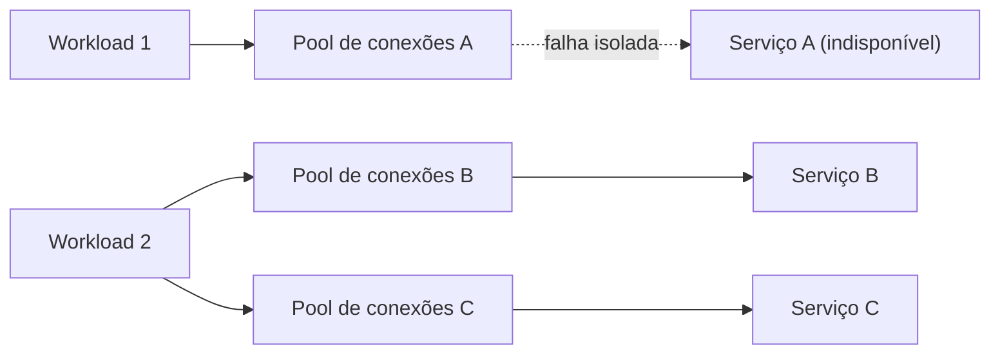

# Bulkhead

## Descrição

O padrão Bulkhead isola os elementos de uma aplicação em pools independentes, de modo que, se um deles falhar, os demais continuem funcionando. O nome vem das anteparas (bulkheads) que dividem o casco de um navio em compartimentos estanques: se o casco é perfurado, apenas o compartimento danificado se enche de água, e o navio não afunda. A abordagem também é conhecida como arquitetura baseada em células (cell-based architecture).

O isolamento pode ocorrer em dois lados. No lado do serviço, as instâncias são particionadas em grupos de acordo com a carga e os requisitos de disponibilidade de cada consumidor, para que um cliente que gera tráfego excessivo esgote apenas a sua partição. No lado do consumidor, os recursos usados para chamar cada dependência são separados, por exemplo com um pool de conexões, de threads ou um semáforo dedicado por serviço. Assim, uma dependência lenta ou indisponível consome apenas os recursos reservados a ela.

As partições podem ser implementadas com processos, threads, semáforos, contêineres, máquinas virtuais ou conjuntos distintos de filas, conforme o nível de isolamento desejado. Cada partição pode ser dimensionada, monitorada e ter seu nível de serviço definido de forma independente.

## Problemas que resolve

- Falhas em cascata: um serviço lento ou mal configurado prende recursos do consumidor (como conexões de um pool compartilhado) até esgotá-los, impedindo chamadas a todos os outros serviços.
- Vizinho barulhento: um único cliente com volume excessivo de requisições esgota a capacidade de um serviço compartilhado e degrada o atendimento de todos os outros consumidores.
- Ausência de diferenciação de qualidade de serviço entre consumidores críticos e consumidores comuns.
- Propagação de incidentes de segurança entre componentes que compartilham os mesmos recursos.

## Quando usar

- Quando é preciso isolar recursos usados para dependências específicas, para que a interrupção de um serviço não derrube a aplicação inteira.
- Quando consumidores críticos precisam ser isolados de consumidores comuns, com níveis de serviço diferentes.
- Quando a aplicação precisa ser protegida contra falhas em cascata.
- Em cenários multi-tenant, para separar tenants (ou grupos de tenants) em partições distintas.
- Em cargas de IA e inferência sujeitas a cotas e limites de concorrência por implantação, isolando implantações de modelos por workload ou por tenant.

### Quando evitar

- Quando o uso menos eficiente de recursos (capacidade reservada e ociosa em cada partição) não é aceitável.
- Quando a complexidade adicional de criar, operar e monitorar várias partições não se justifica, como em sistemas pequenos ou com poucas dependências.

## Trade-offs

| Ganho | Custo / Risco |
| --- | --- |
| Falhas ficam contidas na partição afetada, evitando efeito cascata | Recursos reservados por partição tendem a ficar subutilizados |
| Parte da funcionalidade continua disponível durante falhas | Mais componentes para implantar, configurar e operar |
| Permite níveis de serviço distintos por consumidor ou tenant | Definir a granularidade das partições exige análise de negócio e técnica |
| Cada partição escala de forma independente | Dimensionamento errado de um pool pode causar rejeições desnecessárias |
| Incidentes de segurança ficam restritos ao compartimento comprometido | Custo adicional de infraestrutura conforme o nível de isolamento escolhido |

- Defina as partições a partir dos requisitos de negócio e técnicos; com domain-driven design, alinhe-as aos bounded contexts.
- Avalie o nível de isolamento oferecido pela tecnologia (thread, processo, contêiner, máquina virtual) frente ao custo, desempenho e gerenciabilidade; contêineres costumam oferecer bom equilíbrio.
- Combine com Retry, Circuit Breaker e Throttling para um tratamento de falhas mais sofisticado.
- Monitore desempenho e SLA de cada partição separadamente.
- Prefira controles nativos da plataforma (por exemplo, limites de taxa em um API gateway como o Azure API Management, ou limites de recursos em orquestradores de contêineres) em vez de reimplementar isolamento no código.

## Diagrama

Cada dependência recebe seu próprio pool de recursos. Quando o Serviço A falha, apenas o pool A se esgota; o Workload 2 continua chamando os Serviços B e C normalmente.

## Padrões relacionados

- [Circuit Breaker](/architecture/cloud-design-patterns/resiliency/circuit-breaker) — interrompe chamadas a uma dependência com falha, complementando o isolamento de recursos.
- [Retry](/architecture/cloud-design-patterns/resiliency/retry) — trata falhas transitórias dentro de cada partição sem afetar as demais.
- [Throttling](/architecture/cloud-design-patterns/resiliency/throttling) — limita o consumo de recursos por consumidor, reforçando o isolamento entre partições.
- [Rate Limiting](/architecture/cloud-design-patterns/resiliency/rate-limiting-pattern) — controla o volume de chamadas enviadas a cada dependência isolada.
- [Queue-Based Load Leveling](/architecture/cloud-design-patterns/messaging/queue-based-load-leveling) — filas separadas por partição ajudam a isolar serviços que se comunicam de forma assíncrona.
- [Deployment Stamp](/architecture/cloud-design-patterns/deployment-and-topology/deployment-stamp) — aplica a ideia de células independentes em nível de implantação completa.
- [Sharding](/architecture/cloud-design-patterns/data-management/sharding) — particiona dados, o que também limita o alcance de falhas e sobrecargas.

## Referência

- [Documentação no Azure Architecture Center](https://learn.microsoft.com/en-us/azure/architecture/patterns/bulkhead)
