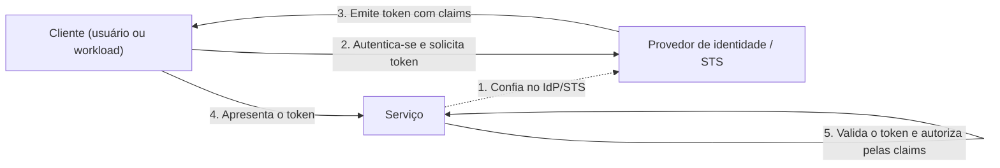

# Federated Identity

## Descrição

O padrão Federated Identity delega a autenticação de usuários (e de cargas de trabalho) a um provedor de identidade (IdP) externo e confiável, em vez de implementá-la no código da aplicação. A aplicação estabelece uma relação de confiança com o IdP ou com um serviço de emissão de tokens de segurança (STS) e passa a aceitar tokens emitidos por ele como prova de identidade.

O cliente se autentica no IdP, que emite um token assinado contendo *claims* (declarações) sobre o usuário: identidade, papéis, grupos ou permissões mais granulares. O STS pode transformar ou enriquecer essas claims com regras predefinidas antes de devolver o token. O cliente apresenta o token ao serviço, que o valida e decide o que liberar com base nas claims. Esse modelo também é chamado de controle de acesso baseado em claims.

Com isso, autenticação e autorização ficam separadas: o IdP cuida de credenciais e do ciclo de vida das identidades, enquanto cada aplicação aplica suas próprias regras de autorização. O padrão se apoia em protocolos abertos (como OpenID Connect, OAuth 2.0 e SAML) e viabiliza single sign-on (SSO) entre aplicações e domínios de organizações diferentes.

## Problemas que resolve

- Usuários precisam manter credenciais diferentes para cada aplicação, o que gera uma experiência fragmentada e senhas esquecidas ou reutilizadas.
- Contas de ex-funcionários ou ex-parceiros continuam ativas em várias aplicações porque a desativação precisa ser feita em cada uma separadamente.
- Administradores gastam esforço com cadastro de usuários, redefinição de senhas e outras tarefas repetidas em cada sistema.
- Cada aplicação reimplementa lógica de autenticação, armazenamento de senhas, MFA e detecção de ameaças, aumentando a superfície de ataque.
- Parceiros, clientes de um SaaS e processos automatizados sem usuário presente precisam acessar serviços sem ter contas no diretório da organização.

## Quando usar

- SSO corporativo para aplicações hospedadas na nuvem, fora do perímetro de segurança da empresa, sem novos logins a cada acesso.
- Aplicações B2B que precisam autenticar funcionários e parceiros que não estão no diretório corporativo, incluindo cenários de fusão ou compartilhamento de recursos entre empresas.
- Aplicações SaaS multi-tenant em que cada tenant usa seu próprio IdP (credenciais corporativas para usuários de empresas, identidades sociais para consumidores).
- Acesso de cargas de trabalho, como pipelines de CI/CD, automações ou aplicações de tenants, que chamam APIs usando identidades de workload federadas em vez de segredos de longa duração.

## Quando evitar

- Todos os usuários se autenticam em um único IdP e não há expectativa de suportar outros (por exemplo, uma aplicação interna ligada diretamente ao diretório corporativo via VPN ou rede privada).
- A aplicação usa um mecanismo de autenticação incompatível (como um repositório de usuários próprio) e não lida com protocolos baseados em claims; adaptar sistemas legados pode ser caro e complexo.

## Trade-offs

| Ganho | Custo / Risco |
| --- | --- |
| Credenciais ficam expostas apenas ao IdP; a aplicação só vê o token | O IdP vira dependência crítica e possível ponto único de falha |
| SSO e experiência de login unificada | Configuração de confiança, metadados, certificados e rotação de chaves entre partes |
| Desativação centralizada de contas e menos administração | IdPs sociais costumam fornecer poucas claims (às vezes apenas um identificador), exigindo cadastro local complementar |
| Recursos avançados (MFA, acesso condicional, detecção de ameaças) sem implementá-los na aplicação | Com vários IdPs, é preciso resolver a descoberta do domínio de origem (home realm discovery) |
| Menos código de autenticação e recursos da aplicação liberados para o negócio | Validação correta de tokens (assinatura, emissor, audiência, expiração) passa a ser responsabilidade de cada serviço |

- **Disponibilidade:** implante ou escolha o mecanismo de identidade nas mesmas regiões da aplicação para não comprometer a resiliência multirregião; por outro lado, o plano de recuperação de desastres da carga não precisa cobrir componentes de autenticação.
- **Autorização:** use as claims (papéis, escopos, tenant) para aplicar controle de acesso baseado em papéis (RBAC) de forma granular em cada serviço.
- **Home realm discovery:** o STS pode escolher o IdP pelo domínio do e-mail, subdomínio da aplicação, faixa de IP ou cookie; quando não consegue, exibe uma página para o usuário escolher.
- **Latência e sessões:** tokens com tempo de vida adequado e refresh tokens evitam idas frequentes ao IdP; tokens longos demais dificultam a revogação.
- **Observabilidade:** correlacione logs de login do IdP com os da aplicação para auditar acessos e investigar incidentes.

## Diagrama

O serviço confia previamente no IdP/STS; o cliente se autentica apenas no IdP e recebe um token com claims, que apresenta ao serviço. O serviço valida o token e aplica suas regras de autorização sem nunca manipular as credenciais do usuário. Um exemplo concreto é o Microsoft Entra ID atuando como IdP com o fluxo Authorization Code + PKCE do OpenID Connect.

## Padrões relacionados

- [Gatekeeper](/architecture/cloud-design-patterns/security-and-access/gatekeeper) — um gatekeeper pode centralizar a validação de tokens antes de encaminhar requisições aos serviços internos.
- [Gateway Offloading](/architecture/cloud-design-patterns/gateways-and-edge/gateway-offloading) — a validação de autenticação é uma responsabilidade transversal comumente transferida para o gateway.
- [Valet Key](/architecture/cloud-design-patterns/security-and-access/valet-key) — após autenticar o usuário via identidade federada, a aplicação pode emitir chaves de acesso restritas e temporárias a recursos.
- [Backends for Frontends](/architecture/cloud-design-patterns/gateways-and-edge/backends-for-frontends) — cada BFF pode conduzir o fluxo de login adequado ao seu tipo de cliente e propagar tokens para as APIs.
- [Deployment Stamp](/architecture/cloud-design-patterns/deployment-and-topology/deployment-stamp) — em soluções multi-tenant e multirregião, a identidade federada permite que todos os stamps confiem no mesmo IdP.

## Referência

- [Documentação no Azure Architecture Center](https://learn.microsoft.com/en-us/azure/architecture/patterns/federated-identity)
