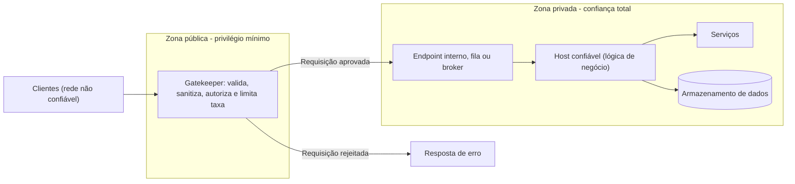

# Gatekeeper

## Descrição

O padrão Gatekeeper protege aplicações e serviços colocando um componente dedicado entre os clientes e o sistema. Esse componente (o *gatekeeper*) é o único ponto exposto à rede não confiável: ele recebe as requisições, valida, sanitiza e só então encaminha as aprovadas a um *host confiável* por meio de um endpoint interno, uma fila ou um broker.

A ideia central é separar o código que expõe os endpoints públicos do código que processa as regras de negócio e acessa armazenamento e outros serviços. O gatekeeper roda com privilégios mínimos e não tem acesso a credenciais, chaves ou dados; o host confiável, que tem esse acesso, não fica exposto externamente. Se o gatekeeper for comprometido, o atacante não obtém acesso direto aos dados nem aos segredos da aplicação.

Diferentemente de um firewall de rede tradicional, o gatekeeper toma decisões orientadas pela aplicação: pode inspecionar o conteúdo da requisição em detalhe, verificar autenticação e autorização, rejeitar payloads inesperados ou malformados e aplicar limitação de taxa antes que qualquer tráfego chegue ao back-end. É comum organizá-lo em camadas, por exemplo um firewall de aplicação web na borda e um gateway de APIs internamente.

## Problemas que resolve

- Exposição direta de serviços que guardam credenciais, chaves de armazenamento e dados sensíveis a redes não confiáveis.
- Comprometimento do ambiente de hospedagem pública resultando em acesso irrestrito a dados e serviços internos.
- Validação e sanitização de entrada espalhadas e inconsistentes entre vários serviços de back-end.
- Superfície de ataque ampla, com muitos componentes acessíveis diretamente pela internet.
- Dificuldade de aplicar limitação de taxa de forma eficiente quando cada nó precisa coordenar o estado de contagem com os demais.

## Quando usar

- A aplicação manipula informações sensíveis.
- Os serviços expostos precisam de proteção forte contra tráfego malicioso (injeção, bots, abuso, DDoS).
- Há operações de missão crítica que não podem ter o back-end exposto diretamente.
- Deseja-se separar a validação e a sanitização das requisições do processamento de negócio.
- Deseja-se centralizar controles de segurança e throttling em um único ponto de entrada.

### Quando evitar

- Os controles nativos da plataforma do back-end já atendem aos requisitos de segurança e validação sem uma camada adicional.
- Os saltos de rede e a latência de validação extras violam requisitos rígidos de latência ponta a ponta.
- O sistema é simples, interno e de baixo risco, e o custo operacional de mais uma camada não se justifica.

## Trade-offs

| Ganho | Custo / Risco |
| --- | --- |
| Superfície de ataque reduzida; back-end acessível só por endpoints privados | Saltos de rede e processamento extras aumentam a latência |
| Comprometimento do gatekeeper não expõe credenciais nem dados | Mais um componente para implantar, escalar, monitorar e manter |
| Validação, autorização e throttling centralizados e consistentes | Pode virar ponto único de falha se não houver redundância |
| Throttling no gatekeeper evita coordenação de estado entre nós do back-end | Pode virar gargalo de capacidade sob picos de tráfego |
| Separação clara entre limites de confiança | Risco de lógica de negócio "vazar" para o gatekeeper, acoplando as camadas |

- **Privilégios:** o gatekeeper deve rodar com privilégio mínimo e em fronteira de computação separada do host confiável; o host confiável não deve expor nenhum endpoint externo.
- **Responsabilidade:** o gatekeeper apenas valida e sanitiza; não processa regras de negócio nem acessa dados. O host confiável ainda pode fazer validações complementares.
- **Comunicação:** use canais seguros (TLS) entre o gatekeeper e os hosts confiáveis sempre que o ambiente permitir, e identidades gerenciadas em vez de segredos armazenados.
- **Disponibilidade:** implante instâncias redundantes e com escalonamento automático para mitigar o risco de ponto único de falha.
- **Observabilidade:** centralize logs e métricas de todas as camadas e propague um ID de correlação desde a borda para rastrear cada transação; configure alertas para picos de bloqueios ou erros.

## Diagrama

Os clientes só alcançam o gatekeeper, que roda com privilégios mínimos e descarta requisições inválidas. As requisições aprovadas seguem por um canal interno até o host confiável, o único que detém credenciais para acessar serviços e dados.

## Padrões relacionados

- [Gateway Offloading](/architecture/cloud-design-patterns/gateways-and-edge/gateway-offloading) — transfere funções transversais (TLS, autenticação, validação) para um gateway, que pode atuar como gatekeeper.
- [Gateway Routing](/architecture/cloud-design-patterns/gateways-and-edge/gateway-routing) — o gatekeeper frequentemente também roteia as requisições aprovadas para o back-end correto.
- [Rate Limiting](/architecture/cloud-design-patterns/resiliency/rate-limiting-pattern) — limitação de taxa costuma ser aplicada no gatekeeper.
- [Throttling](/architecture/cloud-design-patterns/resiliency/throttling) — controle de consumo de recursos que pode ser centralizado no ponto de entrada.
- [Valet Key](/architecture/cloud-design-patterns/security-and-access/valet-key) — complementa o gatekeeper ao conceder acesso restrito e temporário a recursos sem expor chaves.
- [Federated Identity](/architecture/cloud-design-patterns/security-and-access/federated-identity) — delega a autenticação a um provedor de identidade cujos tokens o gatekeeper valida.
- [Queue-Based Load Leveling](/architecture/cloud-design-patterns/messaging/queue-based-load-leveling) — uma fila entre gatekeeper e host confiável desacopla as camadas e absorve picos.
- [Quarantine](/architecture/cloud-design-patterns/security-and-access/quarantine) — também valida e isola conteúdo externo antes de liberá-lo para consumo pela carga de trabalho.

## Referência

- [Documentação no Azure Architecture Center](https://learn.microsoft.com/en-us/azure/architecture/patterns/gatekeeper)
