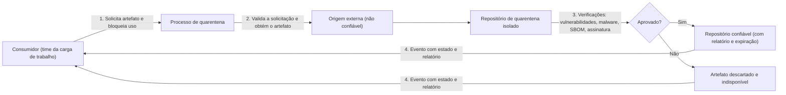

# Quarantine

## Descrição

O padrão Quarantine garante que artefatos de software de terceiros (imagens de contêiner, pacotes de bibliotecas, módulos de infraestrutura como código, imagens de sistema operacional, instaladores de fornecedores) só sejam consumidos pela carga de trabalho depois de verificados e marcados como confiáveis por um processo bem definido. Todo artefato externo é tratado, por padrão, como **não confiável**.

O consumidor sinaliza a intenção de usar um artefato e bloqueia seu uso. Um processo de quarentena, independente do ciclo de desenvolvimento, obtém o artefato da origem externa, guarda uma cópia em um repositório isolado e executa uma série de verificações (varredura de vulnerabilidades, detecção de malware, análise de SBOM, validação de assinatura e procedência etc.). O processo não altera o conteúdo do artefato; apenas decide se ele passa de "não confiável" para "confiável".

Se todas as verificações forem aprovadas, o artefato é publicado em um repositório confiável, com anotações e um relatório de evidências que inclui data de expiração. Caso contrário, ele permanece indisponível. Ao final, o processo emite um evento com o estado e o relatório, e os consumidores decidem como usar o artefato aprovado.

## Problemas que resolve

- Consumo direto de artefatos de fontes públicas ou de fornecedores sem qualquer validação de segurança.
- Introdução de vulnerabilidades conhecidas, malware ou dependências adulteradas na cadeia de suprimentos de software.
- Comprometimento da integridade e da confidencialidade dos dados por componentes externos maliciosos.
- Instabilidade causada por artefatos incompatíveis com o restante da solução.
- Falta de rastreabilidade sobre a origem e as validações aplicadas a cada artefato externo.
- Verificações inconsistentes, feitas manualmente e de forma diferente a cada ingestão.

## Quando usar

- A carga de trabalho integra artefatos desenvolvidos fora do escopo do time, como imagens de registries públicos, pacotes de repositórios públicos (NuGet, PyPI, Maven, npm), módulos de IaC da comunidade ou imagens de sistema operacional de fornecedores.
- O time considera o risco de um artefato comprometido relevante o suficiente para justificar a mitigação.
- Existe um entendimento claro e compartilhado das regras de validação aplicáveis a cada tipo de artefato.
- A organização quer padronizar e centralizar a validação de artefatos externos para vários times.

## Quando evitar

- O artefato é produzido pelo próprio time ou por um time parceiro confiável.
- O custo de construir e manter o processo de quarentena é maior que o risco de não verificar o artefato.
- Não há consenso sobre quais verificações aplicar; sem regras consistentes o padrão perde eficácia.

## Trade-offs

| Ganho | Custo / Risco |
| --- | --- |
| Reduz a superfície de ataque da cadeia de suprimentos de software | Construir e operar o processo e a infraestrutura de quarentena tem custo |
| Evidências auditáveis da origem e das validações de cada artefato | Validações podem demorar e atrasar a adoção de novas versões ou correções |
| Segmentação clara entre artefatos confiáveis e não confiáveis | Exige controles de identidade e rede para manter os repositórios isolados |
| Verificações padronizadas e automatizadas para todos os times | Regras mal calibradas geram falsos positivos ou bloqueiam artefatos legítimos |
| Apoia práticas de implantação segura | Aprovação na quarentena não garante confiança permanente no artefato |

- **Validação momentânea:** a quarentena é a primeira oportunidade de validação; o artefato ainda precisa de varreduras contínuas e verificações no pipeline antes de cada promoção de release.
- **Expiração:** o relatório de verificação deve ter validade; após expirar, o artefato volta a ser considerado inseguro.
- **Invocação confiável:** a sinalização e a ingestão devem ser automatizadas, e políticas devem impedir o consumo de artefatos fora do repositório confiável.
- **Processos longos:** a orquestração precisa suportar tarefas demoradas e continuar até que todas terminem.
- **Centralização ou terceirização:** o processo pode ser mantido por um time central ou contratado de especialistas; avalie custos financeiros e operacionais versus o nível de controle necessário.
- **Observabilidade:** mantenha trilha de auditoria e alertas para importações inesperadas no repositório confiável.

## Diagrama

O consumidor solicita um artefato externo, que é copiado para um repositório isolado e submetido às verificações. Somente artefatos aprovados chegam ao repositório confiável, e o consumidor é notificado do resultado em ambos os casos.

## Padrões relacionados

- [Gatekeeper](/architecture/cloud-design-patterns/security-and-access/gatekeeper) — também interpõe um intermediário que valida e controla o acesso antes que algo alcance recursos confiáveis.
- [Sidecar](/architecture/cloud-design-patterns/integration-and-modernization/sidecar) — a quarentena funciona como um processo operacional auxiliar, separado do ciclo de desenvolvimento.
- [Pipes and Filters](/architecture/cloud-design-patterns/messaging/pipes-and-filters) — as verificações podem ser organizadas como uma sequência de etapas independentes.
- [Scheduler Agent Supervisor](/architecture/cloud-design-patterns/distributed-coordination/scheduler-agent-supervisor) — útil para orquestrar tarefas de validação longas e lidar com falhas.
- [Asynchronous Request-Reply](/architecture/cloud-design-patterns/messaging/asynchronous-request-reply) — o consumidor solicita a quarentena e recebe o resultado de forma assíncrona.
- [Publisher-Subscriber](/architecture/cloud-design-patterns/messaging/publisher-subscriber) — o fim da quarentena é sinalizado por um evento consumido pelos interessados.

## Referência

- [Documentação no Azure Architecture Center](https://learn.microsoft.com/en-us/azure/architecture/patterns/quarantine)
