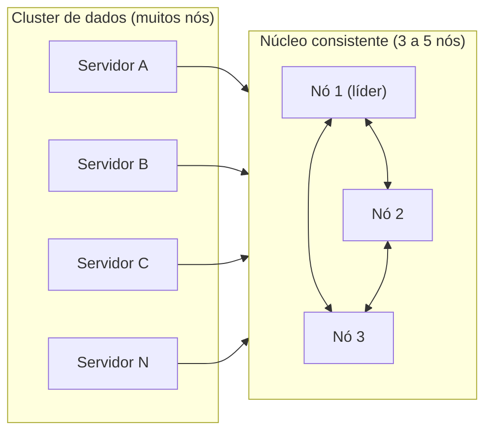

# Consistent Core

## Descrição

O Consistent Core separa o cluster em duas partes: um pequeno grupo de nós (tipicamente três a cinco) que executa um algoritmo de consenso e oferece linearizabilidade com tolerância a falhas, e um cluster de dados, que pode ter centenas de nós. O núcleo guarda os metadados e toma as decisões que exigem uma visão única e confiável do sistema, como a lista de membros, o mapeamento de partições para servidores e a escolha de líderes.

O cluster de dados não participa do consenso. Ele consulta o núcleo e usa primitivas construídas sobre ele, como [Lease](/architecture/distributed-systems/cluster-management/lease) e [State Watch](/architecture/distributed-systems/cluster-management/state-watch), para coordenar-se. Assim, o custo do quórum fica restrito a poucos nós, enquanto o volume de dados e de requisições de clientes escala nos demais.

É a arquitetura por trás de serviços como ZooKeeper, etcd e Consul, e também de componentes de metadados em sistemas como Kafka e Kubernetes.

## Problemas que resolve

- Decisões de coordenação (quem é o líder, quem são os membros, onde está cada partição) exigem consistência forte, mas rodar consenso entre todos os nós de um cluster grande derruba a vazão.
- O componente de coordenação não pode ser um ponto único de falha.
- O cluster de dados precisa crescer sem que o custo do quórum cresça junto.
- Nós distintos precisam enxergar o mesmo estado de metadados, sem divergências.

## Quando usar

- Clusters grandes que precisam de membership, eleição de líder ou mapa de partições consistentes.
- Sistemas em que metadados são pequenos e mudam pouco, comparados ao volume de dados.
- Quando se quer reaproveitar um serviço de coordenação existente (ZooKeeper, etcd, Consul) em vez de implementar consenso em cada produto.

### Quando evitar

- Clusters pequenos, em que o próprio cluster de dados já pode executar o consenso.
- Quando guardar dados de aplicação no núcleo for tentador: ele não foi feito para alto volume de escrita.
- Sistemas que precisam continuar coordenando sem qualquer dependência externa, mesmo com partição de rede (veja [Emergent Leader](/architecture/distributed-systems/cluster-management/emergent-leader) e [Gossip Dissemination](/architecture/distributed-systems/cluster-management/gossip-dissemination)).

## Trade-offs

| Ganho | Custo / Risco |
| --- | --- |
| Linearizabilidade nas decisões de coordenação | O núcleo vira dependência crítica: sem quórum, o cluster não toma novas decisões |
| Cluster de dados escala sem pagar o custo do consenso | Complexidade operacional de manter um segundo cluster |
| Metadados centralizados e consistentes | Todo cliente depende de latência e disponibilidade do núcleo |
| Reuso de implementações maduras | Vazão de escrita do núcleo é limitada e o volume de metadados deve ser baixo |

Considerações adicionais:

- Os clientes devem fazer cache de metadados e usar notificações para invalidá-lo, em vez de consultar o núcleo a cada requisição.
- O núcleo precisa de sessões e de tratamento de retentativas para que comandos de clientes não sejam aplicados duas vezes.
- Monitore o tamanho dos dados e a taxa de escrita do núcleo.

## Diagrama

O consenso acontece apenas entre os poucos nós do núcleo; os servidores de dados são clientes dele e usam seus metadados e primitivas para coordenar-se.

## Padrões relacionados

- [Replicated Log](/architecture/distributed-systems/data-replication/replicated-log) — o núcleo replica os comandos de metadados por meio de um log replicado.
- [Majority Quorum](/architecture/distributed-systems/data-replication/majority-quorum) — define quantos nós do núcleo precisam concordar e quantas falhas ele tolera.
- [Fixed Partitions](/architecture/distributed-systems/data-partitioning/fixed-partitions) — o mapeamento de partições para servidores costuma ser guardado no núcleo.
- [Lease](/architecture/distributed-systems/cluster-management/lease) — primitiva de acesso exclusivo com expiração, implementada sobre o núcleo.
- [State Watch](/architecture/distributed-systems/cluster-management/state-watch) — permite que clientes sejam notificados de mudanças nos metadados.
- [Emergent Leader](/architecture/distributed-systems/cluster-management/emergent-leader) — alternativa quando não se quer um núcleo separado.
- [Service Registry](/architecture/microservices/service-discovery/service-registry) — registros de serviços costumam ser apoiados em um núcleo consistente.

## Referência

- [Página do padrão no catálogo Patterns of Distributed Systems](https://martinfowler.com/articles/patterns-of-distributed-systems/consistent-core.html)
