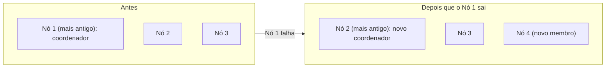

# Emergent Leader

## Descrição

Em clusters peer-to-peer, todos os nós são iguais e não existe uma eleição explícita como em [Leader and Followers](../data-replication/leader-and-followers.md). Mesmo assim, alguém precisa coordenar tarefas globais, como atribuir partições aos nós e reagir a entradas e saídas de membros.

No Emergent Leader, os nós são ordenados pelo tempo em que entraram no cluster, e o mais antigo assume o papel de coordenador. Como todos os nós conhecem a lista de membros e as idades (normalmente propagadas por [Gossip Dissemination](./gossip-dissemination.md)), todos chegam à mesma conclusão sobre quem é o líder, sem trocar mensagens de votação. Se o nó mais antigo sai, o seguinte na ordem assume.

O coordenador decide mudanças de membership e distribui partições (veja [Fixed Partitions](../data-partitioning/fixed-partitions.md)). Esse estilo aparece em sistemas como Akka Cluster, onde o nó mais antigo é usado para tarefas de coordenação.

## Problemas que resolve

- Sistemas peer-to-peer precisam de um coordenador, mas não têm líder fixo nem processo de eleição.
- Não se quer depender de um [Consistent Core](./consistent-core.md) separado, que pode reduzir a disponibilidade.
- Eleições com votação têm custo e complexidade que se quer evitar para tarefas de coordenação leves.

## Quando usar

- Clusters peer-to-peer baseados em gossip, com membership conhecido por todos.
- Quando o papel do coordenador é leve (atribuir partições, tratar membership) e tolera visões temporariamente divergentes.
- Quando disponibilidade é mais importante que consistência estrita nas decisões de coordenação.

### Quando evitar

- Decisões que exigem exclusividade garantida: durante uma partição de rede, dois lados podem eleger coordenadores diferentes (split brain).
- Quando a visão de membership não é confiável ou converge devagar.
- Quando o líder precisa ordenar escritas de dados; nesse caso use [Leader and Followers](../data-replication/leader-and-followers.md) com eleição por quórum.

## Trade-offs

| Ganho | Custo / Risco |
| --- | --- |
| Sem eleição explícita nem votação | Risco de dois coordenadores durante partições ou visões divergentes |
| Sem dependência de serviço de consenso externo | Garantias de consistência mais fracas |
| Simples de implementar sobre uma lista de membros ordenada | A qualidade da decisão depende da detecção de falhas e da convergência do gossip |
| Alta disponibilidade | Mudanças de membership podem causar trocas de coordenador não ideais |

Considerações adicionais:

- Ações do coordenador devem ser idempotentes, para tolerar duplicidade temporária.
- Pode-se exigir estabilidade da visão de membership antes de agir.
- Observabilidade de quem cada nó considera o líder ajuda a diagnosticar divergências.

## Diagrama

O coordenador é sempre o nó mais antigo da lista de membros; quando ele sai, o seguinte na ordem assume sem votação.

## Padrões relacionados

- [Leader and Followers](../data-replication/leader-and-followers.md) — modelo com eleição explícita, alternativa a este.
- [Leader Election](../../../cloud/azure/distributed-coordination/leader-election.md) — eleição de líder em nuvem, com coordenação explícita.
- [Gossip Dissemination](./gossip-dissemination.md) — propaga a lista de membros e as idades dos nós.
- [Consistent Core](./consistent-core.md) — alternativa quando se precisa de coordenação fortemente consistente.
- [Fixed Partitions](../data-partitioning/fixed-partitions.md) — partições que o coordenador atribui aos nós.

## Referência

- [Página do padrão no catálogo Patterns of Distributed Systems](https://martinfowler.com/articles/patterns-of-distributed-systems/emergent-leader.html)
