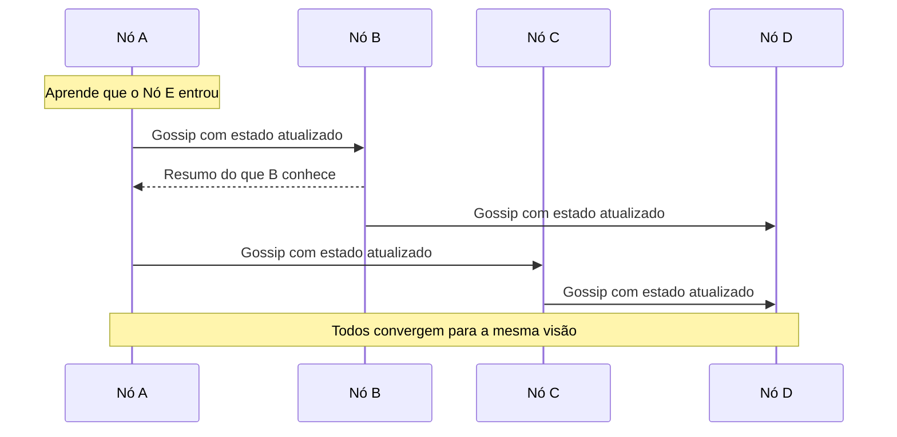

# Gossip Dissemination

## Descrição

No Gossip Dissemination, cada nó guarda os metadados que conhece sobre o cluster (membership, estado de nós, informações de partições) e, em intervalos regulares, por exemplo a cada segundo, escolhe um ou poucos nós aleatórios e troca com eles o que sabe. Cada nó que recebe informação nova a repassa nas próximas rodadas, de modo que ela se espalha de forma epidêmica.

Como a escolha dos pares é aleatória, a informação alcança todos os nós em um número de rodadas que cresce de forma logarítmica com o tamanho do cluster, sem depender de um armazenamento central e sem que cada nó fale com todos os outros. Implementações costumam enviar resumos de estado e versões (veja [Version Vector](../data-replication/version-vector.md)) para decidir o que cada lado precisa receber, podendo trabalhar por push, pull ou ambos.

É usado por Cassandra, Consul (Serf), Akka Cluster e Riak para propagar membership e detectar falhas.

## Problemas que resolve

- Comunicação todos-com-todos consome rede demais em clusters grandes.
- Metadados precisam chegar a todos os nós sem um repositório compartilhado.
- A informação deve continuar a se propagar mesmo se alguns enlaces de rede ou nós falharem.

## Quando usar

- Clusters grandes e descentralizados, sem líder fixo, que precisam espalhar membership e estado de nós.
- Sistemas que aceitam consistência eventual para os metadados.
- Detecção de falhas em escala, combinada com [Heartbeat](../data-replication/heartbeat.md) indireto.

### Quando evitar

- Decisões que exigem consistência forte ou ordem total (use um [Consistent Core](./consistent-core.md)).
- Clusters pequenos, em que enviar a todos é barato e mais simples.
- Quando a latência de propagação precisa ser limitada de forma estrita e previsível.

## Trade-offs

| Ganho | Custo / Risco |
| --- | --- |
| Carga de rede por nó baixa e constante | Convergência apenas eventual; nós têm visões temporariamente diferentes |
| Sem ponto único de falha | Mensagens redundantes e tráfego de fundo contínuo |
| Resiliente a falhas parciais de rede | Difícil de depurar e de prever o tempo exato de propagação |
| Escala para milhares de nós | Detecção de falhas probabilística, com risco de falsos positivos |

Considerações adicionais:

- Ajuste intervalo e fan-out entre velocidade de convergência e custo de rede.
- Use versões ou relógios lógicos para resolver conflitos entre informações recebidas.
- Nós sementes (seeds) ajudam a entrada de novos membros no cluster.

## Diagrama

A informação nasce em um nó e se espalha em rodadas, cada nó repassando a pares escolhidos aleatoriamente.

## Padrões relacionados

- [Heartbeat](../data-replication/heartbeat.md) — sinais de vida que o gossip pode carregar para detectar falhas.
- [Version Vector](../data-replication/version-vector.md) — versiona as informações trocadas e resolve conflitos.
- [Emergent Leader](./emergent-leader.md) — o líder emergente usa a visão de membership espalhada por gossip.
- [Consistent Core](./consistent-core.md) — alternativa centralizada e fortemente consistente para metadados.

## Referência

- [Página do padrão no catálogo Patterns of Distributed Systems](https://martinfowler.com/articles/patterns-of-distributed-systems/gossip-dissemination.html)
