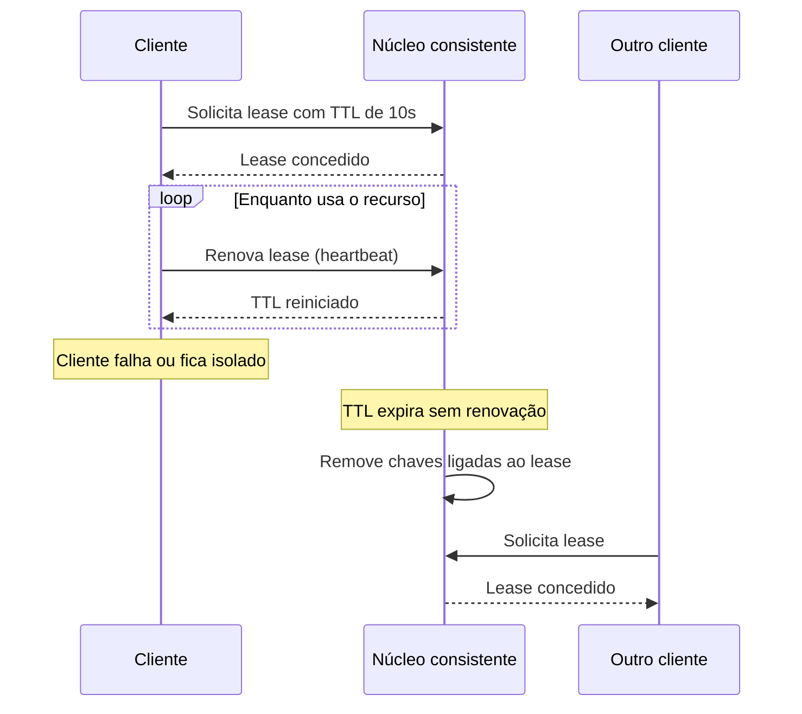

# Lease

## Descrição

Um Lease é uma concessão de acesso exclusivo a um recurso por um tempo limitado. O nó que quer o recurso pede o lease a um [Consistent Core](/architecture/distributed-systems/cluster-management/consistent-core), recebe um prazo (time-to-live, TTL) e precisa renová-lo periodicamente enquanto continuar usando o recurso. Se ele parar de renovar, o lease expira e o recurso pode ser entregue a outro nó.

A renovação costuma ser feita por mensagens de [Heartbeat](/architecture/distributed-systems/data-replication/heartbeat) enviadas pelo cliente ao núcleo. O núcleo replica a criação e a renovação do lease, para que um novo líder do próprio núcleo continue a respeitá-los. Chaves ou entradas de metadados podem ser associadas ao lease e removidas automaticamente quando ele expira, o que é a base de registro de membros e de locks distribuídos em ZooKeeper (sessões e nós efêmeros), etcd (leases) e Chubby.

## Problemas que resolve

- Um nó com acesso exclusivo pode travar, ficar isolado da rede ou sofrer uma pausa longa de processo, e não deve segurar o recurso para sempre.
- Sem um prazo, é impossível distinguir um nó lento de um nó morto e liberar o recurso com segurança.
- É preciso limpar automaticamente estados efêmeros (registro de membro, lock, liderança) quando o dono desaparece.

## Quando usar

- Locks distribuídos e exclusão mútua sobre recursos compartilhados.
- Registro de membros e de instâncias de serviço que deve sumir quando o nó cai.
- Liderança temporária sobre uma partição ou tarefa.
- Dados efêmeros ligados à vida de uma sessão de cliente.

### Quando evitar

- Quando a correção depende de exclusividade estrita e o recurso protegido não valida um token de fencing (por exemplo, [Generation Clock](/architecture/distributed-systems/data-replication/generation-clock)): um dono com pausa longa pode agir depois de o lease ter expirado.
- Quando não há um núcleo consistente para gerenciar os leases.
- Para tarefas curtas, em que um lock simples ou uma operação idempotente basta.

## Trade-offs

| Ganho | Custo / Risco |
| --- | --- |
| Liberação automática de recursos de nós falhos | O recurso fica indisponível até o prazo vencer |
| Detecção de falhas simples, baseada em tempo | Depende de relógios que avançam em ritmo parecido (veja [Clock-Bound Wait](/architecture/distributed-systems/distributed-time/clock-bound-wait)) |
| Estado efêmero consistente com a vida do cliente | Tráfego constante de renovação |
| Evita deadlocks por donos mortos | Pausas (GC, rede) podem causar expiração falsa e dois nós achando que são donos |

Considerações adicionais:

- Escolha o TTL equilibrando rapidez de failover e risco de falsos positivos.
- O dono deve parar de usar o recurso antes do prazo local se não conseguir renovar.
- Use tokens de fencing para que o recurso rejeite operações de donos antigos.

## Diagrama

O cliente mantém o lease enquanto renova. Quando para de renovar, o núcleo o expira e o recurso pode ser concedido a outro cliente.

## Padrões relacionados

- [Consistent Core](/architecture/distributed-systems/cluster-management/consistent-core) — onde os leases são criados, replicados e expirados.
- [Heartbeat](/architecture/distributed-systems/data-replication/heartbeat) — mecanismo usado para renovar o lease.
- [Clock-Bound Wait](/architecture/distributed-systems/distributed-time/clock-bound-wait) — lida com a incerteza de relógios, relevante para medir expiração.
- [State Watch](/architecture/distributed-systems/cluster-management/state-watch) — outros nós são notificados quando um lease expira.
- [Leader Election](/architecture/cloud-design-patterns/distributed-coordination/leader-election) — eleição de líder frequentemente implementada com leases.

## Referência

- [Página do padrão no catálogo Patterns of Distributed Systems](https://martinfowler.com/articles/patterns-of-distributed-systems/lease.html)
