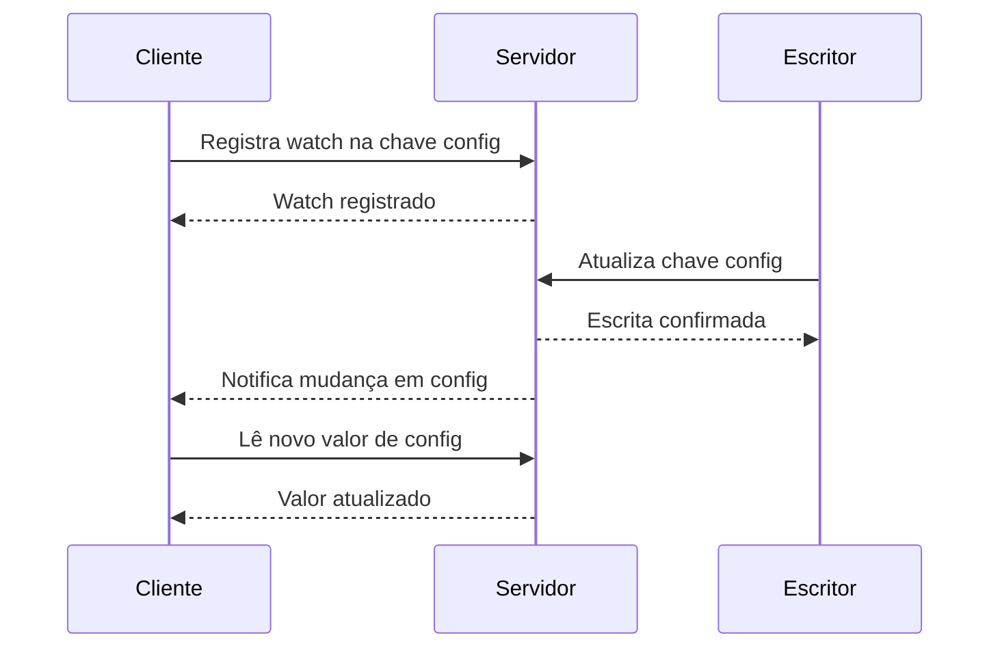

# State Watch

## Descrição

No State Watch, o cliente registra no servidor o interesse em mudanças de determinados valores (uma chave, um prefixo, o estado de um nó). Quando um desses valores muda, o servidor envia uma notificação ao cliente, que então reage sem precisar consultar o servidor repetidamente.

Como um único cliente pode observar muitos valores, o padrão se apoia em um [Single-Socket Channel](/architecture/distributed-systems/node-communication/single-socket-channel): todas as observações e notificações trafegam por uma conexão, e requisições de registro podem ser agrupadas com um [Request Pipeline](/architecture/distributed-systems/node-communication/request-pipeline). O servidor mantém um mapa de quais clientes observam quais chaves e dispara eventos ao aplicar cada mudança.

É o recurso de watches do ZooKeeper e do etcd, e é usado para acompanhar mudanças de membership, de configuração, de líder e de expiração de leases.

## Problemas que resolve

- Fazer polling constante complica a lógica do cliente e desperdiça rede e CPU do servidor.
- Abrir uma conexão por valor observado sobrecarrega o servidor.
- Clientes precisam reagir com rapidez a mudanças de estado do cluster, como entrada e saída de nós.

## Quando usar

- Clientes que precisam reagir a mudanças de configuração, membership ou liderança.
- Quando muitos clientes observam poucos valores que mudam raramente.
- Em conjunto com um [Consistent Core](/architecture/distributed-systems/cluster-management/consistent-core) e [Lease](/architecture/distributed-systems/cluster-management/lease), para saber quando um lease expirou.

### Quando evitar

- Dados que mudam com altíssima frequência: o fluxo de eventos pode ser maior que o do polling, e um stream dedicado é mais adequado.
- Quando o cliente precisa de todos os eventos sem perda e o protocolo só garante a notificação do estado mais recente.
- Quando o número de observadores por chave é enorme e o servidor não consegue fazer o fan-out.

## Trade-offs

| Ganho | Custo / Risco |
| --- | --- |
| Menos tráfego e latência de reação menor que o polling | O servidor mantém estado por observador (memória e registros) |
| Lógica de cliente orientada a eventos | Reconexões podem perder eventos; o cliente deve reler o estado e reregistrar as observações |
| Uma conexão para várias observações | Fan-out de muitas notificações pode causar picos de carga |

Considerações adicionais:

- Ao reconectar, o cliente deve comparar o estado atual com o último conhecido e reregistrar os watches.
- Notificações costumam indicar apenas que algo mudou, cabendo ao cliente buscar o valor novo.
- A ordem das notificações em relação às leituras deve ser definida para evitar leituras inconsistentes.

## Diagrama

O cliente registra o interesse uma vez, e o servidor o avisa quando o valor muda, evitando consultas repetidas.

## Padrões relacionados

- [Observer](/coding/gof/behavioral/observer) — o mesmo conceito, em escala local, dentro de um processo.
- [Publisher-Subscriber](/cloud/cloud-design-patterns/messaging/publisher-subscriber) — mensageria assíncrona com assinantes.
- [Consistent Core](/architecture/distributed-systems/cluster-management/consistent-core) — normalmente oferece watches sobre seus metadados.
- [Lease](/architecture/distributed-systems/cluster-management/lease) — a expiração de leases é um evento típico observado.
- [Single-Socket Channel](/architecture/distributed-systems/node-communication/single-socket-channel) — canal compartilhado para as notificações.
- [Request Pipeline](/architecture/distributed-systems/node-communication/request-pipeline) — reduz o custo de registrar muitas observações.

## Referência

- [Página do padrão no catálogo Patterns of Distributed Systems](https://martinfowler.com/articles/patterns-of-distributed-systems/state-watch.html)
