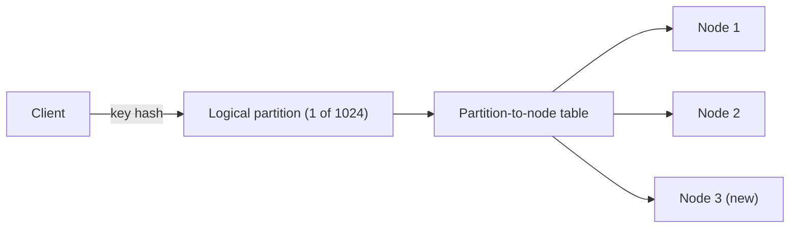

# Fixed Partitions

## Descrição

Fixed Partitions mantém constante o número de partições lógicas de um cluster. Cada chave é mapeada por uma função de hash para uma partição, e as partições é que são atribuídas aos nós. Como o número de partições nunca muda, a relação chave → partição é estável durante toda a vida do cluster.

Quando um nó entra ou sai, apenas algumas partições inteiras trocam de dono. O restante dos dados permanece onde está. O número de partições é escolhido no início, com folga suficiente para o maior tamanho de cluster esperado (por exemplo, milhares de partições para dezenas de nós).

O mapeamento partição → nó precisa ser conhecido pelos clientes ou pelos nós que roteiam requisições. Em geral ele é guardado por um serviço de coordenação, como um Consistent Core.

## Problemas que resolve

- O mapeamento ingênuo `hash(chave) % N` muda para quase todas as chaves quando N (nós) muda, forçando uma movimentação massiva de dados.
- É preciso distribuir os dados de forma uniforme entre os nós.
- É preciso localizar o nó responsável por uma chave sem consultar todo o cluster.
- A movimentação de dados ao redimensionar o cluster deve ser uma fração pequena e feita em unidades manejáveis.

## Quando usar

- Dados distribuídos por hash da chave, sem necessidade de consultas por intervalo.
- Clusters que crescem e encolhem ao longo do tempo (key-value stores, brokers de mensagens, caches distribuídos).
- Quando o volume total de dados é previsível o bastante para escolher um número de partições adequado.

### Quando evitar

- Quando as consultas por faixa de chaves são frequentes: o hash espalha chaves vizinhas por todas as partições (veja Key-Range Partitions).
- Quando o volume de dados é muito imprevisível: partições demais geram sobrecarga de metadados e partições de menos limitam a escalabilidade.
- Quando a distribuição das chaves é muito enviesada e o hash não evita pontos quentes.

## Trade-offs

| Ganho | Custo / Risco |
| --- | --- |
| Rebalanceamento move só partições inteiras, não chaves avulsas | O número de partições precisa ser decidido antecipadamente e é difícil de mudar |
| Localização de chave previsível e sem consulta | Exige manter e propagar a tabela partição → nó |
| Distribuição uniforme via hash | Consultas por intervalo precisam acessar todas as partições |
| Partições são a unidade de replicação e recuperação | Partições de tamanho desigual podem causar desequilíbrio |

- Cada partição costuma ter seu próprio log e suas réplicas, o que aumenta o custo operacional quando há muitas partições.
- Durante a movimentação de uma partição, é preciso garantir que leituras e escritas continuem consistentes.
- Observabilidade: acompanhar tamanho e carga por partição ajuda a detectar desequilíbrio.

## Diagrama

O hash da chave sempre resulta na mesma partição; só a tabela partição → nó muda quando o cluster é redimensionado, movendo algumas partições para o novo nó.

## Padrões relacionados

- [Key-Range Partitions](./key-range-partitions.md) — alternativa que preserva a ordem das chaves para consultas por intervalo
- [Consistent Core](../cluster-management/consistent-core.md) — mantém o mapeamento de partições para nós de forma consistente
- [Sharding](../../../cloud/cloud-design-patterns/data-management/sharding.md) (nuvem) — particionamento horizontal de dados em armazenamentos distintos

## Referência

- [Página do padrão no catálogo Patterns of Distributed Systems](https://martinfowler.com/articles/patterns-of-distributed-systems/fixed-partitions.html)
