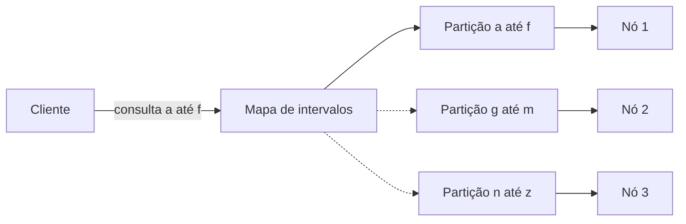

# Key-Range Partitions

## Descrição

Key-Range Partitions divide o espaço de chaves ordenadas em intervalos contíguos, e cada intervalo vira uma partição lógica. As partições são então atribuídas aos nós do cluster. Chaves próximas na ordem ficam na mesma partição, o que torna eficientes as leituras por faixa.

Uma consulta por intervalo (por exemplo, nomes de "a" a "f") é roteada apenas às partições cujos intervalos se sobrepõem à faixa pedida, sem varrer o cluster inteiro. O mapa de intervalos → nós precisa ficar disponível para quem roteia as requisições.

Como a distribuição das chaves nem sempre é uniforme, sistemas que usam esse padrão costumam dividir (split) uma partição que cresceu demais ou ficou quente, e mesclar partições pequenas. Isso é uma prática comum em bancos como HBase, CockroachDB e TiKV, não parte essencial do padrão.

## Problemas que resolve

- Com particionamento por hash, uma consulta por faixa de chaves precisa consultar todas as partições.
- É preciso manter a ordem das chaves para varreduras (scans) sequenciais eficientes.
- É preciso localizar rapidamente as partições que cobrem um dado intervalo.
- O tamanho das partições deve poder acompanhar a distribuição real dos dados.

## Quando usar

- Cargas com consultas por intervalo ou varreduras ordenadas frequentes.
- Armazenamentos ordenados de chave-valor ou tabulares (estilo Bigtable).
- Quando o volume de dados cresce de forma imprevisível e as partições precisam se dividir dinamicamente.

### Quando evitar

- Quando as chaves são monotônicas (timestamps, IDs sequenciais): as escritas se concentram na última partição, criando um ponto quente.
- Quando só há acesso por chave exata e a uniformidade de carga é prioridade (prefira Fixed Partitions).
- Quando não há infraestrutura para manter o mapa de intervalos e coordenar divisões.

## Trade-offs

| Ganho | Custo / Risco |
| --- | --- |
| Consultas por faixa acessam poucas partições | Risco de pontos quentes com chaves sequenciais ou populares |
| Ordem das chaves preservada | Distribuição de carga menos uniforme que o hash |
| Partições podem se dividir conforme os dados crescem | A divisão e a movimentação exigem coordenação e consistência do mapa |
| Localização por busca no mapa de intervalos | Metadados mais complexos que uma função de hash |

- Escolher bem os limites iniciais (pré-divisão) evita concentrar a carga no começo.
- A atualização do mapa de intervalos precisa ser consistente, senão clientes roteiam para o nó errado.
- Observabilidade: monitorar tamanho e taxa de requisições por intervalo.

## Diagrama

A consulta é roteada apenas à partição cujo intervalo cobre a faixa pedida; as demais partições não são acessadas.

## Padrões relacionados

- [Fixed Partitions](/architecture/distributed-systems/data-partitioning/fixed-partitions) — alternativa baseada em hash, sem suporte eficiente a faixas
- [Consistent Core](/architecture/distributed-systems/cluster-management/consistent-core) — mantém o mapeamento de partições de forma consistente
- [Sharding](/architecture/cloud-design-patterns/data-management/sharding) (nuvem) — particionamento horizontal, incluindo estratégia por intervalo

## Referência

- [Página do padrão no catálogo Patterns of Distributed Systems](https://martinfowler.com/articles/patterns-of-distributed-systems/key-range-partitions.html)
