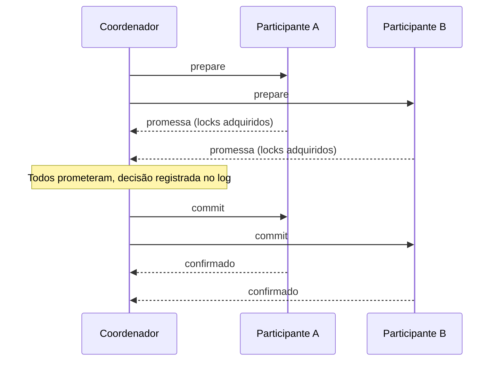

# Two-Phase Commit

## Descrição

Two-Phase Commit (2PC) grava dados de forma atômica em vários nós, normalmente em partições diferentes. Um coordenador conduz o protocolo em duas fases: na fase de prepare, pergunta a cada participante se consegue se comprometer; na fase de commit, só se todos prometeram, manda todos efetivarem.

Na fase de prepare, cada participante adquire os recursos necessários (como locks sobre as chaves) e registra a promessa de forma durável antes de responder. Depois de prometer, ele não pode mais desistir por conta própria. Se algum participante recusar ou não responder, o coordenador ordena rollback e os locks são liberados.

Os participantes e o coordenador usam um log durável, como um Write-Ahead Log, para registrar suas decisões. Assim, após uma queda e reinício, cada nó recupera o estado da transação e consegue concluir o protocolo. Em bancos reais, costuma-se combinar com valores versionados e relógios para ordenar as transações.

## Problemas que resolve

- Atualizações que atravessam várias partições precisam ser atômicas: ou todas valem, ou nenhuma.
- Nenhum nó pode expor o dado aos clientes antes de saber a decisão dos demais.
- É preciso que cada participante saiba o resultado de todos antes de efetivar.
- O protocolo precisa sobreviver a falhas de nós, com decisões duráveis.

## Quando usar

- Transações que tocam várias partições de um mesmo banco, com requisito de atomicidade forte.
- Quando a consistência forte entre partições é mais importante que a latência.
- Em sistemas em que todos os participantes são confiáveis e controlados pela mesma plataforma.

### Quando evitar

- Quando a transação cruza serviços independentes ou de organizações distintas: prefira Saga com compensação.
- Em cenários de alta disponibilidade sob partições de rede, pois o protocolo bloqueia.
- Quando a latência é crítica ou há alta contenção de locks.
- Quando é possível modelar os dados para que a operação caiba em uma única partição.

## Trade-offs

| Ganho | Custo / Risco |
| --- | --- |
| Atomicidade entre múltiplas partições | Locks mantidos durante as duas fases reduzem a concorrência |
| Participantes decidem de forma consistente | Se o coordenador falhar após o prepare, os participantes ficam bloqueados |
| Decisões duráveis permitem recuperação | Mais round trips e escritas em disco aumentam a latência |
| Modelo simples de raciocinar | Disponibilidade reduzida: qualquer participante indisponível aborta a transação |

- O coordenador é um ponto crítico; costuma-se replicá-lo (por exemplo, com um log replicado) para evitar bloqueio.
- Deadlocks entre transações concorrentes exigem detecção ou timeouts.
- Observabilidade: acompanhar transações em estado preparado e há quanto tempo estão pendentes.

## Diagrama

Se qualquer participante recusar na fase de prepare, o coordenador envia rollback a todos em vez de commit, e os locks são liberados.

## Padrões relacionados

- [Write-Ahead Log](/architecture/distributed-systems/data-replication/write-ahead-log) — garante a durabilidade das decisões de coordenador e participantes
- [Replicated Log](/architecture/distributed-systems/data-replication/replicated-log) — permite replicar o estado do coordenador para evitar bloqueio
- [Versioned Value](/architecture/distributed-systems/data-replication/versioned-value) — armazena as versões gravadas pela transação
- [Hybrid Clock](/architecture/distributed-systems/distributed-time/hybrid-clock) — ordena transações entre nós com timestamps
- [Fixed Partitions](/architecture/distributed-systems/data-partitioning/fixed-partitions) e [Key-Range Partitions](/architecture/distributed-systems/data-partitioning/key-range-partitions) — as partições sobre as quais a transação costuma atuar
- [Saga](/cloud/cloud-design-patterns/distributed-coordination/saga) (nuvem) — alternativa sem locks globais, baseada em compensação
- [Compensating Transaction](/cloud/cloud-design-patterns/distributed-coordination/compensating-transaction) (nuvem) — desfaz passos já efetivados em vez de bloquear

## Referência

- [Página do padrão no catálogo Patterns of Distributed Systems](https://martinfowler.com/articles/patterns-of-distributed-systems/two-phase-commit.html)
