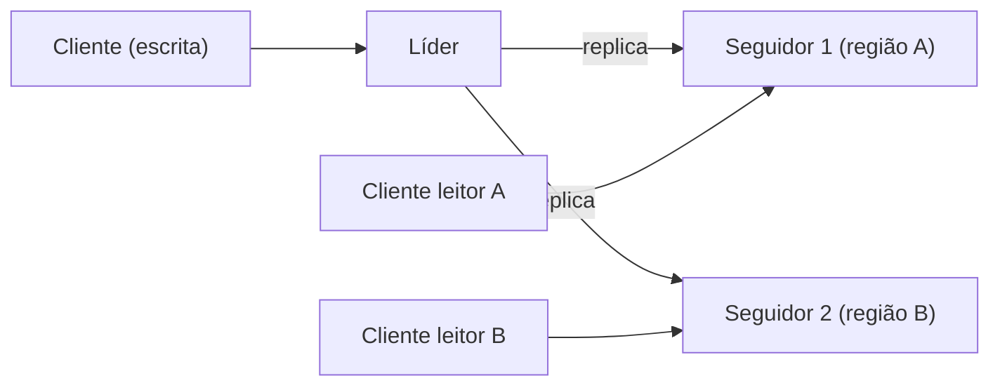

# Follower Reads

## Descrição

No Follower Reads, as escritas continuam passando pelo líder, mas as requisições somente de leitura podem ser atendidas pelos seguidores, em especial o mais próximo do cliente. Isso distribui a carga de leitura entre mais nós e reduz a latência em implantações multi-datacenter, em que o líder pode estar em outra região.

O custo é que um seguidor pode estar atrasado em relação ao líder, então a leitura pode devolver dados ligeiramente desatualizados. O seguidor deve servir apenas dados até o High-Water Mark. Para leituras mais fortes, o cliente pode informar a versão mínima que precisa ver (por exemplo, um Versioned Value ou índice do log) e o seguidor espera ou redireciona se ainda não a alcançou.

Aparece em Kafka (consumidores lendo de réplicas), ZooKeeper (leituras em qualquer servidor), bancos com réplicas de leitura e em Raft com leituras em seguidores.

## Problemas que resolve

- O líder fica sobrecarregado ao receber todas as requisições de um cluster com carga de leitura alta.
- Clientes remotos sofrem latência adicional ao acessar um líder em outra região.

## Quando usar

- Cargas majoritariamente de leitura.
- Implantações em várias regiões, em que leituras locais reduzem a latência.
- Quando dados ligeiramente defasados são aceitáveis ou há leitura por versão mínima.

### Quando evitar

- Cargas que exigem sempre a leitura mais recente (linearizabilidade) sem mecanismo de versão.
- Sistemas em que a leitura logo após a escrita precisa refletir a escrita do próprio cliente e não há garantia de sessão.

## Trade-offs

| Ganho | Custo / Risco |
| --- | --- |
| Escala as leituras e alivia o líder | Leituras podem ser antigas (consistência eventual) |
| Menor latência para clientes próximos | Garantias como ler a própria escrita exigem mecanismos adicionais |
| Maior disponibilidade de leitura durante problemas no líder | Roteamento de clientes para o seguidor correto adiciona complexidade |

- **Versão mínima:** combine com Versioned Value ou High-Water Mark para leituras monotônicas.
- **CQRS:** a separação de leitura e escrita segue ideia semelhante em nível de aplicação.

## Diagrama

As escritas vão ao líder, enquanto os clientes leitores consultam o seguidor mais próximo.

## Padrões relacionados

- [Leader and Followers](/architecture/distributed-systems/data-replication/leader-and-followers) — padrão sobre o qual esta otimização se apoia
- [High-Water Mark](/architecture/distributed-systems/data-replication/high-water-mark) — limite do que o seguidor pode servir
- [Versioned Value](/architecture/distributed-systems/data-replication/versioned-value) — permite ler a partir de uma versão mínima
- [CQRS](/architecture/cloud-design-patterns/data-management/cqrs) — separação de leitura e escrita no nível da aplicação

## Referência

- [Página do padrão no catálogo Patterns of Distributed Systems](https://martinfowler.com/articles/patterns-of-distributed-systems/follower-reads.html)
