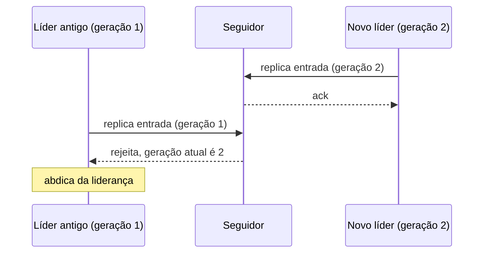

# Generation Clock

## Descrição

O Generation Clock é um número que só cresce e identifica o "mandato" do líder atual. A cada nova eleição, o número de geração é incrementado. Ele é gravado junto com cada entrada do Write-Ahead Log, de modo que sobrevive a reinicializações, e é enviado em todas as mensagens de replicação.

Se um seguidor recebe uma mensagem com geração menor que a que já viu, sabe que ela vem de um líder destituído e a rejeita com falha. O líder antigo, ao receber essa resposta, percebe que foi substituído e abdica. Seguidores também usam a geração, junto com o High-Water Mark, para identificar entradas conflitantes no log após uma troca de líder.

É a ideia por trás do *term* do Raft, do *epoch* do ZAB no ZooKeeper e do *leader epoch* do Kafka.

## Problemas que resolve

- Um líder pode ficar desconectado (GC, rede) e voltar a enviar requisições depois que outro líder foi eleito.
- O cluster precisa reconhecer requisições de um líder antigo.
- O líder antigo precisa perceber que foi substituído e abdicar.
- A identificação de geração deve sobreviver a reinicializações.

## Quando usar

- Qualquer cluster com Leader and Followers e eleições.
- Quando é preciso rejeitar mensagens obsoletas após falhas ou partições de rede.
- Em protocolos de consenso para ordenar propostas concorrentes.

### Quando evitar

- Sistemas sem líder ou com um único servidor, em que não há mandatos concorrentes.
- Quando a causalidade precisa ser rastreada entre muitos eventos (use relógios lógicos ou vetores).

## Trade-offs

| Ganho | Custo / Risco |
| --- | --- |
| Bloqueia líderes antigos e mensagens obsoletas | Exige persistir a geração e incluí-la em todas as mensagens |
| Simples: um inteiro monotônico | Não captura causalidade entre eventos, apenas a ordem dos mandatos |
| Ajuda a resolver conflitos no log após eleições | Eleições frequentes incrementam a geração e podem indicar instabilidade |

- **Persistência:** grave a geração antes de responder a uma votação.
- **Eleição:** um candidato pede votos com uma geração maior que a atual.

## Diagrama

O seguidor já viu a geração 2 e rejeita a mensagem do líder antigo, que descobre que foi destituído.

## Padrões relacionados

- [Leader and Followers](/architecture/distributed-systems/data-replication/leader-and-followers) — cada eleição de líder incrementa a geração
- [Write-Ahead Log](/architecture/distributed-systems/data-replication/write-ahead-log) — a geração é gravada em cada entrada do log
- [High-Water Mark](/architecture/distributed-systems/data-replication/high-water-mark) — usada em conjunto para resolver conflitos de log
- [Paxos](/architecture/distributed-systems/data-replication/paxos) — usa o Generation Clock na fase prepare
- [Lamport Clock](/architecture/distributed-systems/distributed-time/lamport-clock) — outro relógio lógico monotônico, com granularidade por evento

## Referência

- [Página do padrão no catálogo Patterns of Distributed Systems](https://martinfowler.com/articles/patterns-of-distributed-systems/generation-clock.html)
