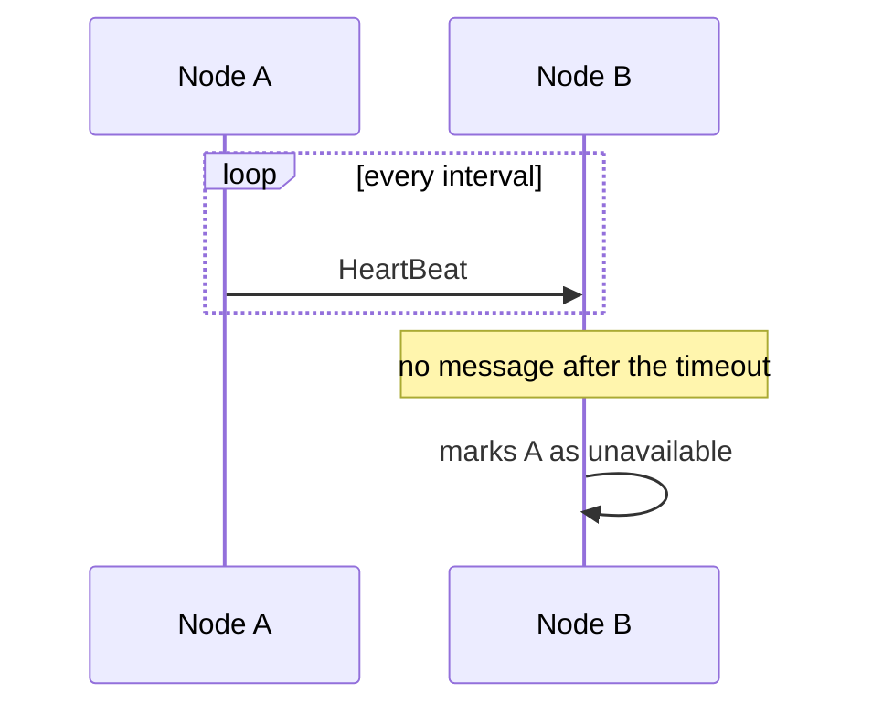

# HeartBeat

## Descrição

No HeartBeat, cada servidor envia periodicamente a outros servidores uma mensagem curta indicando que continua ativo. O receptor mantém o instante da última mensagem recebida de cada nó e, se nenhuma chegar dentro de um tempo limite, considera aquele nó indisponível e pode redirecionar suas responsabilidades.

O intervalo de envio deve ser maior que o tempo de ida e volta da rede, e o tempo limite costuma ser um múltiplo do intervalo, para tolerar atrasos ocasionais sem declarar falsos negativos. Há duas formas comuns: o líder envia heartbeats aos seguidores, que iniciam uma eleição se os perdem; ou todos os nós enviam e recebem de todos, o que escala mal em clusters grandes e leva a alternativas como Gossip Dissemination.

Usado em ZooKeeper, etcd (Raft), Kafka e Cassandra para detectar falhas de nós e líderes.

## Problemas que resolve

- Detectar rapidamente que um servidor falhou, para que pedidos aos seus dados sejam redirecionados.
- Saber quando iniciar uma nova eleição de líder.
- Distinguir um nó lento de um nó caído, ajustando o tempo limite.

## Quando usar

- Clusters que armazenam dados particionados ou replicados e precisam reagir a falhas de nós.
- Liderança baseada em Leader and Followers, em que seguidores precisam saber se o líder está vivo.

### Quando evitar

- Clusters muito grandes em que o tráfego todos-para-todos é proibitivo (prefira gossip).
- Quando a rede é tão instável que o tempo limite gera falsos positivos constantes sem ajuste adaptativo.

## Trade-offs

| Ganho | Custo / Risco |
| --- | --- |
| Detecção rápida e simples de falhas | Tráfego de rede constante e crescente com o tamanho do cluster |
| Base para eleições e reatribuição de dados | Pausas (GC, rede) podem causar falsos positivos e eleições desnecessárias |
| Fácil de implementar | Ajustar intervalo e tempo limite é um compromisso entre rapidez e estabilidade |

- **Tempo limite:** valores altos reduzem falsos alarmes e atrasam a detecção real.
- **Pausas longas:** um nó pausado por GC pode voltar achando que ainda é líder, o que o Generation Clock trata.
- **Detectores adaptativos:** algoritmos como phi-accrual evitam valores fixos.

## Diagrama

O nó A envia heartbeats periódicos; quando o nó B deixa de recebê-los dentro do tempo limite, considera A indisponível.

## Padrões relacionados

- [Leader and Followers](./leader-and-followers.md) — seguidores usam o heartbeat para detectar a queda do líder
- [Lease](../cluster-management/lease.md) — concessão com prazo que também depende de renovação periódica
- [Health Endpoint Monitoring](../../../cloud/cloud-design-patterns/resiliency/health-endpoint-monitoring.md) — verificação de saúde externa, equivalente na camada de plataforma
- [Generation Clock](./generation-clock.md) — protege contra líderes que voltam depois de uma pausa

## Referência

- [Página do padrão no catálogo Patterns of Distributed Systems](https://martinfowler.com/articles/patterns-of-distributed-systems/heartbeat.html)
