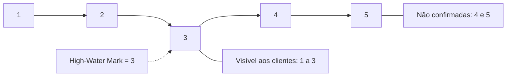

# High-Water Mark

## Descrição

O High-Water Mark é um índice no log que marca a última entrada replicada com sucesso em uma maioria (quórum) de nós. O líder o calcula a partir das confirmações dos seguidores e o envia junto com as mensagens de replicação (ou em HeartBeats), para que todos os nós saibam até onde o log é seguro. Ele também é chamado de *commit index*.

Apenas as entradas até a marca são expostas aos clientes e aplicadas à máquina de estados. Entradas acima dela existem no log do líder ou de alguns seguidores, mas podem ser descartadas em uma troca de liderança, então nunca devem ser mostradas.

Em Kafka, o high-water mark da partição define o que os consumidores podem ler; em Raft, é o *commitIndex*.

## Problemas que resolve

- O líder pode falhar antes de enviar entradas a qualquer seguidor ou depois de enviá-las a apenas alguns.
- Seguidores ficam com logs diferentes: alguns com entradas a menos, outros a mais.
- Cada nó precisa saber qual parte do log é segura para expor aos clientes.

## Quando usar

- Qualquer log replicado com líder e seguidores.
- Quando leituras (inclusive em seguidores) devem ver apenas dados duráveis.
- Para decidir quais entradas truncar após a eleição de um novo líder.

### Quando evitar

- Sistemas de nó único, em que não há replicação.
- Quando a visibilidade imediata de dados não confirmados é aceitável (consistência fraca).

## Trade-offs

| Ganho | Custo / Risco |
| --- | --- |
| Clientes nunca veem dados que possam ser perdidos | Atraso na visibilidade: o dado só aparece após a replicação em maioria |
| Permite truncar com segurança entradas não confirmadas | O líder precisa rastrear o progresso de cada seguidor |
| Base para leituras consistentes em seguidores | Seguidores aprendem a marca com atraso, então podem estar defasados |

- **Propagação:** a marca viaja nos HeartBeats e nas mensagens de replicação.
- **Após falha:** o novo líder trunca entradas acima da marca que conflitem com a geração atual.

## Diagrama

As entradas de 1 a 3 já estão na maioria e são visíveis; as entradas 4 e 5 ainda podem ser descartadas.

## Padrões relacionados

- [Write-Ahead Log](./write-ahead-log.md) — o log cuja parte segura a marca delimita
- [Leader and Followers](./leader-and-followers.md) — o líder calcula e propaga a marca
- [Majority Quorum](./majority-quorum.md) — a marca é definida pela maioria
- [Replicated Log](./replicated-log.md) — o commit das entradas segue a marca
- [Low-Water Mark](./low-water-mark.md) — marca complementar no extremo inferior
- [Follower Reads](./follower-reads.md) — seguidores servem leituras até a marca

## Referência

- [Página do padrão no catálogo Patterns of Distributed Systems](https://martinfowler.com/articles/patterns-of-distributed-systems/high-watermark.html)
