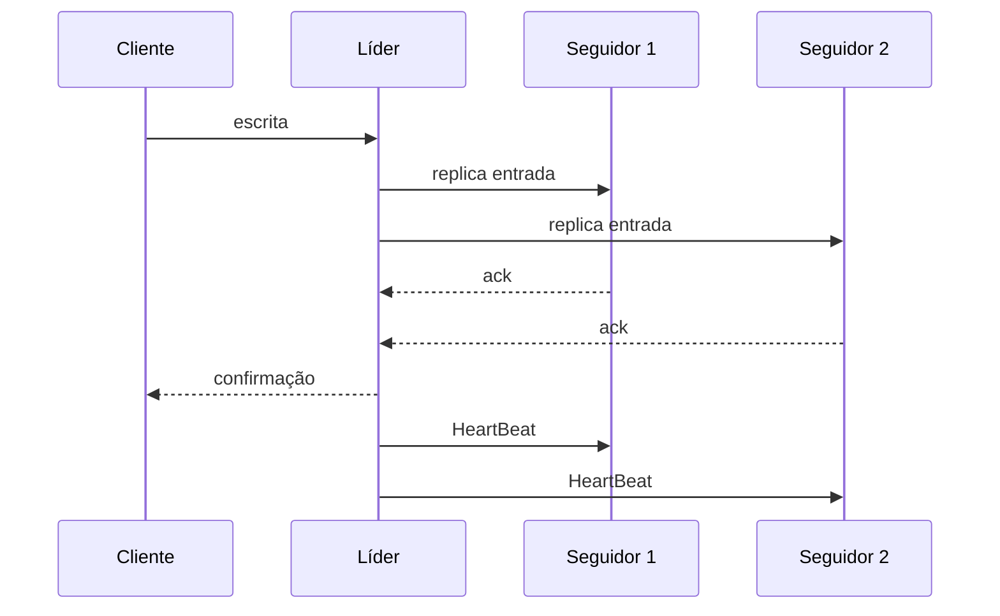

# Leader and Followers

## Descrição

Em Leader and Followers, um servidor do cluster é escolhido como líder e passa a tomar as decisões em nome do grupo: ele recebe as escritas, define a ordem das atualizações e as propaga para os demais servidores, os seguidores. Como há um único ponto de decisão, não é preciso coordenar todos os nós a cada operação, e a visão dos clientes permanece consistente.

O líder é escolhido por eleição no início e novamente quando falha. Os seguidores acompanham o líder por meio de HeartBeat; se deixam de receber mensagens por um tempo, iniciam uma nova eleição. Um Generation Clock identifica cada mandato de líder, permitindo rejeitar mensagens de líderes antigos, e o High-Water Mark define até onde os dados replicados já podem ser expostos.

O padrão é a base de sistemas como ZooKeeper (ZAB), etcd (Raft), e das partições do Kafka, em que cada partição tem um líder para escritas. Também aparece em bancos relacionais com réplicas primárias e secundárias.

## Problemas que resolve

- Quóruns de maioria para leitura e escrita não bastam: em certos cenários de falha os clientes podem ver dados inconsistentes.
- Cada servidor isolado não conhece o estado dos outros, e a divergência só seria resolvida lendo de vários nós.
- Decisões independentes em cada nó geram estados divergentes.
- Coordenar todos os nós a cada decisão tem alto custo de desempenho e complexidade.

## Quando usar

- Dados replicados que precisam de ordem total das atualizações e garantias fortes de consistência.
- Sistemas de consenso, coordenação e armazenamento replicado em que a escrita deve passar por um único ponto.
- Quando se aceita um mecanismo de eleição em troca de simplificar a replicação.

### Quando evitar

- Cargas que exigem escrita em vários pontos geograficamente distribuídos com baixa latência local (considere multi-líder ou sem líder).
- Quando o líder único se torna gargalo de escrita e o particionamento é preferível.
- Sistemas em que a indisponibilidade breve durante eleições é inaceitável.

## Trade-offs

| Ganho | Custo / Risco |
| --- | --- |
| Ordem de atualizações bem definida e consistência simples de raciocinar | O líder é gargalo de escrita e ponto único de decisão |
| Replicação direta do log do líder para os seguidores | Falha do líder causa janela de indisponibilidade até a nova eleição |
| Tolerância a falhas de seguidores e do próprio líder via eleição | Risco de dois líderes coexistirem sem um Generation Clock e quórum |

- **Detecção de falhas:** depende de HeartBeat e de timeouts ajustados à rede.
- **Split brain:** previna com quórum e número de geração.
- **Leituras:** podem ser atendidas por seguidores com Follower Reads, aceitando dados potencialmente atrasados.

## Diagrama

O cliente escreve no líder, que replica a entrada para os seguidores e responde após as confirmações, enviando HeartBeat periódico para sinalizar que está vivo.

## Padrões relacionados

- [HeartBeat](/architecture/distributed-systems/data-replication/heartbeat) — detecta a falha do líder
- [Generation Clock](/architecture/distributed-systems/data-replication/generation-clock) — identifica o mandato do líder e rejeita líderes antigos
- [High-Water Mark](/architecture/distributed-systems/data-replication/high-water-mark) — define o que os seguidores podem expor
- [Majority Quorum](/architecture/distributed-systems/data-replication/majority-quorum) — define quantas confirmações o líder precisa
- [Replicated Log](/architecture/distributed-systems/data-replication/replicated-log) — o líder replica seu log para os seguidores
- [Follower Reads](/architecture/distributed-systems/data-replication/follower-reads) — leituras servidas pelos seguidores
- [Emergent Leader](/architecture/distributed-systems/cluster-management/emergent-leader) — alternativa em que o líder emerge da ordem de entrada dos nós
- [Leader Election](/architecture/cloud-design-patterns/distributed-coordination/leader-election) — padrão de nuvem para eleger um coordenador entre instâncias

## Referência

- [Página do padrão no catálogo Patterns of Distributed Systems](https://martinfowler.com/articles/patterns-of-distributed-systems/leader-follower.html)
