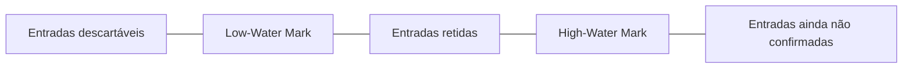

# Low-Water Mark

## Descrição

O Low-Water Mark é um índice (offset) no log abaixo do qual as entradas não são mais necessárias e podem ser descartadas com segurança. Ele resolve o problema de crescimento ilimitado em disco: mesmo com o Segmented Log limitando o tamanho de cada arquivo, o total continuaria crescendo sem uma regra para apagar o passado.

Essa marca pode ser calculada de formas diferentes. Uma é baseada em *snapshots*: quando o estado até certo índice foi gravado em um snapshot, o log anterior a ele é dispensável. Outra é baseada em tempo ou tamanho: o log mais antigo que um período de retenção é removido. Em sistemas replicados, também é preciso considerar o que os seguidores ainda precisam, para não apagar entradas que um seguidor lento ainda não recebeu.

Um processo em segundo plano verifica periodicamente a marca e remove os segmentos inteiramente abaixo dela. Kafka usa retenção por tempo ou tamanho, e ZooKeeper e etcd usam snapshots seguidos de compactação do log.

## Problemas que resolve

- O Write-Ahead Log cresce indefinidamente e consome todo o disco.
- Não é claro até que ponto o histórico é necessário para recuperação ou para seguidores atrasados.
- Apagar entradas cedo demais pode impedir a recuperação ou a ressincronização de réplicas.

## Quando usar

- Logs que acumulam histórico além do necessário para recuperação.
- Quando há snapshots periódicos que tornam o log anterior redundante.
- Quando existe uma política de retenção por tempo ou tamanho.

### Quando evitar

- Quando é preciso manter todo o histórico para auditoria ou reprodução (por exemplo, event sourcing com retenção infinita).
- Quando o volume é pequeno e o custo de manter o log inteiro é desprezível.

## Trade-offs

| Ganho | Custo / Risco |
| --- | --- |
| Uso de disco limitado e previsível | Seguidores ou consumidores muito atrasados podem precisar de um snapshot completo, pois o log necessário já foi apagado |
| Recuperação mais rápida, partindo do snapshot | Exige produzir snapshots, o que consome CPU e I/O |
| Política de retenção simples de operar | Escolher mal a marca causa perda de dados ou desperdício de espaço |

- **Seguidores lentos:** a marca deve respeitar o menor offset ainda necessário a réplicas ativas, ou então forçar transferência de snapshot.
- **Atomicidade:** remova apenas segmentos inteiros abaixo da marca.

## Diagrama

O log é dividido em três zonas: o que já pode ser descartado, o que é retido e confirmado, e o que ainda não foi replicado pela maioria.

## Padrões relacionados

- [Write-Ahead Log](./write-ahead-log.md) — o log cujo crescimento a marca limita
- [Segmented Log](./segmented-log.md) — facilita a remoção de segmentos abaixo da marca
- [High-Water Mark](./high-water-mark.md) — marca complementar, no extremo superior do log
- [Replicated Log](./replicated-log.md) — a marca precisa considerar o que os seguidores ainda precisam

## Referência

- [Página do padrão no catálogo Patterns of Distributed Systems](https://martinfowler.com/articles/patterns-of-distributed-systems/low-watermark.html)
