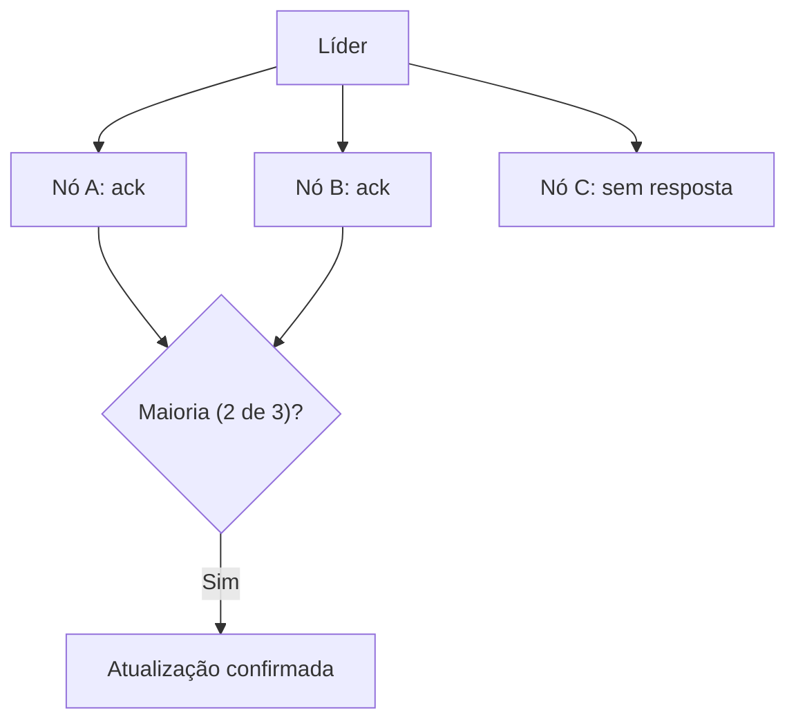

# Majority Quorum

## Descrição

No Majority Quorum, uma atualização só é considerada aceita pelo cluster quando a maioria dos nós a reconhece. Para um cluster de n nós, o quórum é n/2 + 1 (divisão inteira). Em um cluster de cinco nós o quórum é três, e o sistema tolera a falha de dois. Para tolerar f falhas, são necessários 2f + 1 nós.

Esperar todos os nós deixaria o sistema lento e vulnerável a qualquer falha; esperar poucos arriscaria perder atualizações. A maioria equilibra os dois: duas maiorias sempre se intersectam, de modo que qualquer decisão posterior tem pelo menos um nó que conhece a anterior.

O padrão aparece em ZooKeeper, etcd, Raft e Paxos para confirmar escritas e eleger líderes, e em Cassandra, onde o quórum de leitura e escrita é configurável.

## Problemas que resolve

- Decidir quantas confirmações são necessárias antes de considerar uma atualização segura.
- Evitar perda de atualizações quando poucos nós confirmam e depois falham.
- Evitar lentidão e indisponibilidade ao exigir confirmação de todos os nós.
- Garantir que decisões concorrentes não conflitem (intersecção de maiorias).

## Quando usar

- Replicação em que a escrita deve sobreviver à falha de alguns nós.
- Eleição de líder e consenso.
- Tomada de decisões por grupo em que um segmento minoritário isolado não deve continuar operando.

## Quando evitar

- Clusters de dois nós ou com número par, em que o quórum não tolera mais falhas que o ímpar anterior.
- Quando a latência de esperar a maioria entre regiões distantes é inaceitável e a consistência eventual basta.

## Trade-offs

| Ganho | Custo / Risco |
| --- | --- |
| Tolera falhas sem perder dados confirmados | Exige 2f + 1 nós e comunicação com a maioria a cada escrita |
| Evita split brain: apenas uma partição tem maioria | Sem maioria, o cluster para de aceitar escritas (prioriza consistência sobre disponibilidade) |
| Mais rápido que esperar todos os nós | Latência dominada pelos nós mais lentos dentro da maioria |

- **Número ímpar de nós:** 3 ou 5 são tamanhos típicos.
- **Quórum flexível:** escolher R + W > N em sistemas como Cassandra ajusta o equilíbrio entre leitura e escrita.
- **Mudança de membros:** reconfigurar o cluster exige cuidado para que as maiorias antiga e nova se sobreponham.

## Diagrama

Em um cluster de três nós, duas confirmações bastam para considerar a atualização aceita, mesmo com um nó sem resposta.

## Padrões relacionados

- [Leader and Followers](/architecture/distributed-systems/data-replication/leader-and-followers) — o líder usa o quórum para confirmar escritas
- [High-Water Mark](/architecture/distributed-systems/data-replication/high-water-mark) — marca a última entrada replicada em maioria
- [Paxos](/architecture/distributed-systems/data-replication/paxos) — usa quóruns de maioria nas fases de prepare e accept
- [Replicated Log](/architecture/distributed-systems/data-replication/replicated-log) — entradas só são confirmadas após o quórum
- [Two-Phase Commit](/architecture/distributed-systems/data-partitioning/two-phase-commit) — contraste: exige todos os participantes, não apenas a maioria

## Referência

- [Página do padrão no catálogo Patterns of Distributed Systems](https://martinfowler.com/articles/patterns-of-distributed-systems/majority-quorum.html)
