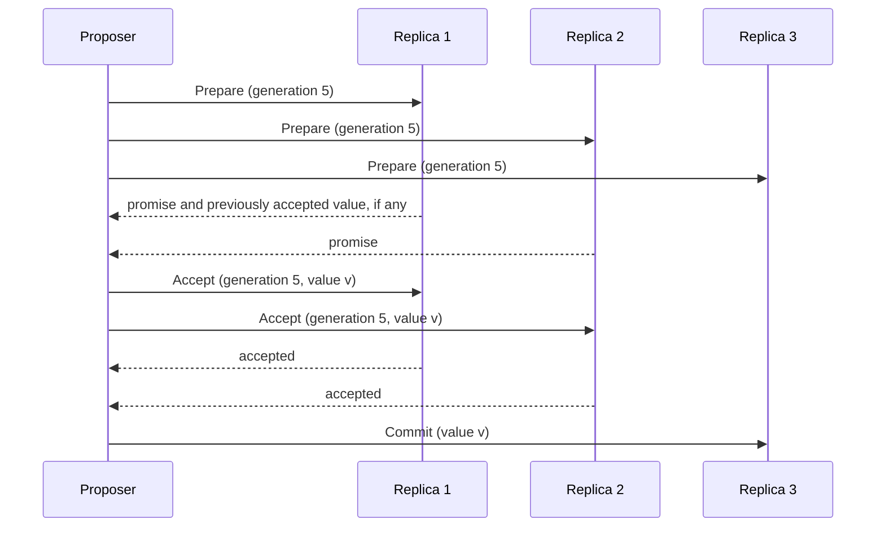

# Paxos

## Descrição

Paxos é um protocolo de consenso, proposto por Leslie Lamport, que permite a um grupo de nós concordar em um valor mesmo com falhas de nós e de rede e sem um líder fixo. O problema é sutil: um nó pode obter a aceitação de uma maioria para um valor e cair antes de contar ao resto do cluster, e outro nó, sem saber, pode tentar impor um valor diferente.

O protocolo usa três fases. Em Prepare, o proponente escolhe um número de geração (Generation Clock) maior que os já vistos e o envia a um quórum, que promete ignorar gerações menores e devolve qualquer valor já aceito. Em Accept, o proponente propõe um valor (o de maior geração já aceito, se houver, ou o seu) e as réplicas o aceitam se não prometeram uma geração maior. Em Commit, o valor escolhido é divulgado a todas as réplicas.

O Paxos básico decide um único valor; Multi-Paxos repete o processo para uma sequência de valores e, na prática, é a base de logs replicados. Raft e ZAB têm ideias semelhantes. Google Chubby e Spanner usam variantes de Paxos.

## Problemas que resolve

- Nós sem coordenador central precisam concordar em um valor.
- Nós podem falhar ou ficar isolados a qualquer momento.
- Propostas concorrentes podem tentar impor valores diferentes.
- Uma decisão parcial tomada por maioria mas não divulgada não pode gerar inconsistência.

## Quando usar

- Quando é preciso consenso sem confiar em um líder fixo, ou para eleger o líder.
- Como base de um Replicated Log em sistemas que exigem forte consistência.
- Para acordar configuração ou metadados críticos do cluster.

### Quando evitar

- Quando o simples Leader and Followers com um serviço de consenso externo (ZooKeeper, etcd) resolve; evite implementar Paxos do zero.
- Sistemas que toleram consistência eventual.

## Trade-offs

| Ganho | Custo / Risco |
| --- | --- |
| Segurança garantida mesmo com falhas e mensagens atrasadas | Complexidade conceitual e de implementação elevada |
| Funciona sem líder fixo | Propostas concorrentes podem se atropelar (livelock) sem um líder estável |
| Tolera f falhas com 2f + 1 nós | Duas viagens de ida e volta por valor no Paxos básico |

- **Multi-Paxos:** elege um proponente estável para pular a fase prepare nas decisões seguintes.
- **Alternativas:** Raft foi desenhado para ser mais fácil de entender e implementar.

## Diagrama

O proponente obtém promessas de uma maioria na fase prepare, propõe o valor na fase accept e divulga o resultado na fase commit.

## Padrões relacionados

- [Generation Clock](./generation-clock.md) — identifica as gerações das propostas
- [Majority Quorum](./majority-quorum.md) — todas as fases dependem de maioria
- [Replicated Log](./replicated-log.md) — Multi-Paxos aplica o consenso a cada entrada do log
- [Leader and Followers](./leader-and-followers.md) — alternativa com líder estável, que simplifica o protocolo
- [Consistent Core](../cluster-management/consistent-core.md) — serviços de consenso pequenos usam Paxos ou Raft

## Referência

- [Página do padrão no catálogo Patterns of Distributed Systems](https://martinfowler.com/articles/patterns-of-distributed-systems/paxos.html)
