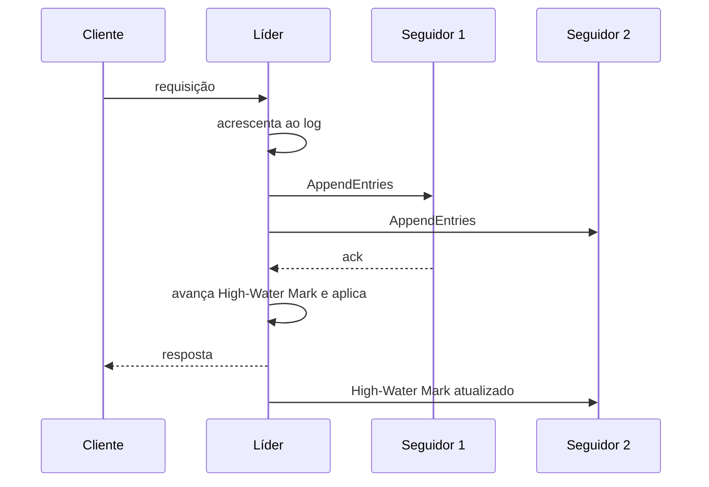

# Replicated Log

## Descrição

No Replicated Log, cada nó do cluster mantém um Write-Ahead Log cujas entradas guardam as requisições do usuário e o estado necessário para o consenso. Os nós trabalham juntos para que todos tenham exatamente o mesmo log, e as requisições são executadas na ordem do log. Se todos concordam em cada entrada e a aplicam na mesma ordem, todos chegam ao mesmo estado: é a técnica de máquina de estados replicada.

Na prática, o líder acrescenta a entrada ao seu log, a replica aos seguidores e, quando uma maioria a confirmou, avança o High-Water Mark e aplica a entrada à máquina de estados, respondendo ao cliente. Seguidores com logs divergentes após uma troca de líder têm as entradas conflitantes truncadas e substituídas com base na geração.

É o coração de Raft, ZAB (ZooKeeper), etcd e das réplicas de partições do Kafka.

## Problemas que resolve

- Os nós precisam manter o mesmo estado mesmo com falhas e desconexões.
- Concordar sobre cada requisição não basta: elas devem ser executadas na mesma ordem em todas as réplicas.
- Logs divergentes após falhas do líder precisam ser reconciliados.

## Quando usar

- Bancos, serviços de coordenação e filas que exigem forte consistência com tolerância a falhas.
- Quando todas as réplicas devem executar o mesmo conjunto de comandos na mesma ordem.
- Como base para um Consistent Core.

### Quando evitar

- Cargas que toleram consistência eventual e podem usar replicação assíncrona mais simples.
- Cargas com escrita massiva em que o consenso por entrada é um gargalo, sem batching ou pipelining.

## Trade-offs

| Ganho | Custo / Risco |
| --- | --- |
| Todas as réplicas convergem para o mesmo estado, com ordem total | Cada escrita paga uma viagem de rede até a maioria |
| Tolera falhas de minoria sem perder dados confirmados | Complexidade de reconciliar logs divergentes após trocas de líder |
| Log duradouro permite recuperação e ressincronização de réplicas | Requer compactação e snapshots para evitar crescimento infinito |

- **Desempenho:** combine com Request Batch e Request Pipeline.
- **Espera de respostas:** o líder usa uma Request Waiting List para responder ao cliente após o commit.
- **Idempotência:** clientes que repetem pedidos precisam de um Idempotent Receiver.

## Diagrama

O líder acrescenta a entrada, a replica, avança o High-Water Mark quando a maioria confirma, aplica a entrada e responde ao cliente.

## Padrões relacionados

- [Write-Ahead Log](/architecture/distributed-systems/data-replication/write-ahead-log) — cada nó mantém um WAL local
- [Leader and Followers](/architecture/distributed-systems/data-replication/leader-and-followers) — o líder coordena a replicação
- [High-Water Mark](/architecture/distributed-systems/data-replication/high-water-mark) — delimita as entradas confirmadas
- [Majority Quorum](/architecture/distributed-systems/data-replication/majority-quorum) — define o commit da entrada
- [Paxos](/architecture/distributed-systems/data-replication/paxos) — protocolo de consenso para cada entrada
- [Request Waiting List](/architecture/distributed-systems/data-replication/request-waiting-list) — acompanha requisições até o commit
- [Idempotent Receiver](/cloud/cloud-design-patterns/messaging/idempotent-consumer) — evita aplicar duas vezes requisições repetidas
- [Consistent Core](/architecture/distributed-systems/cluster-management/consistent-core) — serviço pequeno construído sobre um log replicado
- [Event Sourcing](/cloud/cloud-design-patterns/data-management/event-sourcing) — estado derivado de um log de eventos, sem replicação por consenso
- [Transaction Log Tailing](/architecture/microservices/transactional-messaging/transaction-log-tailing) — lê o log de transações para publicar mudanças

## Referência

- [Página do padrão no catálogo Patterns of Distributed Systems](https://martinfowler.com/articles/patterns-of-distributed-systems/replicated-log.html)
