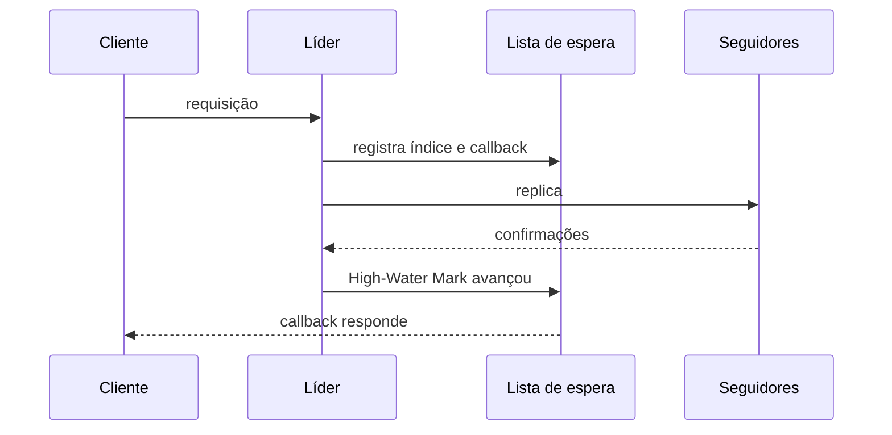

# Request Waiting List

## Descrição

A Request Waiting List é uma estrutura que associa uma chave a uma função de callback. Quando um nó do cluster precisa replicar dados para atender a requisição de um cliente, ele só pode responder depois de receber confirmações de todos ou de uma maioria dos nós. Como a comunicação é assíncrona, as respostas chegam em momentos diferentes e precisam ser correlacionadas com a requisição original.

A chave depende do critério que dispara o callback. Pode ser o identificador de correlação de cada mensagem, caso o callback seja chamado a cada resposta recebida, ou, em um Replicated Log, o índice do log: quando o High-Water Mark alcança aquele índice, a requisição correspondente é concluída. O callback inspeciona a resposta e decide se a requisição do cliente pode ser atendida.

Também costuma ter um tempo limite, para falhar requisições que não alcançam o quórum.

## Problemas que resolve

- Respostas assíncronas de vários nós precisam ser correlacionadas com a requisição do cliente.
- É necessário saber quando o quórum foi atingido para cada requisição.
- Não se pode responder ao cliente antes de a replicação ser confirmada.

## Quando usar

- Nós que replicam dados e esperam o quórum antes de responder.
- Quando se usam Request Pipeline e Request Batch e há muitas requisições em voo.
- Em líderes de logs replicados que respondem após o commit.

### Quando evitar

- Comunicação síncrona simples com um único destinatário, em que basta bloquear a chamada.
- Quando não há necessidade de espera por confirmações.

## Trade-offs

| Ganho | Custo / Risco |
| --- | --- |
| Permite comunicação assíncrona e alto desempenho | Mais estado em memória para acompanhar |
| Correlaciona respostas com requisições de forma limpa | Callbacks pendentes precisam de timeout e limpeza para evitar vazamento |
| Responde ao cliente no momento exato do quórum ou commit | Perder a lista numa queda exige que os clientes repitam (Idempotent Receiver) |

- **Timeouts:** expire entradas e responda ao cliente com erro.
- **Mudança de liderança:** falhe todas as requisições pendentes quando o nó deixa de ser líder.

## Diagrama

O líder registra um callback por índice e o dispara quando a replicação alcança o quórum, respondendo ao cliente.

## Padrões relacionados

- [Replicated Log](/architecture/distributed-systems/data-replication/replicated-log) — usa o índice do log como chave
- [Majority Quorum](/architecture/distributed-systems/data-replication/majority-quorum) — define quando o callback é disparado
- [High-Water Mark](/architecture/distributed-systems/data-replication/high-water-mark) — ao avançar, completa as requisições pendentes
- [Singular Update Queue](/architecture/distributed-systems/data-replication/singular-update-queue) — acompanha a execução serializada das requisições

## Referência

- [Página do padrão no catálogo Patterns of Distributed Systems](https://martinfowler.com/articles/patterns-of-distributed-systems/request-waiting-list.html)
