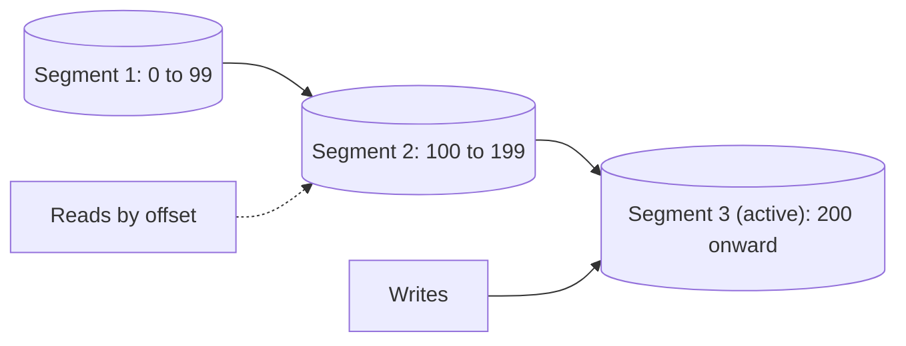

# Segmented Log

## Descrição

O Segmented Log divide o Write-Ahead Log em vários arquivos menores, chamados segmentos, em vez de manter um único arquivo que cresce indefinidamente. Quando o segmento ativo atinge um limite (de tamanho ou de tempo), o log "rola": o arquivo é fechado e um novo segmento é criado para receber os próximos registros. Só o último segmento recebe escritas, e os anteriores ficam imutáveis.

Cada segmento costuma ser nomeado ou associado ao primeiro índice (offset) que contém. Dado um índice, uma pequena tabela ou o próprio nome dos arquivos permite localizar o segmento correto sem varrer tudo. Como os segmentos antigos são arquivos independentes, apagar ou arquivar o passado vira uma operação simples de remover arquivos inteiros.

Kafka organiza cada partição como uma sequência de segmentos, e Cassandra, ZooKeeper e etcd fazem algo equivalente para seus logs de transação.

## Problemas que resolve

- Um único arquivo de log grande é lento de ler na inicialização e difícil de manipular.
- Remover registros antigos de dentro de um arquivo enorme é caro e complicado.
- Pesquisar um índice específico em um log monolítico exige leitura sequencial extensa.
- Limitar o tamanho de cada arquivo simplifica backup, cópia para seguidores e gestão de disco.

## Quando usar

- Qualquer Write-Ahead Log que cresce continuamente, em especial logs replicados.
- Quando é necessário descartar o histórico antigo periodicamente (retenção por tempo ou tamanho).
- Quando a recuperação precisa ler apenas os segmentos mais recentes.

### Quando evitar

- Volumes pequenos de dados, em que um único arquivo permanece gerenciável.
- Quando o log é efêmero e descartado inteiro a cada reinício.

## Trade-offs

| Ganho | Custo / Risco |
| --- | --- |
| Limpeza barata: apagar um segmento inteiro | Mais arquivos abertos e metadados para manter, com necessidade de um índice de segmentos |
| Leitura e recuperação mais rápidas, restritas aos segmentos relevantes | O momento de rolagem exige cuidado para não perder atomicidade das gravações |
| Segmentos imutáveis são fáceis de copiar e replicar | Segmentos muito pequenos geram sobrecarga; muito grandes perdem o benefício |

- **Tamanho do segmento:** equilibre número de arquivos e granularidade de limpeza.
- **Índice por offset:** manter o primeiro offset no nome do arquivo permite busca binária entre segmentos.
- **Limpeza:** a decisão de quais segmentos remover vem do Low-Water Mark.

## Diagrama

O log é uma sequência de segmentos imutáveis mais um segmento ativo, o único que recebe novas escritas.

## Padrões relacionados

- [Write-Ahead Log](./write-ahead-log.md) — o log que é dividido em segmentos
- [Low-Water Mark](./low-water-mark.md) — indica quais segmentos antigos podem ser removidos
- [Replicated Log](./replicated-log.md) — o log replicado costuma ser armazenado de forma segmentada

## Referência

- [Página do padrão no catálogo Patterns of Distributed Systems](https://martinfowler.com/articles/patterns-of-distributed-systems/segmented-log.html)
