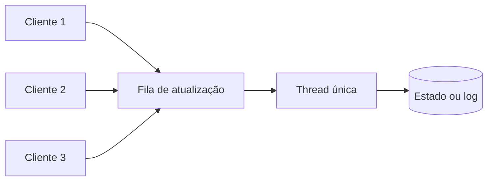

# Singular Update Queue

## Descrição

A Singular Update Queue usa uma fila de trabalho processada por uma única thread para aplicar mudanças de estado. Vários clientes concorrentes enviam suas atualizações para a fila (sem bloquear) e uma thread dedicada as retira e executa uma por vez, na ordem de chegada.

Em vez de proteger o estado com locks, em que as threads concorrentes ficam bloqueadas esperando e a vazão cai quando a tarefa é lenta (como gravar em arquivo), o estado fica confinado a uma thread. Os chamadores recebem uma promessa (*future*) ou callback que é completada quando a atualização é processada. A ideia combina bem com goroutines e canais em Go, ou com um *single-thread executor* em Java.

Aparece em torno do Write-Ahead Log, para serializar escritas no log, e na aplicação de entradas confirmadas de um Replicated Log.

## Problemas que resolve

- Várias threads concorrentes precisam alterar o mesmo estado, mas as mudanças devem ser aplicadas uma de cada vez.
- Locks bloqueiam as threads em espera e reduzem a vazão e aumentam a latência quando a tarefa é lenta.
- É preciso preservar a ordem de execução e simplificar o raciocínio sobre concorrência.

## Quando usar

- Gravação sequencial em um Write-Ahead Log com escritas concorrentes.
- Aplicação de comandos a uma máquina de estados replicada.
- Quando o estado compartilhado é complexo e locks fariam o código frágil.

### Quando evitar

- Cargas fortemente paralelizáveis em que as operações são independentes (use competing consumers ou particionamento).
- Quando uma única thread é gargalo de CPU que não pode ser dividido.

## Trade-offs

| Ganho | Custo / Risco |
| --- | --- |
| Ordem garantida e ausência de locks no estado | Vazão limitada pela velocidade de uma única thread |
| Chamadores não bloqueiam durante a execução | Fila ilimitada pode crescer e consumir memória |
| Código mais simples de entender | Tarefas lentas atrasam todas as seguintes |

- **Backpressure:** use fila limitada e rejeição ou bloqueio quando cheia.
- **Batching:** a thread pode processar vários itens por ciclo para amortizar o custo de `fsync`.
- **Erros:** trate exceções sem derrubar a thread consumidora.

## Diagrama

Vários clientes enfileiram atualizações e uma única thread as aplica ao estado em ordem.

## Padrões relacionados

- [Write-Ahead Log](/architecture/distributed-systems/data-replication/write-ahead-log) — as gravações no log são serializadas por essa fila
- [Replicated Log](/architecture/distributed-systems/data-replication/replicated-log) — as entradas confirmadas são aplicadas em ordem por uma thread
- [Request Waiting List](/architecture/distributed-systems/data-replication/request-waiting-list) — registra callbacks de requisições enfileiradas
- [Competing Consumers](/architecture/cloud-design-patterns/messaging/competing-consumers) — contraste: vários consumidores em paralelo, sem ordem global

## Referência

- [Página do padrão no catálogo Patterns of Distributed Systems](https://martinfowler.com/articles/patterns-of-distributed-systems/singular-update-queue.html)
