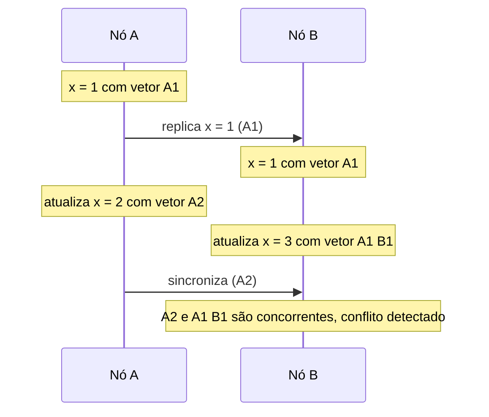

# Version Vector

## Descrição

O Version Vector associa a cada valor de uma chave um vetor com um contador por nó do cluster. Quando um nó atualiza o valor localmente, incrementa apenas o seu próprio contador. Quando as réplicas trocam dados, comparam os vetores: se um vetor é maior ou igual ao outro em todas as posições, o valor correspondente é mais novo e substitui o outro; se cada um é maior em alguma posição, as atualizações foram concorrentes, e há um conflito a ser resolvido.

A resolução pode ser feita pelo cliente, por uma regra como *last-write-wins* ou por tipos de dados de merge (CRDTs). Isso permite que vários servidores aceitem escritas para a mesma chave sem líder e detectem conflitos depois, em vez de impedi-los.

É usado em Dynamo e Riak; Cassandra optou por timestamps (last-write-wins) em vez de vetores.

## Problemas que resolve

- Quando vários servidores aceitam atualizações para a mesma chave, é preciso detectar se réplicas receberam modificações concorrentes.
- Relógios físicos não são confiáveis para ordenar eventos entre nós.

## Quando usar

- Armazenamentos sem líder (leaderless), com replicação multi-mestre e alta disponibilidade de escrita.
- Quando conflitos devem ser detectados e resolvidos explicitamente, em vez de silenciosamente descartados.

### Quando evitar

- Sistemas com um líder único, em que a ordem já é definida (use Versioned Value).
- Clusters muito grandes, pois o vetor cresce com o número de nós.
- Quando last-write-wins é aceitável.

## Trade-offs

| Ganho | Custo / Risco |
| --- | --- |
| Detecta atualizações concorrentes sem relógios sincronizados | O tamanho do vetor cresce com o número de nós ou clientes |
| Permite escrita em qualquer réplica, com alta disponibilidade | Conflitos precisam de resolução, que pode ser complexa |
| Preserva causalidade entre atualizações | Mais complexo que um simples número de versão |

- **Poda:** limite o tamanho do vetor, removendo entradas antigas, ao custo de precisão.
- **Dotted version vectors:** reduzem o crescimento por cliente.

## Diagrama

Dois nós atualizam a mesma chave sem conhecer a atualização do outro; ao sincronizar, a comparação dos vetores revela o conflito.

## Padrões relacionados

- [Versioned Value](/architecture/distributed-systems/data-replication/versioned-value) — versão única, para sistemas com ordem total
- [Lamport Clock](/architecture/distributed-systems/distributed-time/lamport-clock) — relógio lógico escalar que ordena sem detectar concorrência
- [Leader and Followers](/architecture/distributed-systems/data-replication/leader-and-followers) — abordagem alternativa: um líder evita conflitos de escrita

## Referência

- [Página do padrão no catálogo Patterns of Distributed Systems](https://martinfowler.com/articles/patterns-of-distributed-systems/version-vector.html)
