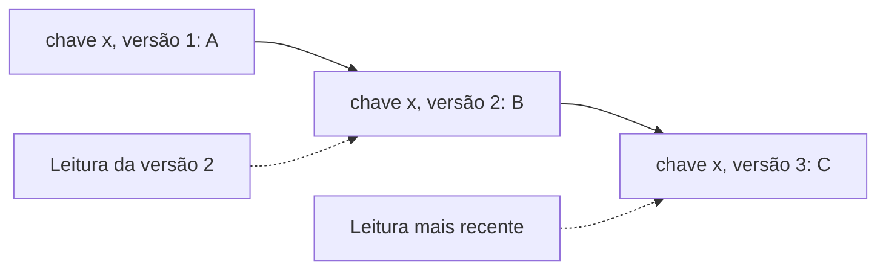

# Versioned Value

## Descrição

No Versioned Value, cada valor de uma chave é guardado junto com um número de versão que aumenta a cada atualização. Em vez de sobrescrever, cada atualização cria uma nova entrada (chave mais versão), de modo que leituras não precisam bloquear escritas e valores antigos continuam disponíveis.

Isso permite que os clientes leiam o valor mais recente, ou um valor histórico em uma versão específica (leitura *snapshot*), e escrevam condicionalmente, comparando a versão esperada (*compare-and-swap*). A versão pode vir do índice do Replicated Log ou de um contador, e frequentemente é ordenada com a chave, o que torna eficientes buscas por intervalo.

Aparece em etcd (revisões do MVCC), ZooKeeper (zxid e versão do znode) e Kafka (offsets).

## Problemas que resolve

- Nós precisam saber qual é o valor mais recente de uma chave.
- Às vezes é preciso conhecer valores anteriores para reagir a mudanças.
- Leituras não devem bloquear escritas nem ver estados parciais.

## Quando usar

- Armazenamentos chave-valor com leitura consistente e concorrência otimista.
- Quando clientes observam mudanças (watch) a partir de uma versão.
- MVCC e leituras de snapshot.

### Quando evitar

- Dados em que o histórico não é necessário e o espaço é crítico.
- Armazenamento simples de um único cliente sem concorrência.

## Trade-offs

| Ganho | Custo / Risco |
| --- | --- |
| Leituras sem bloqueio e leitura de versões históricas | Mais armazenamento e necessidade de compactar versões antigas |
| Escritas condicionais evitam atualizações perdidas | Conflitos exigem retentativa pelo cliente |
| Base para observação de mudanças e snapshots | Gestão de versões aumenta a complexidade do armazenamento |

- **Compactação:** descarte versões antigas segundo uma política, como o Low-Water Mark.
- **Versão global:** em armazenamentos replicados, use o índice do log como versão.

## Diagrama

Cada atualização cria uma nova versão da chave, permitindo ler o valor mais recente ou uma versão histórica.

## Padrões relacionados

- [Replicated Log](/architecture/distributed-systems/data-replication/replicated-log) — o índice do log pode servir de versão
- [Follower Reads](/architecture/distributed-systems/data-replication/follower-reads) — a versão permite leituras com garantia mínima em seguidores
- [Version Vector](/architecture/distributed-systems/data-replication/version-vector) — versão por nó para detectar concorrência
- [Optimistic Offline Lock](/design/poeaa/offline-concurrency/optimistic-offline-lock) — controle de concorrência otimista com número de versão

## Referência

- [Página do padrão no catálogo Patterns of Distributed Systems](https://martinfowler.com/articles/patterns-of-distributed-systems/versioned-value.html)
