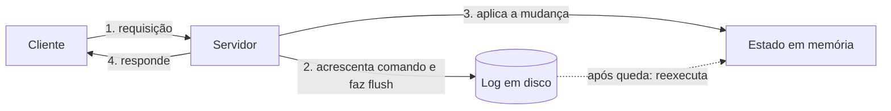

# Write-Ahead Log

## Descrição

O Write-Ahead Log (WAL) é um arquivo de log somente com acréscimos (*append-only*) em disco no qual cada mudança de estado é registrada como um comando antes de ser aplicada às estruturas de dados em memória ou aos arquivos de dados. Só depois que o registro foi gravado (e sincronizado com o disco, via *flush*/`fsync`) o servidor aplica a mudança e responde ao cliente. Por isso o log também é chamado de *commit log*.

Se o servidor cai e reinicia, ele perdeu o estado em memória, mas não o log. Na recuperação, o nó lê o log do início (ou do último ponto de verificação) e reexecuta os comandos na ordem, reconstruindo o estado exato de antes da falha. Cada entrada costuma ter um identificador sequencial (índice), o tipo de dado e o conteúdo do comando, e frequentemente um checksum para detectar gravações parciais.

O padrão é a base de vários outros do catálogo: o Segmented Log divide o log em arquivos menores, o Low-Water Mark descarta o que não é mais necessário e o Replicated Log o replica entre nós. Aparece no Cassandra (commit log), no ZooKeeper (log de transações), no etcd (WAL com Raft) e no Kafka, cujo armazenamento é essencialmente um log particionado.

## Problemas que resolve

- Garantir durabilidade: depois que o servidor aceitou uma ação, ela precisa ser concluída mesmo que ele falhe e reinicie sem o estado em memória.
- Evitar escritas aleatórias custosas em estruturas de dados no caminho crítico, trocando-as por acréscimos sequenciais.
- Permitir reconstruir o estado após uma queda reexecutando os comandos registrados.
- Dar uma ordem total e um identificador a cada mudança, o que sustenta replicação e recuperação.

## Quando usar

- Bancos de dados, brokers e serviços de coordenação que mantêm estado em memória ou em estruturas complexas e precisam sobreviver a reinicializações.
- Quando é preciso replicar a sequência de mudanças para outros nós, como base de um Replicated Log.
- Quando a durabilidade de cada escrita confirmada é requisito (por exemplo, com `fsync` antes do *ack*).

### Quando evitar

- Dados efêmeros ou facilmente recriáveis (caches), em que perder o estado em uma queda é aceitável.
- Quando a latência do `fsync` por escrita é inaceitável e a perda de uma janela recente de dados é tolerada.
- Sistemas que já delegam a durabilidade a um armazenamento externo confiável, tornando o log redundante.

## Trade-offs

| Ganho | Custo / Risco |
| --- | --- |
| Durabilidade forte e recuperação determinística após falhas | Cada escrita paga o custo de acréscimo e `fsync` em disco, o que limita a vazão e adiciona latência |
| Escritas sequenciais, rápidas em discos e SSDs | O log cresce sem parar e exige segmentação e limpeza (Segmented Log e Low-Water Mark) |
| Ordem total das mudanças, útil para replicação | Recuperação lenta se o log for longo e não houver *snapshots* ou pontos de verificação |

- **Escritas parciais:** use checksums por entrada para descartar a cauda corrompida na recuperação.
- **Política de flush:** sincronizar a cada escrita é seguro e lento; agrupar escritas (*group commit*) ou sincronizar periodicamente troca durabilidade por desempenho.
- **Concorrência:** a gravação sequencial costuma ser feita por uma única thread, como no Singular Update Queue.
- **Idempotência:** como a reexecução pode repetir comandos, os comandos devem poder ser reaplicados com segurança.

## Diagrama

O servidor grava o comando no log em disco antes de alterar o estado em memória e só então responde. Após uma falha, o estado é reconstruído reexecutando o log.

## Padrões relacionados

- [Segmented Log](./segmented-log.md) — divide o log em vários arquivos para facilitar leitura e limpeza
- [Low-Water Mark](./low-water-mark.md) — define até onde o log pode ser descartado
- [Replicated Log](./replicated-log.md) — replica o WAL entre nós para formar um log consistente
- [Singular Update Queue](./singular-update-queue.md) — serializa as escritas no log em uma única thread
- [Generation Clock](./generation-clock.md) — a geração é gravada em cada entrada do log
- [Event Sourcing](../../../cloud/cloud-design-patterns/data-management/event-sourcing.md) — também armazena o estado como sequência de eventos em um log imutável
- [Transaction Log Tailing](../../microservices/transactional-messaging/transaction-log-tailing.md) — lê o log de transações do banco, que é um WAL, para publicar eventos

## Referência

- [Página do padrão no catálogo Patterns of Distributed Systems](https://martinfowler.com/articles/patterns-of-distributed-systems/write-ahead-log.html)
