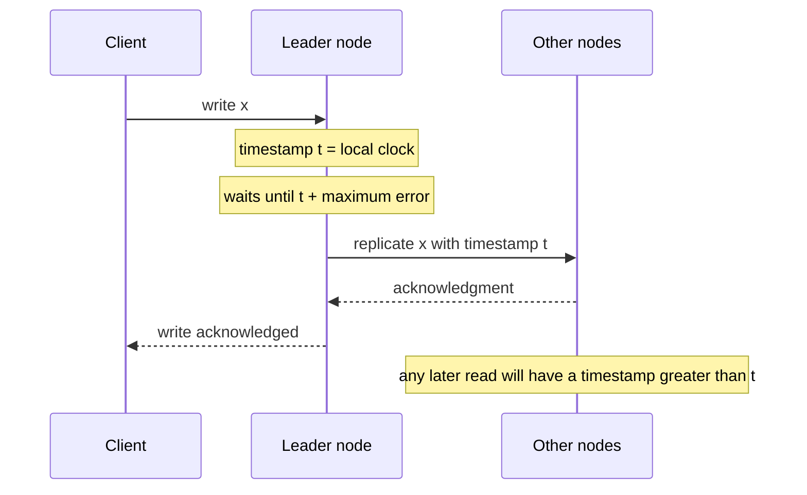

# Clock-Bound Wait

## Descrição

O Clock-Bound Wait lida com a incerteza dos relógios físicos de um cluster esperando que ela passe. Conhecendo um limite superior para a diferença entre os relógios dos nós, o nó que atribui um timestamp a uma escrita (ou lê um valor) aguarda até que todos os relógios do cluster estejam garantidamente além desse timestamp antes de prosseguir.

Por exemplo, se o desvio máximo entre relógios é de 10 ms, uma escrita com timestamp t só é tornada visível depois de t mais 10 ms. A partir daí, qualquer nó, mesmo com relógio atrasado, atribuirá a leituras timestamps maiores que o da escrita e a enxergará.

Quanto menor e mais bem conhecido o limite de erro, menor a espera. Por isso o padrão costuma ser associado a infraestrutura de tempo de alta precisão, como relógios atômicos e GPS, ou a serviços de sincronização que expõem o erro máximo. Bancos como Spanner, CockroachDB e YugabyteDB aplicam variações dessa ideia.

## Problemas que resolve

- Em um armazenamento chave-valor com versões por timestamp, uma leitura em um nó com relógio atrasado pode devolver dado antigo, mesmo após a escrita ter sido confirmada em outro nó.
- Dois clientes que consultam nós diferentes veem "o mais recente" diferente, violando a consistência externa.
- Perguntar a um servidor qual é a última versão exige uma ida e volta extra e, para várias chaves, consultar cada uma.
- Relógios adiantados fazem escritas parecerem estar no futuro.
- Lamport e Hybrid Clock dão só ordem parcial: eventos sem relação causal em nós diferentes não ficam ordenados.

## Quando usar

- É preciso consistência externa (ordem coerente com o tempo real observado pelos clientes) entre nós diferentes.
- Existe um limite de erro de relógio conhecido e pequeno, de modo que a espera seja aceitável.
- O sistema usa timestamps como versões em armazenamento multiversão distribuído.

### Quando evitar

- O limite de erro dos relógios é desconhecido ou grande; a espera fica longa ou, pior, o limite é violado e a garantia se perde.
- A latência de escrita ou leitura é crítica e a incerteza não é pequena.
- Basta ordem causal, caso em que um Lamport Clock ou um Hybrid Clock é suficiente.

## Trade-offs

| Ganho | Custo / Risco |
| --- | --- |
| Consistência externa sem consultar um serviço central de ordem | Latência extra em cada escrita ou leitura, proporcional à incerteza |
| Leituras em qualquer nó enxergam escritas já confirmadas | Depende de um limite de erro confiável |
| Evita ida e volta para descobrir a última versão | Se o limite for subestimado, a garantia é violada silenciosamente |

- O custo cai quando os relógios são bem sincronizados, mas cresce com a deriva.
- Alguns sistemas, em vez de esperar sempre, reiniciam a leitura quando encontram um valor dentro da janela de incerteza.
- É necessário monitorar o erro dos relógios e tirar do cluster nós que excedam o limite.

## Diagrama

A escrita só é confirmada depois que o tempo local passa de t somado ao erro máximo, garantindo que nenhum relógio do cluster ainda esteja antes de t.

## Padrões relacionados

- [Hybrid Clock](./hybrid-clock.md) — fornece os timestamps sobre os quais a espera é aplicada
- [Lamport Clock](./lamport-clock.md) — ordem causal sem tempo físico, que o Clock-Bound Wait complementa
- [Versioned Value](../data-replication/versioned-value.md) — valores versionados por timestamp que precisam dessa garantia
- [Two-Phase Commit](../data-partitioning/two-phase-commit.md) — transações entre partições escolhem o timestamp de commit e podem esperar a incerteza
- [Version Vector](../data-replication/version-vector.md) — abordagem alternativa que detecta concorrência sem depender de relógios
- [Message Sequence](../../eip/message-construction/message-sequence.md) (EIP) — ordenação no nível de mensagens
- [Resequencer](../../eip/message-routing/resequencer.md) (EIP) — reordena mensagens por sequência

## Referência

- [Página do padrão no catálogo Patterns of Distributed Systems](https://martinfowler.com/articles/patterns-of-distributed-systems/clock-bound-wait.html)
