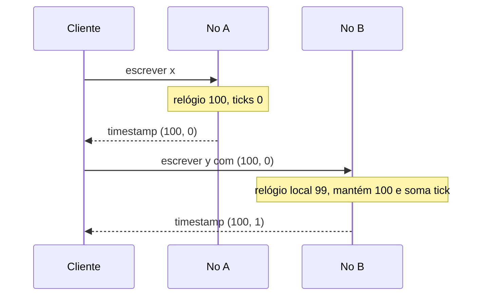

# Hybrid Clock

## Descrição

O Hybrid Clock (relógio lógico híbrido, ou HLC) combina o relógio de parede do sistema com um contador lógico. O timestamp é um par: o tempo físico e um número de ticks que desempata eventos ocorridos no mesmo instante físico.

A comparação é feita primeiro pelo tempo físico e, em caso de empate, pelos ticks. Quando o relógio do sistema avança, o contador volta a zero; quando o relógio não avança ou está atrás de um timestamp recebido, o nó mantém o maior tempo conhecido e incrementa os ticks. Dessa forma o valor nunca regride, mesmo se o relógio físico for ajustado para trás.

O resultado se comporta como um Lamport Clock, com versões sempre crescentes e consistentes com a causalidade, mas com a vantagem de os valores permanecerem próximos da hora real. Isso permite que clientes consultem dados "até" um certo instante e que se leia o histórico por data.

## Problemas que resolve

- Versões inteiras de um Lamport Clock não dizem aos clientes quando um valor foi gravado.
- Clientes preferem versões que se relacionem a data e hora, mas relógios de parede sozinhos não são monotônicos nem comparáveis entre nós.
- Várias escritas podem ocorrer no mesmo instante físico e ainda assim precisam de uma ordem total determinística.

## Quando usar

- Valores versionados precisam de ordem causal e também de uma relação com o tempo real, por exemplo para consultas por instante ou expiração.
- O sistema faz controle de concorrência multiversão e precisa de timestamps de leitura e escrita comparáveis.
- Os relógios dos nós são razoavelmente sincronizados (NTP), sem hardware especializado.

## Quando evitar

- Basta ordenar por causalidade, sem relação com o tempo real; um Lamport Clock é mais simples.
- Se for necessária consistência externa estrita entre nós com relógios divergentes, o HLC sozinho não basta: ele dá apenas ordem parcial entre eventos sem relação causal, e é preciso combiná-lo com um Clock-Bound Wait.
- Detectar escritas concorrentes é o objetivo principal; use um Version Vector.

## Trade-offs

| Ganho | Custo / Risco |
| --- | --- |
| Versões crescentes, causais e próximas da hora real | Timestamp maior (tempo físico mais contador) do que um inteiro |
| Tolera relógios que andam para trás sem regredir a versão | Um relógio muito adiantado puxa o tempo lógico de todo o cluster |
| Sem hardware de tempo dedicado | Eventos sem relação causal em nós diferentes ficam só parcialmente ordenados |

- O tempo lógico pode se afastar do físico se algum nó tiver relógio muito à frente; convém limitar a diferença aceitável.
- Facilita observabilidade, pois versões podem ser correlacionadas com horários.
- Usado por bancos como MongoDB e CockroachDB para versionar dados e coordenar leituras.

## Diagrama

O nó B tem o relógio físico atrasado, mas mantém o maior tempo conhecido e incrementa os ticks, de modo que a segunda escrita fique depois da primeira.

## Padrões relacionados

- [Lamport Clock](/architecture/distributed-systems/distributed-time/lamport-clock) — base lógica que o Hybrid Clock estende com o tempo físico
- [Clock-Bound Wait](/architecture/distributed-systems/distributed-time/clock-bound-wait) — complementa o HLC esperando a incerteza dos relógios para obter ordem externa
- [Versioned Value](/architecture/distributed-systems/data-replication/versioned-value) — armazena cada valor com o timestamp híbrido como versão
- [Version Vector](/architecture/distributed-systems/data-replication/version-vector) — alternativa para detectar escritas concorrentes
- [Two-Phase Commit](/architecture/distributed-systems/data-partitioning/two-phase-commit) — transações entre partições usam timestamps como momento de commit
- [Message Sequence](/architecture/eip/message-construction/message-sequence) (EIP) — ordenação no nível de mensagens
- [Resequencer](/architecture/eip/message-routing/resequencer) (EIP) — reordena mensagens por sequência

## Referência

- [Página do padrão no catálogo Patterns of Distributed Systems](https://martinfowler.com/articles/patterns-of-distributed-systems/hybrid-clock.html)
