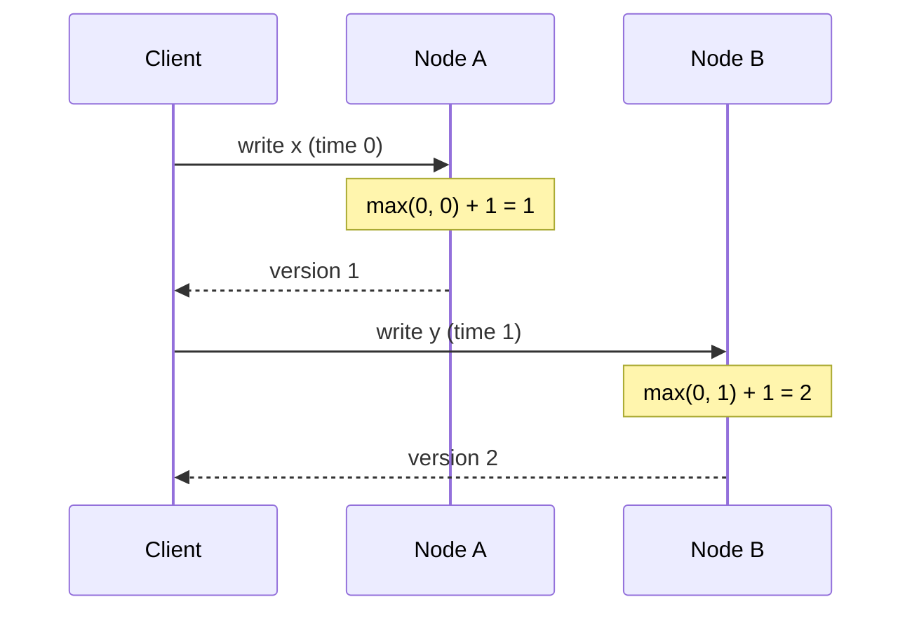

# Lamport Clock

## Descrição

O Lamport Clock é um contador lógico, um simples inteiro, mantido por cada nó do cluster para ordenar eventos sem depender do relógio de parede. Cada escrita incrementa o contador, e o valor resultante serve como versão da escrita.

A regra central é a atualização com base no que chega: ao receber uma requisição que carrega um timestamp, o nó adota o maior entre o seu contador local e o recebido, e só então incrementa. Assim, a nova escrita sempre fica depois da requisição que a originou e de tudo o que o nó já havia feito.

O nó devolve o timestamp ao cliente, e o cliente o envia nas requisições seguintes, mesmo que para outros nós. Essa passagem de timestamps pelo cliente propaga a causalidade entre servidores diferentes, sem nenhuma sincronização de relógios físicos.

## Problemas que resolve

- Relógios de sistema derivam e podem andar para trás quando o NTP os corrige, então não garantem monotonicidade nem em um único servidor.
- A deriva entre servidores não tem limite conhecido, tornando impossível comparar timestamps físicos de nós distintos.
- Escritas causalmente relacionadas (por exemplo, uma escrita feita depois de ler um valor de outro nó) precisam ser ordenadas depois de suas causas.

## Quando usar

- Valores versionados em vários nós precisam de uma ordem consistente com a causalidade.
- Não há relógios sincronizados confiáveis, ou não se quer depender deles.
- Uma versão numérica simples e barata (um inteiro) é suficiente.

### Quando evitar

- Os clientes precisam relacionar a versão a uma data e hora reais; nesse caso, prefira um Hybrid Clock.
- É necessário detectar escritas concorrentes (conflitos); um único inteiro impõe uma ordem total que esconde a concorrência, e um Version Vector é mais adequado.
- Eventos sem relação causal observada precisam ser ordenados conforme o tempo real; o Lamport Clock não oferece isso.

## Trade-offs

| Ganho | Custo / Risco |
| --- | --- |
| Ordem consistente com a causalidade sem relógios sincronizados | O número não tem relação com o tempo real |
| Estado mínimo: um inteiro por nó | Eventos concorrentes recebem uma ordem arbitrária, sem sinalizar o conflito |
| Implementação trivial e barata | Depende de o cliente repassar o timestamp para preservar a cadeia causal |

- A causalidade só é preservada entre operações ligadas por timestamps trocados; eventos independentes não têm ordem significativa.
- Não há como saber, olhando dois valores, se um aconteceu antes do outro ou se foram concorrentes.
- Observabilidade limitada: as versões são difíceis de correlacionar com logs e horários.

## Diagrama

O cliente leva o timestamp devolvido pelo nó A na requisição ao nó B, e o nó B adota o maior valor e incrementa, garantindo que a segunda escrita fique depois da primeira.

## Padrões relacionados

- [Hybrid Clock](./hybrid-clock.md) — estende a ideia combinando o contador com o relógio de parede
- [Clock-Bound Wait](./clock-bound-wait.md) — resolve a ordenação entre nós esperando a incerteza dos relógios físicos
- [Versioned Value](../data-replication/versioned-value.md) — usa o timestamp lógico como versão de cada valor armazenado
- [Version Vector](../data-replication/version-vector.md) — detecta concorrência, o que um único inteiro não consegue
- [Generation Clock](../data-replication/generation-clock.md) — outro contador lógico, usado para marcar épocas de liderança
- [Message Sequence](../../eip/message-construction/message-sequence.md) (EIP) — numeração de mensagens para ordená-las
- [Resequencer](../../eip/message-routing/resequencer.md) (EIP) — restaura a ordem de mensagens usando números de sequência

## Referência

- [Página do padrão no catálogo Patterns of Distributed Systems](https://martinfowler.com/articles/patterns-of-distributed-systems/lamport-clock.html)
