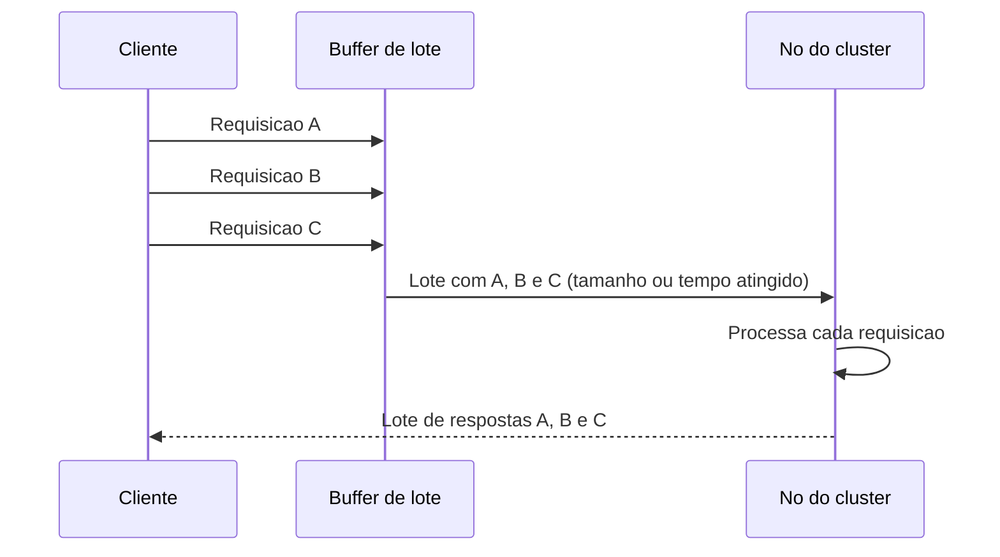

# Request Batch

## Descrição

O Request Batch agrupa várias requisições pequenas em uma única mensagem de rede, enviada de uma vez a um nó do cluster. O nó processa cada requisição do lote como processaria individualmente e devolve um lote de respostas, normalmente na mesma ordem.

O ganho vem de diluir custos fixos por requisição: latência de rede, cabeçalhos, serialização e desserialização, chamadas de sistema e acordar threads. Com requisições de poucos bytes, esse overhead costuma dominar o tempo total, e o enlace fica subutilizado mesmo com muitos clientes concorrentes.

O cliente costuma fechar o lote por tamanho (bytes ou número de itens) ou por tempo máximo de espera, o que ocorrer primeiro. Brokers de log como Kafka e bancos como Cassandra usam essa técnica em produtores, replicação e gravações em disco para aumentar a vazão.

## Problemas que resolve

- Muitas requisições pequenas saturam o processamento e a rede por overhead, não por volume de dados.
- A latência por requisição limita a vazão total do cliente, mesmo com banda sobrando.
- O servidor gasta tempo demais em serialização, desserialização e chamadas de sistema por requisição.

## Quando usar

- Alto volume de requisições pequenas para o mesmo nó (gravações em um log replicado, produção de mensagens, atualizações de metadados).
- Quando é aceitável trocar um pouco de latência individual por vazão agregada.
- Em combinação com [Request Pipeline](./request-pipeline.md), para aproveitar ao máximo o canal.

### Quando evitar

- Cargas com baixo volume ou sensíveis a latência, em que esperar para formar o lote só atrasa a resposta.
- Quando as requisições são grandes e já amortizam bem o overhead.
- Quando uma falha parcial no lote é difícil de tratar ou de reportar ao cliente de forma independente.

## Trade-offs

| Ganho | Custo / Risco |
| --- | --- |
| Maior vazão e uso mais eficiente de rede e CPU | Latência adicional enquanto o lote se forma |
| Menos serialização e menos chamadas de sistema por requisição | Falhas parciais exigem tratamento item a item |
| Menos mensagens para o nó receptor processar | Lotes grandes aumentam o uso de memória e o custo de reenvio |

- É preciso limitar tamanho e tempo do lote para evitar tanto latência excessiva quanto mensagens enormes.
- Convém aplicar contrapressão quando o nó receptor não acompanha o ritmo dos lotes.
- Para operações não idempotentes, reenviar um lote inteiro pode duplicar efeitos; considere [Idempotent Receiver](../../../cloud/azure/messaging/idempotent-consumer.md).
- Não confundir com [Queue-Based Load Leveling](../../../cloud/azure/messaging/queue-based-load-leveling.md), que usa uma fila para suavizar picos de carga e desacoplar produtor e consumidor, sem agrupar requisições para o mesmo destino.

## Diagrama

O cliente acumula requisições em um buffer e as envia como um único lote quando atinge o limite de tamanho ou de tempo. O nó processa todas e responde também em lote.

## Padrões relacionados

- [Request Pipeline](./request-pipeline.md) — complementar: o pipeline mantém várias requisições em voo, e o lote reduz o custo de cada uma.
- [Single-Socket Channel](./single-socket-channel.md) — canal pelo qual os lotes costumam trafegar, preservando a ordem.
- [Singular Update Queue](../data-replication/singular-update-queue.md) — o receptor pode drenar a fila em lotes para ganhar eficiência.
- [Idempotent Receiver](../../../cloud/azure/messaging/idempotent-consumer.md) — protege contra efeitos duplicados quando um lote é reenviado.
- [Message Sequence](../../eip/message-construction/message-sequence.md) (EIP) — dividir ou agrupar dados em sequências de mensagens.
- [Queue-Based Load Leveling](../../../cloud/azure/messaging/queue-based-load-leveling.md) (nuvem) — contraste: nivela a carga com uma fila, em vez de agrupar requisições.

## Referência

- [Página do padrão no catálogo Patterns of Distributed Systems](https://martinfowler.com/articles/patterns-of-distributed-systems/request-batch.html)
