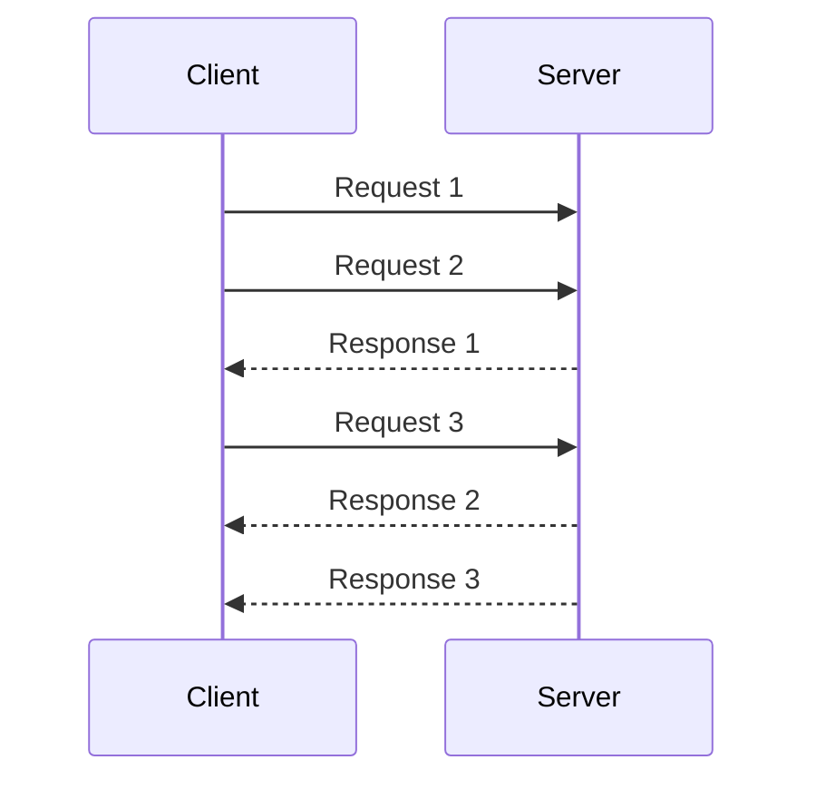

# Request Pipeline

## Descrição

O Request Pipeline faz um nó enviar várias requisições a outro nó sem esperar a resposta de cada uma antes de enviar a seguinte. Em vez do ciclo estrito de enviar e aguardar, o canal fica sempre com requisições em voo, e as respostas são consumidas à medida que chegam.

Em geral há duas linhas de execução independentes por conexão: uma escreve requisições no canal e outra lê as respostas. Um mecanismo de correlação associa cada resposta à requisição de origem, e, num [Single-Socket Channel](./single-socket-channel.md), a ordem do TCP ajuda a manter essa associação previsível.

O ganho aparece quando o servidor consegue processar algo enquanto outras requisições ainda chegam, como ocorre com uma [Singular Update Queue](../data-replication/singular-update-queue.md). Se o cliente só envia uma requisição por vez, a capacidade do servidor e do enlace fica ociosa durante cada ida e volta. Sistemas como Kafka e ZooKeeper limitam o número de requisições em voo por conexão, para equilibrar vazão, ordem e consumo de memória.

## Problemas que resolve

- Esperar a resposta de cada requisição desperdiça a capacidade do servidor e da rede.
- A vazão fica limitada pela latência de ida e volta, e não pela capacidade real do nó.
- Filas de requisições do servidor ficam vazias, quando poderiam ser mantidas cheias.

## Quando usar

- Replicação do líder para followers, em que muitas entradas de log são enviadas em sequência.
- Cliente e servidor ligados por um canal único e ordenado, com latência de rede relevante.
- Quando o servidor processa requisições em fila e se beneficia de ter trabalho sempre disponível.

### Quando evitar

- Quando cada requisição depende do resultado da anterior e não pode ser enviada antes.
- Quando a reordenação por retentativa pode violar garantias de ordem sem um mecanismo de controle.
- Quando o receptor não tem como aplicar contrapressão e pode ser inundado de requisições.

## Trade-offs

| Ganho | Custo / Risco |
| --- | --- |
| Maior vazão e melhor uso do servidor e da rede | Mais complexidade no cliente (correlação, duas linhas de execução) |
| Menor impacto da latência de ida e volta | Falhas deixam várias requisições em dúvida, exigindo reenvio |
| Fila do servidor sempre alimentada | Risco de sobrecarga sem limite de requisições em voo |

- Defina um limite máximo de requisições em voo por conexão para controlar memória e pressão sobre o receptor.
- Retentativas podem reordenar mensagens; sem cuidado, a ordem original se perde. Receptores idempotentes ajudam a tolerar reenvios.
- Respostas associadas por identificador ou por ordem do canal facilitam o acompanhamento, por exemplo na [Request Waiting List](../data-replication/request-waiting-list.md).
- Monitore o número de requisições em voo e o tempo das respostas.

## Diagrama

O cliente envia as requisições 2 e 3 sem esperar a resposta da requisição 1. As respostas chegam depois e são tratadas por uma linha de execução separada.

## Padrões relacionados

- [Single-Socket Channel](./single-socket-channel.md) — fornece o canal ordenado sobre o qual o pipeline opera.
- [Request Batch](./request-batch.md) — complementar: reduz o custo por requisição, enquanto o pipeline reduz a espera.
- [Singular Update Queue](../data-replication/singular-update-queue.md) — fila do servidor que se beneficia de estar sempre alimentada.
- [Request Waiting List](../data-replication/request-waiting-list.md) — acompanha requisições em voo até que as respostas cheguem.
- [Leader and Followers](../data-replication/leader-and-followers.md) — cenário típico de envio contínuo do líder aos followers.
- [Idempotent Receiver](../../../cloud/cloud-design-patterns/messaging/idempotent-consumer.md) — torna seguros os reenvios após falhas.

## Referência

- [Página do padrão no catálogo Patterns of Distributed Systems](https://martinfowler.com/articles/patterns-of-distributed-systems/request-pipeline.html)
