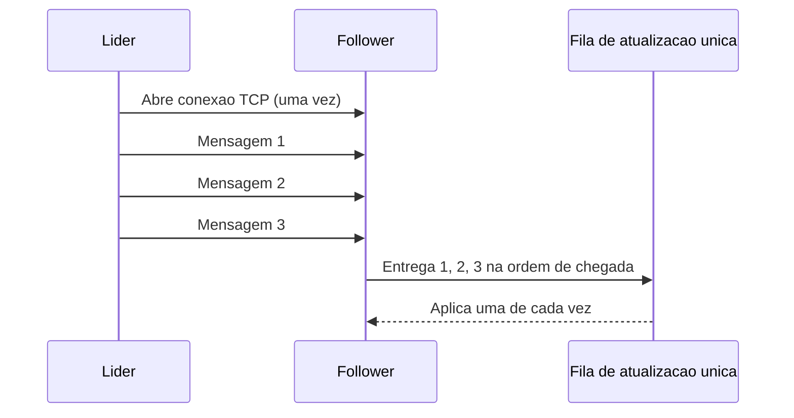

# Single-Socket Channel

## Descrição

O Single-Socket Channel usa uma única conexão TCP, aberta e mantida de forma duradoura, para todo o tráfego entre um par de nós, por exemplo entre um follower e o seu líder. Como o TCP já entrega os bytes em ordem e retransmite pacotes perdidos, as mensagens enviadas por esse canal chegam na sequência em que foram escritas, sem que o protocolo de aplicação precise reimplementar essas garantias.

No nó receptor, as mensagens lidas do canal costumam ser entregues a uma fila de atualização única, que as processa uma de cada vez. Assim a ordem de chegada se transforma em ordem de aplicação, algo essencial para replicação de logs e para a atualização de estado dos followers.

Se a conexão cai, o remetente a reabre e reenvia o que ainda não foi confirmado. Como a conexão é reaproveitada, o custo de estabelecimento (handshake, TLS) é pago uma vez e não a cada mensagem.

## Problemas que resolve

- Mensagens entre líder e follower precisam ser processadas na ordem em que foram enviadas.
- Mensagens perdidas na rede precisam ser retransmitidas sem lógica extra na aplicação.
- Abrir uma conexão por requisição aumenta a latência e o consumo de recursos (portas, descritores, handshakes).
- Conexões paralelas entre o mesmo par de nós podem reordenar mensagens relacionadas.

## Quando usar

- Comunicação contínua entre pares fixos de nós, como líder e followers em [Leader and Followers](../data-replication/leader-and-followers.md).
- Fluxos de replicação em que a ordem das mensagens importa (log replicado, atualizações de estado).
- Quando se deseja ordenação e entrega confiável delegadas ao TCP, em vez de numeração e confirmação próprias.

### Quando evitar

- Quando as mensagens são independentes e a ordem não importa: várias conexões podem render mais vazão.
- Quando uma mensagem grande ou lenta não pode bloquear as demais (head-of-line blocking) e não há como segmentá-las.
- Quando o protocolo já multiplexa fluxos independentes (por exemplo, protocolos baseados em streams), tornando o canal único redundante.

## Trade-offs

| Ganho | Custo / Risco |
| --- | --- |
| Ordenação e entrega confiável fornecidas pelo TCP | Head-of-line blocking: uma mensagem lenta atrasa todas as seguintes |
| Custo de conexão pago uma vez e reaproveitado | A queda da conexão exige reconexão e reenvio do que não foi confirmado |
| Modelo simples de raciocínio sobre a ordem | Um único canal pode limitar a vazão em enlaces de alta latência |

- A ordenação vale por canal: se o nó troca de conexão, é preciso garantir que mensagens antigas não sejam processadas depois das novas.
- É comum combinar o canal com [Heartbeat](../data-replication/heartbeat.md) para detectar conexões mortas.
- A observabilidade é simples, pois há uma conexão por par de nós para monitorar.

## Diagrama

O líder abre uma conexão única com o follower e envia todas as mensagens por ela. O follower as recebe na ordem e as entrega a uma fila que as aplica sequencialmente.

## Padrões relacionados

- [Leader and Followers](../data-replication/leader-and-followers.md) — contexto em que o canal único liga o líder a cada follower.
- [Singular Update Queue](../data-replication/singular-update-queue.md) — serializa no receptor as mensagens que chegam pelo canal.
- [Heartbeat](../data-replication/heartbeat.md) — trafega pelo mesmo canal e ajuda a detectar falhas de conexão.
- [Request Pipeline](./request-pipeline.md) — permite enviar várias requisições pelo canal sem esperar cada resposta.
- [Request Batch](./request-batch.md) — agrupa requisições para reduzir o custo por mensagem no canal.
- [Guaranteed Delivery](../../eip/messaging-channels/guaranteed-delivery.md) (EIP) — garantia de entrega em nível de mensageria, comparável à confiabilidade do TCP.

## Referência

- [Página do padrão no catálogo Patterns of Distributed Systems](https://martinfowler.com/articles/patterns-of-distributed-systems/single-socket-channel.html)
