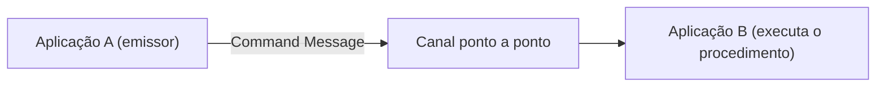

# Command Message

## Descrição

Command Message é uma mensagem comum cujo conteúdo é uma ordem: pede que outra aplicação execute um procedimento. É a forma de obter o efeito de uma chamada remota usando mensageria, com a confiabilidade e o desacoplamento que o canal oferece.

Não existe um tipo especial de mensagem para isso. O comando pode ser um objeto, um texto estruturado ou uma requisição SOAP; o que o caracteriza é a intenção de acionar uma ação no receptor.

## Problemas que resolve

- Uma aplicação precisa invocar funcionalidade de outra, mas prefere os benefícios da mensageria à chamada remota síncrona.
- O invocador não deve falhar só porque o receptor está temporariamente indisponível.
- A invocação deve ser entregue de forma confiável a um único executor.

## Quando usar

- Quando uma aplicação precisa que outra execute uma ação e a execução pode ser assíncrona.
- Quando se quer enfileirar trabalho e absorver picos de carga.
- Normalmente em um canal ponto a ponto, para que só um receptor execute o comando.

### Quando evitar

- Quando o chamador precisa do resultado imediatamente e não tolera espera.
- Quando o que se quer é apenas informar que algo ocorreu (use Event Message).
- Quando a intenção é transferir dados sem ditar o que o receptor fará (use Document Message).

## Trade-offs

| Ganho | Custo / Risco |
| --- | --- |
| Invocação entregue de forma confiável e assíncrona | Resultado não é imediato; exige Request-Reply se houver resposta |
| Receptor indisponível não derruba o emissor | Acoplamento semântico: o emissor conhece a operação do receptor |
| Trabalho pode ser enfileirado e balanceado | Reentrega pode duplicar a execução se o receptor não for idempotente |

- Comandos devem ser tratados com idempotência quando houver reentrega.
- O erro de execução precisa de caminho próprio (resposta ou canal de mensagens inválidas).

## Diagrama

A aplicação A envia um comando por um canal e a aplicação B o executa quando o recebe.

## Padrões relacionados

- [Message](./message.md) — o comando é uma mensagem
- [Document Message](./document-message.md) — transporta dados em vez de ordenar uma ação
- [Event Message](./event-message.md) — notifica um fato em vez de pedir uma ação
- [Request-Reply](./request-reply.md) — usado quando o comando precisa de resposta
- [Point-to-Point Channel](../messaging-channels/point-to-point-channel.md) — garante um único executor
- [Command](../../../coding/gof/behavioral/command.md) — padrão GoF que encapsula uma requisição como objeto

## Referência

- [Página do padrão no Enterprise Integration Patterns](https://www.enterpriseintegrationpatterns.com/CommandMessage.html)
