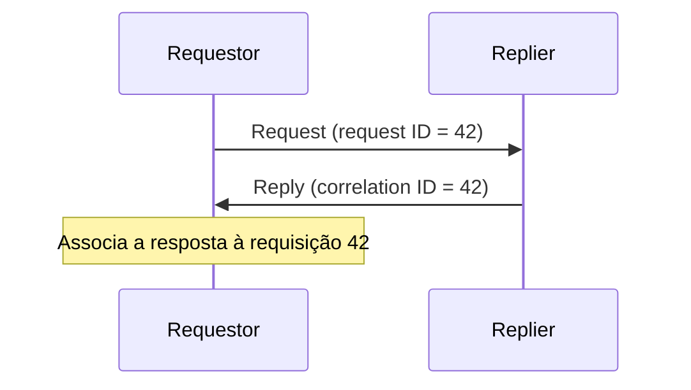

# Correlation Identifier

## Descrição

Correlation Identifier permite que o requestor saiba a qual requisição uma resposta se refere. Cada requisição leva um identificador único; o replier copia esse valor para a resposta como identificador de correlação.

Ao receber a resposta, o requestor compara o identificador de correlação com os identificadores das requisições que enviou e associa cada resposta ao seu contexto. Os elementos são: requestor, replier, requisição, resposta, request ID e correlation ID.

## Problemas que resolve

- Em mensageria assíncrona, várias requisições ficam em voo ao mesmo tempo.
- Respostas podem chegar fora de ordem.
- O requestor precisa ligar cada resposta à requisição original para retomar o contexto.

## Quando usar

- Em qualquer Request-Reply com mais de uma requisição pendente.
- Em fluxos com várias etapas, para agrupar mensagens de uma mesma conversa.
- Para rastrear uma transação entre componentes.

### Quando evitar

- Quando há só uma requisição pendente por canal de resposta e a ordem é garantida.
- Quando não há resposta a correlacionar.

## Trade-offs

| Ganho | Custo / Risco |
| --- | --- |
| Respostas associadas corretamente, mesmo fora de ordem | Requestor precisa guardar o estado das requisições pendentes |
| Permite concorrência e callbacks assíncronos | Replier deve sempre copiar o identificador |
| Base para rastreamento de conversas | Identificadores duplicados ou perdidos quebram a associação |

- Gere identificadores únicos (por exemplo UUID).
- Propague o identificador em logs para facilitar a investigação.

## Diagrama

O replier devolve o mesmo identificador, e o requestor o usa para encontrar a requisição original.

## Padrões relacionados

- [Request-Reply](./request-reply.md) — contexto principal de uso
- [Return Address](./return-address.md) — informa o destino, enquanto o identificador informa a origem
- [Message Sequence](./message-sequence.md) — também usa identificadores para agrupar mensagens
- [Message](./message.md) — o identificador vive no cabeçalho
- [Distributed Tracing](../../microservices/observability/distributed-tracing.md) — propaga identificadores para rastrear chamadas entre serviços

## Referência

- [Página do padrão no Enterprise Integration Patterns](https://www.enterpriseintegrationpatterns.com/CorrelationIdentifier.html)
