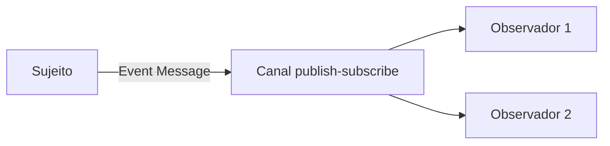

# Event Message

## Descrição

Event Message é uma mensagem que notifica, de forma assíncrona, que algo aconteceu. O sujeito empacota o evento em uma mensagem e a publica em um canal; o observador a recebe, extrai o evento e reage.

O foco está no fato de o evento ter ocorrido, e não no volume de dados. Muitos eventos nem carregam conteúdo: a mera chegada da mensagem já sinaliza ao observador que deve agir. Por isso o tempo importa: o evento deve ser publicado logo e processado enquanto ainda é relevante.

## Problemas que resolve

- Aplicações precisam coordenar ações reagindo a mudanças umas das outras.
- Evitar acoplamento forte entre quem muda de estado e quem precisa saber disso.
- Entregar notificações com baixa latência a um ou vários observadores.

## Quando usar

- Para notificar mudanças de estado a observadores interessados.
- Com um canal publish-subscribe, quando vários consumidores reagem ao mesmo evento.
- Com Message Expiration, quando eventos antigos perdem a utilidade.

### Quando evitar

- Quando o receptor precisa receber dados completos e confiáveis (use Document Message).
- Quando se quer comandar uma ação específica (use Command Message).
- Quando todo evento precisa ser entregue sem perda; eventos frequentes e sensíveis ao tempo raramente justificam Guaranteed Delivery, mas se a perda for inaceitável, reavalie.

## Trade-offs

| Ganho | Custo / Risco |
| --- | --- |
| Baixo acoplamento entre sujeito e observadores | Difícil saber quem reage a cada evento |
| Notificação rápida e assíncrona | Eventos perdidos ou atrasados podem deixar observadores desatualizados |
| Fácil adicionar novos observadores | Fluxo de negócio distribuído é mais difícil de rastrear |

- Eventos pequenos pedem que o observador consulte a fonte para obter detalhes.
- Defina expiração para descartar eventos obsoletos.

## Diagrama

O sujeito publica o evento uma vez e cada observador o recebe e reage.

## Padrões relacionados

- [Message](/architecture/eip/message-construction/message) — o evento é transportado como mensagem
- [Document Message](/architecture/eip/message-construction/document-message) — usado quando o conteúdo importa mais que o momento
- [Command Message](/architecture/eip/message-construction/command-message) — pede uma ação em vez de relatar um fato
- [Message Expiration](/architecture/eip/message-construction/message-expiration) — descarta eventos que perderam a validade
- [Publish-Subscribe Channel](/architecture/cloud-design-patterns/messaging/publisher-subscriber) — entrega o evento a vários observadores
- [Guaranteed Delivery](/architecture/eip/messaging-channels/guaranteed-delivery) — raramente adequado para eventos frequentes
- [Domain Event](/architecture/microservices/service-collaboration/domain-event) — evento de domínio publicado entre serviços

## Referência

- [Página do padrão no Enterprise Integration Patterns](https://www.enterpriseintegrationpatterns.com/EventMessage.html)
