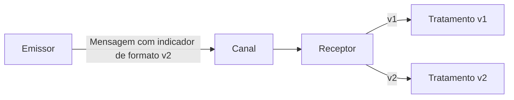

# Format Indicator

## Descrição

Format Indicator inclui em cada mensagem um marcador que identifica o formato de seus dados. O receptor lê o marcador para saber como interpretar o conteúdo, o que permite tratar vários formatos ao mesmo tempo e evoluir o formato sem quebrar os participantes.

Há três maneiras de construir o marcador: um número de versão, que ambos os lados precisam saber interpretar; uma chave estrangeira (nome de arquivo, chave de banco ou URL) que aponta para um documento de formato; ou um documento de formato embutido na própria mensagem, por exemplo um schema, caso em que ambos precisam concordar com a linguagem do schema.

## Problemas que resolve

- O formato dos dados, mesmo um modelo canônico, mudará com o tempo.
- Emissores e receptores evoluem em ritmos diferentes e precisam continuar se entendendo.
- Um receptor pode precisar aceitar mais de uma versão ao mesmo tempo.

## Quando usar

- Quando o formato das mensagens tende a mudar.
- Quando coexistem várias versões de emissores e receptores.
- Em integrações de longa duração, com ciclos de implantação independentes.

### Quando evitar

- Quando o formato é fixo e todos os participantes são atualizados juntos.
- Quando a evolução pode ser feita apenas com campos opcionais compatíveis, sem identificar versões.

## Trade-offs

| Ganho | Custo / Risco |
| --- | --- |
| Evolução do formato sem quebrar consumidores | Receptores precisam manter suporte a várias versões |
| Receptor escolhe o tratamento correto | Necessidade de acordar o significado do indicador |
| Documento embutido dispensa consulta externa | Mensagens maiores com schema embutido |

- Versões antigas devem ter política de descontinuação.
- Use um Message Translator para converter versões antigas para a atual.

## Diagrama

O receptor lê o indicador de formato e escolhe o tratamento adequado.

## Padrões relacionados

- [Message](/architecture/eip/message-construction/message) — o indicador vai no cabeçalho
- [Canonical Data Model](/architecture/eip/message-transformation/canonical-data-model) — formato comum cuja evolução o indicador viabiliza
- [Message Translator](/architecture/eip/message-transformation/message-translator) — converte entre versões de formato
- [Document Message](/architecture/eip/message-construction/document-message) — documentos costumam exigir versionamento

## Referência

- [Página do padrão no Enterprise Integration Patterns](https://www.enterpriseintegrationpatterns.com/FormatIndicator.html)
