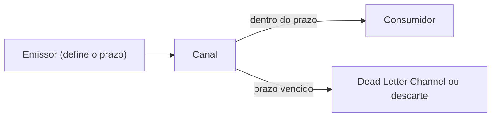

# Message Expiration

## Descrição

Message Expiration permite ao emissor definir por quanto tempo uma mensagem continua válida. Se ela não for consumida dentro do prazo, expira, e os consumidores a ignoram como se nunca tivesse sido enviada.

Muitos sistemas redirecionam mensagens expiradas para um Dead Letter Channel; outros simplesmente as descartam, às vezes por configuração. Um receptor que perceba que não conseguirá concluir o processamento antes do prazo também deve descartar a mensagem.

## Problemas que resolve

- Mensagens que só têm utilidade se processadas rapidamente.
- Processar dados ou pedidos obsoletos desperdiça recursos e pode gerar resultados errados.
- Destinos com vazão limitada acumulam filas de mensagens que já perderam o valor.

## Quando usar

- Pedidos ou dados que perdem o valor após um prazo.
- Destinos com limite de taxa, como endpoints HTTP, em que o backlog cresce.
- Para evitar agir sobre instruções desatualizadas.

### Quando evitar

- Quando toda mensagem deve ser processada, por mais tarde que seja.
- Quando assinantes que entram depois precisam receber mensagens antigas; nesse caso prefira retenção maior ou assinaturas duráveis.

## Trade-offs

| Ganho | Custo / Risco |
| --- | --- |
| Evita processar mensagens obsoletas | Mensagens úteis podem ser perdidas se o prazo for curto demais |
| Reduz backlog e custo de processamento | Escolher descartar ou enviar à dead letter afeta a recuperação |
| Protege destinos lentos | Relógios dessincronizados distorcem o prazo |

- Em geral o prazo mais cedo entre mensagem e fila prevalece.
- Monitore o volume de mensagens expiradas como sinal de consumidores lentos.

## Diagrama

Mensagens dentro do prazo vão ao consumidor; as vencidas são descartadas ou desviadas.

## Padrões relacionados

- [Dead Letter Channel](/architecture/eip/messaging-channels/dead-letter-channel) — destino comum das mensagens expiradas
- [Invalid Message Channel](/architecture/eip/messaging-channels/invalid-message-channel) — destino de mensagens que o receptor não consegue tratar
- [Guaranteed Delivery](/architecture/eip/messaging-channels/guaranteed-delivery) — preocupação oposta: não perder mensagens
- [Publish-Subscribe Channel](/cloud/cloud-design-patterns/messaging/publisher-subscriber) — assinantes tardios podem precisar de mensagens antigas
- [Event Message](/architecture/eip/message-construction/event-message) — eventos obsoletos são bons candidatos à expiração
- [Request-Reply](/architecture/eip/message-construction/request-reply) — requisições vencidas não devem ser atendidas
- [Message](/architecture/eip/message-construction/message) — o prazo vai no cabeçalho

## Referência

- [Página do padrão no Enterprise Integration Patterns](https://www.enterpriseintegrationpatterns.com/MessageExpiration.html)
