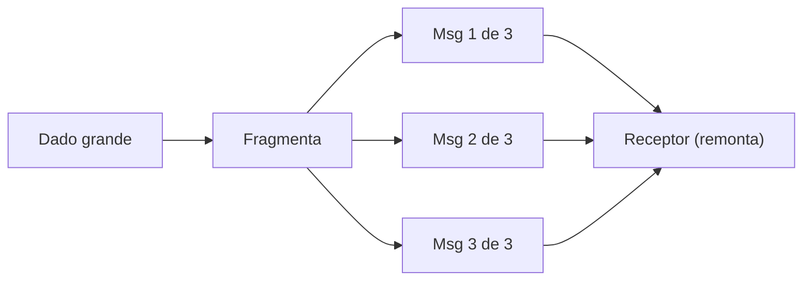

# Message Sequence

## Descrição

Message Sequence trata dados grandes demais para caber em uma única mensagem. Os dados são divididos em pedaços do tamanho de uma mensagem e enviados como uma sequência.

Cada mensagem leva três campos: um identificador de sequência, que agrupa as mensagens de um mesmo conjunto; um identificador de posição, que ordena a mensagem dentro do conjunto; e o tamanho total ou um marcador de fim na última mensagem. O receptor usa esses campos para remontar o dado original.

## Problemas que resolve

- Enviar uma quantidade arbitrariamente grande de dados por mensageria.
- Devolver uma resposta grande demais para uma única mensagem.
- Permitir ao receptor saber quando recebeu o conjunto completo.

## Quando usar

- Quando o payload excede o limite de tamanho do sistema de mensageria.
- Quando uma resposta a uma requisição precisa ser fragmentada.
- Quando o dado pode ser processado e remontado em partes.

### Quando evitar

- Quando é possível guardar o dado em um armazenamento e enviar só uma referência (Claim Check).
- Quando a ordem e a completude não podem ser garantidas pela infraestrutura e não há como remontar.

## Trade-offs

| Ganho | Custo / Risco |
| --- | --- |
| Transfere dados de qualquer tamanho | Receptor precisa remontar e lidar com mensagens faltantes |
| Cada mensagem é pequena e rápida de enviar | Ordem e completude exigem controle explícito |
| Permite processamento em partes | Consumidores concorrentes complicam a remontagem |

- Reúna as partes de uma sequência no mesmo consumidor, ou use um Resequencer.
- Defina o que fazer se uma parte nunca chegar, por exemplo com expiração.

## Diagrama

O dado é dividido em mensagens numeradas dentro da mesma sequência e o receptor as remonta.

## Padrões relacionados

- [Splitter](../message-routing/splitter.md) — divide uma mensagem em várias
- [Resequencer](../message-routing/resequencer.md) — restaura a ordem das mensagens
- [Aggregator](../message-routing/aggregator.md) — reúne mensagens relacionadas em uma
- [Claim Check](../../../cloud/azure/messaging/claim-check.md) — alternativa que envia só uma referência ao dado
- [Correlation Identifier](./correlation-identifier.md) — também agrupa mensagens por identificador
- [Request-Reply](./request-reply.md) — a resposta pode vir em sequência
- [Sequential Convoy](../../../cloud/azure/messaging/sequential-convoy.md) — processa mensagens relacionadas em ordem no Azure

## Referência

- [Página do padrão no Enterprise Integration Patterns](https://www.enterpriseintegrationpatterns.com/MessageSequence.html)
