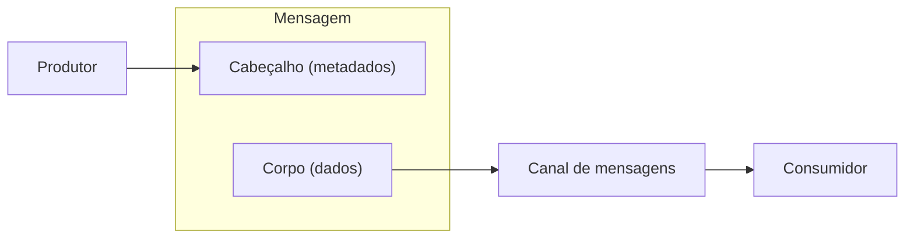

# Message

## Descrição

Message é a unidade básica de troca em integração por mensageria: um registro de dados que o sistema de mensageria sabe transportar por um canal. Qualquer informação que duas aplicações precisem compartilhar deve ser empacotada em uma ou mais mensagens antes de ser enviada.

Uma mensagem tem duas partes. O cabeçalho carrega metadados usados pela infraestrutura, como origem, destino e o tipo do dado. O corpo carrega o dado propriamente dito, que o sistema de mensageria em geral não inspeciona e entrega sem alterações.

## Problemas que resolve

- Aplicações conectadas por um canal precisam de um formato comum para trocar informação.
- A infraestrutura precisa de metadados de roteamento sem interpretar o conteúdo de negócio.
- O dado de negócio deve trafegar intacto entre produtor e consumidor.

## Quando usar

- Sempre que duas aplicações se comunicam por meio de um canal de mensagens.
- Quando se quer separar metadados de transporte do conteúdo de negócio.

### Quando evitar

- Quando uma chamada síncrona direta resolve o caso e não há necessidade de desacoplamento temporal.
- Para volumes de dados muito grandes que não cabem em uma mensagem; nesse caso use sequência de mensagens ou referência ao dado.

## Trade-offs

| Ganho | Custo / Risco |
| --- | --- |
| Desacoplamento entre produtor e consumidor | Necessidade de acordar formato e semântica do corpo |
| Metadados separados do conteúdo facilitam roteamento | Cabeçalhos mal definidos geram acoplamento oculto |
| Transporte uniforme independente do dado | Limites de tamanho exigem fragmentação ou referência |

- Converter dados de domínio em mensagens e de volta adiciona custo de serialização.
- Padronizar cabeçalhos (identificadores, expiração, formato) melhora a observabilidade.

## Diagrama

O produtor empacota o dado em uma mensagem com cabeçalho e corpo e a envia por um canal até o consumidor.

## Padrões relacionados

- [Message Channel](/architecture/eip/messaging-channels/message-channel) — caminho pelo qual as mensagens trafegam
- [Command Message](/architecture/eip/message-construction/command-message) — mensagem que pede uma ação
- [Document Message](/architecture/eip/message-construction/document-message) — mensagem que transporta dados
- [Event Message](/architecture/eip/message-construction/event-message) — mensagem que notifica um acontecimento
- [Request-Reply](/architecture/eip/message-construction/request-reply) — troca de mensagens em par
- [Message Sequence](/architecture/eip/message-construction/message-sequence) — divide dados grandes em várias mensagens
- [Message Expiration](/architecture/eip/message-construction/message-expiration) — limita a validade da mensagem
- [Canonical Data Model](/architecture/eip/message-transformation/canonical-data-model) — formato comum para o corpo

## Referência

- [Página do padrão no Enterprise Integration Patterns](https://www.enterpriseintegrationpatterns.com/Message.html)
