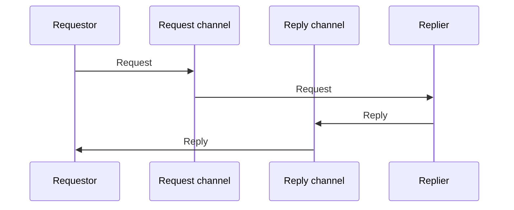

# Request-Reply

## Descrição

A mensageria é naturalmente unidirecional. Request-Reply resolve o caso em que o emissor precisa de uma resposta usando um par de mensagens, cada uma em seu próprio canal: o requestor envia a requisição por um canal de requisição e o replier devolve a resposta por um canal de resposta.

O canal de requisição pode ser ponto a ponto (um único consumidor atende) ou publish-subscribe. O canal de resposta quase sempre é ponto a ponto, pois só o requestor deve recebê-la. O requestor pode esperar de forma síncrona, bloqueando a thread, ou de forma assíncrona, com um callback acionado por outra thread.

Atenção: não confundir com o Asynchronous Request-Reply do Azure, que usa HTTP 202 e polling de status. Aqui a resposta chega por um segundo canal de mensagens.

## Problemas que resolve

- O emissor de uma mensagem precisa receber uma resposta do receptor.
- Manter o desacoplamento da mensageria mesmo em interações de pergunta e resposta.
- Permitir várias requisições em andamento compartilhando o mesmo canal de resposta.

## Quando usar

- Quando uma operação via mensagens precisa devolver resultado ao solicitante.
- Espera síncrona: casos simples, com uma requisição pendente por vez.
- Espera assíncrona: várias requisições concorrentes ou necessidade de se recuperar de falhas do requestor.

### Quando evitar

- Quando não há resposta a devolver; basta Command Message ou Event Message.
- Quando o requestor não pode ficar acoplado ao tempo de resposta do replier.

## Trade-offs

| Ganho | Custo / Risco |
| --- | --- |
| Resposta obtida sem perder o desacoplamento do canal | Dois canais e correlação entre mensagens para gerenciar |
| Callback assíncrono permite concorrência e recuperação | Restaurar o contexto do chamador no callback dá trabalho |
| Espera síncrona é simples | Thread bloqueada é difícil de restaurar se o requestor cair |

- Requer Correlation Identifier para associar respostas às requisições.
- Requer Return Address quando o destino da resposta varia por requisição.
- Defina expiração e timeout para não esperar indefinidamente.

## Diagrama

O requestor envia a requisição por um canal e recebe a resposta por outro.

## Padrões relacionados

- [Return Address](./return-address.md) — informa ao replier onde responder
- [Correlation Identifier](./correlation-identifier.md) — liga cada resposta à sua requisição
- [Command Message](./command-message.md) — a requisição costuma ser um comando
- [Document Message](./document-message.md) — a resposta costuma ser um documento
- [Message Expiration](./message-expiration.md) — evita requisições que perderam o prazo
- [Point-to-Point Channel](../messaging-channels/point-to-point-channel.md) — canal típico da resposta
- [Asynchronous Request-Reply](../../../cloud/cloud-design-patterns/messaging/asynchronous-request-reply.md) — variante do Azure baseada em HTTP 202 e polling, diferente do par de canais do EIP

## Referência

- [Página do padrão no Enterprise Integration Patterns](https://www.enterpriseintegrationpatterns.com/RequestReply.html)
