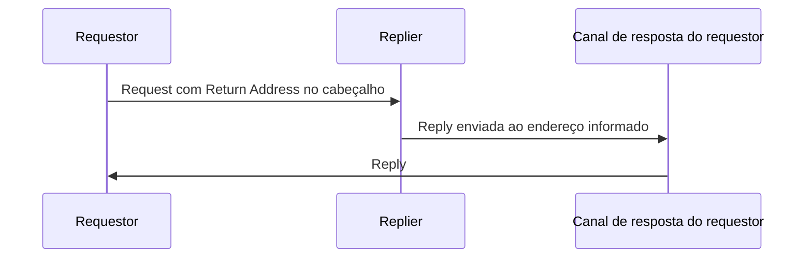

# Return Address

## Descrição

Return Address faz o requestor indicar, na própria mensagem de requisição, para onde a resposta deve ser enviada. Por ser informação de roteamento e não dado de negócio, o endereço vai no cabeçalho.

O replier lê o endereço de cada requisição e responde nele, sem precisar conhecer de antemão os destinos de resposta. O conhecimento sobre quais canais usar fica com o requestor.

## Problemas que resolve

- O replier não deve ter destinos de resposta fixos no código.
- Requisições diferentes podem exigir respostas em lugares diferentes.
- Quem decide os canais de resposta deve ser o requestor.

## Quando usar

- Em Request-Reply em que vários requestors usam o mesmo replier.
- Quando um mesmo requestor quer receber respostas em canais distintos conforme o caso.

### Quando evitar

- Quando todas as respostas vão sempre para um único destino conhecido; um canal fixo basta.
- Quando não há resposta a enviar.

## Trade-offs

| Ganho | Custo / Risco |
| --- | --- |
| Replier genérico, reutilizável por muitos requestors | O replier passa a confiar em um destino vindo da mensagem |
| Requestor controla onde recebe as respostas | Endereços inválidos ou obsoletos geram respostas perdidas |
| Sem configuração de destinos no replier | Exige criar e gerenciar canais de resposta |

- Valide ou restrinja os endereços aceitos, para evitar redirecionar respostas a destinos indevidos.
- Combine com Correlation Identifier para associar a resposta à requisição.

## Diagrama

O replier responde no canal indicado pelo cabeçalho da requisição.

## Padrões relacionados

- [Request-Reply](/architecture/eip/message-construction/request-reply) — padrão que depende de um destino de resposta
- [Correlation Identifier](/architecture/eip/message-construction/correlation-identifier) — associa a resposta à requisição
- [Message](/architecture/eip/message-construction/message) — o endereço vai no cabeçalho
- [Message Channel](/architecture/eip/messaging-channels/message-channel) — o endereço aponta para um canal

## Referência

- [Página do padrão no Enterprise Integration Patterns](https://www.enterpriseintegrationpatterns.com/ReturnAddress.html)
