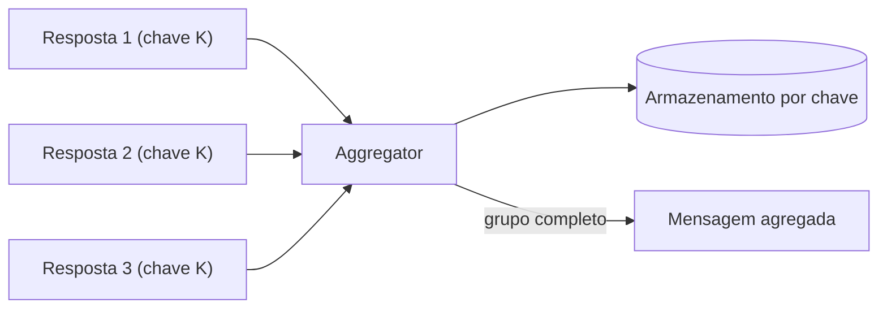

# Aggregator

## Descrição

O Aggregator é um filtro com estado que fica entre o fluxo de mensagens de entrada e a próxima etapa. Ele armazena mensagens que compartilham uma chave de correlação e, quando uma condição de completude é atendida, as combina em uma nova mensagem, publicada no canal de saída.

É necessário quando Splitters, Recipient Lists ou canais publish-subscribe produzem várias mensagens relacionadas, muitas vezes processadas em paralelo, e o passo seguinte depende de todas elas: escolher a melhor oferta entre fornecedores, ou cobrar o cliente só depois que todos os itens forem separados.

Três decisões moldam o padrão: como correlacionar, quando considerar o grupo completo e como combinar o conteúdo.

## Problemas que resolve

- Identificar quais mensagens pertencem ao mesmo grupo
- Decidir quando já há mensagens suficientes para produzir um resultado
- Combinar respostas dispersas em uma única mensagem
- Lidar com respostas atrasadas ou ausentes em sistemas assíncronos

## Quando usar

- Resultados paralelos precisam ser consolidados antes da etapa seguinte
- Após um Splitter, para remontar o resultado
- Em leilões ou cotações, para escolher a melhor resposta

### Quando evitar

- Há uma única resposta por requisição; basta o padrão de requisição-resposta
- Não há como correlacionar ou saber quando o grupo termina

## Trade-offs

| Ganho | Custo / Risco |
| --- | --- |
| Um único resultado a partir de muitas mensagens | Precisa manter estado e armazenamento confiável |
| Controle de completude conforme o negócio | Mensagens ausentes podem bloquear o grupo |
| Permite paralelismo a montante | Contenção de armazenamento com muitos grupos simultâneos |

Estratégias de completude:

- **Esperar todas:** dados completos, porém lento e frágil.
- **Timeout:** decide com o que chegou no prazo; precisa de plano se nada chegar.
- **Primeira melhor:** age na primeira resposta e descarta o resto.
- **Timeout com override:** encerra cedo se uma resposta atinge a qualidade desejada.
- **Evento externo:** o fechamento vem de um evento de negócio, como o fim do dia.

## Diagrama

O Aggregator guarda as mensagens por chave de correlação e publica uma única mensagem quando o grupo satisfaz a condição de completude.

## Padrões relacionados

- [Splitter](./splitter.md) — gera as partes que serão recombinadas
- [Scatter-Gather](./scatter-gather.md) — usa um Aggregator para reunir as respostas
- [Composed Message Processor](./composed-message-processor.md) — Splitter, roteamento e Aggregator juntos
- [Resequencer](./resequencer.md) — também é filtro com estado, mas só reordena
- [Correlation Identifier](../message-construction/correlation-identifier.md) — chave que agrupa as mensagens
- [Gateway Aggregation](../../../cloud/cloud-design-patterns/gateways-and-edge/gateway-aggregation.md) — agregação de chamadas em um gateway
- [API Composition](../../microservices/service-collaboration/api-composition.md) — composição de dados de vários serviços

## Referência

- [Página do padrão no Enterprise Integration Patterns](https://www.enterpriseintegrationpatterns.com/Aggregator.html)
