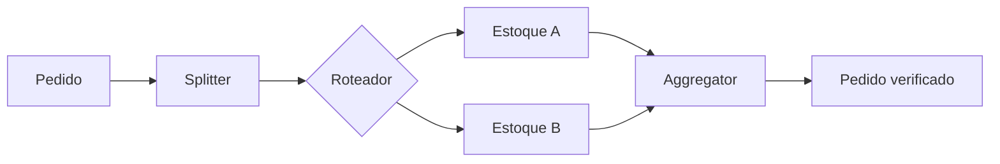

# Composed Message Processor

## Descrição

O Composed Message Processor trata uma mensagem composta: divide-a em submensagens, envia cada uma ao destino adequado e depois mescla as respostas em uma única mensagem. Um Aggregator reúne as respostas, por exemplo dos sistemas de estoque, e as combina segundo uma regra predefinida.

É uma composição de padrões: um Splitter separa as partes, um roteador (como um Content-Based Router) as distribui, e o Aggregator as recompõe. O fluxo geral continua coerente: o pedido só segue adiante quando cada item foi verificado.

## Problemas que resolve

- Cada parte de uma mensagem precisa ser tratada separadamente, possivelmente por sistemas diferentes
- As partes devem ser recombinadas antes de a mensagem completa prosseguir
- O processo precisa esperar todas as partes

## Quando usar

- Pedidos ou documentos com itens que exigem verificações em sistemas distintos
- O resultado final depende de todas as respostas parciais

### Quando evitar

- Todas as partes vão ao mesmo processador e podem ser tratadas em bloco
- O fluxo é dinâmico ou depende de resultados intermediários; considere o [Process Manager](/architecture/eip/message-routing/process-manager)

## Trade-offs

| Ganho | Custo / Risco |
| --- | --- |
| Composição de padrões simples e reutilizáveis | Combinação de várias peças a operar |
| Paralelismo no tratamento das partes | Estado e correlação no Aggregator |
| Fluxo coerente para o chamador | Falha de uma parte afeta o todo |

- **Completude:** escolha a estratégia do Aggregator (todas, timeout etc.).
- **Erros parciais:** defina se o pedido falha por inteiro ou parcialmente.

## Diagrama

O pedido é dividido, cada item vai ao estoque correto e as respostas são reunidas em um pedido verificado.

## Padrões relacionados

- [Splitter](/architecture/eip/message-routing/splitter) — divide a mensagem
- [Content-Based Router](/architecture/eip/message-routing/content-based-router) — distribui as partes
- [Aggregator](/architecture/eip/message-routing/aggregator) — reúne as respostas
- [Scatter-Gather](/architecture/eip/message-routing/scatter-gather) — padrão parente que envia a mesma mensagem a vários destinos
- [Process Manager](/architecture/eip/message-routing/process-manager) — alternativa para fluxos dinâmicos

## Referência

- [Página do padrão no Enterprise Integration Patterns](https://www.enterpriseintegrationpatterns.com/DistributionAggregate.html)
