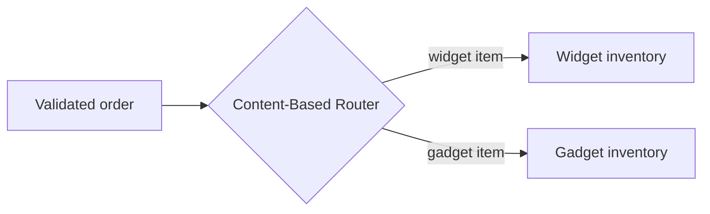

# Content-Based Router

## Descrição

O Content-Based Router examina o conteúdo de cada mensagem e a envia para um canal escolhido a partir dos dados dela. Os critérios podem ser a existência de um campo, o valor de um campo ou uma combinação de verificações.

O exemplo clássico é um pedido que, depois de validado, precisa de uma checagem de estoque. Se existem vários sistemas de estoque, cada um responsável por certos itens, o roteador lê o item do pedido e o encaminha ao sistema correto, de modo que uma função lógica implementada por vários sistemas físicos seja vista como uma só.

Em cenários mais sofisticados, o roteador evolui para um mecanismo de regras configuráveis.

## Problemas que resolve

- Uma função lógica está distribuída entre vários sistemas, cada um tratando um subconjunto das mensagens
- O destino correto depende de dados dentro da mensagem
- Remetentes não devem conhecer a topologia dos destinatários

## Quando usar

- O destino varia conforme tipo, valor ou presença de campos da mensagem
- É preciso esconder do remetente a divisão de responsabilidades entre sistemas
- As regras de roteamento mudam e precisam ficar em um único lugar

### Quando evitar

- O destino pode ser decidido pelo remetente de forma trivial
- Os destinatários precisam se registrar dinamicamente; considere o [Dynamic Router](./dynamic-router.md)
- Os destinatários mudam com frequência e o roteador viraria um ponto de alteração constante

## Trade-offs

| Ganho | Custo / Risco |
| --- | --- |
| Roteamento adaptado ao conteúdo | O roteador depende do formato das mensagens e dos destinos |
| Regras centralizadas e configuráveis | Pode exigir alterações frequentes quando surgem novos destinos |
| Remetente alheio à topologia | Motor de regras adiciona complexidade |

- **Manutenção:** projete o roteador para ser fácil de alterar, pois ele tende a ser um ponto quente de mudança.
- **Mensagens sem regra:** defina um destino padrão ou um canal de mensagens inválidas.

## Diagrama

O roteador lê o item do pedido e o encaminha ao sistema de estoque responsável por ele.

## Padrões relacionados

- [Message Router](./message-router.md) — padrão genérico do qual este é uma variante
- [Message Filter](./message-filter.md) — descarta em vez de escolher entre destinos
- [Dynamic Router](./dynamic-router.md) — regras registradas pelos próprios destinatários
- [Recipient List](./recipient-list.md) — quando a lista de destinatários é calculada
- [Gateway Routing](../../../cloud/cloud-design-patterns/gateways-and-edge/gateway-routing.md) — roteamento de requisições por caminho ou cabeçalho em um gateway

## Referência

- [Página do padrão no Enterprise Integration Patterns](https://www.enterpriseintegrationpatterns.com/ContentBasedRouter.html)
