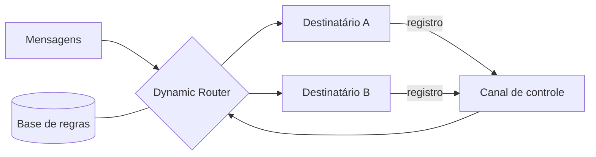

# Dynamic Router

## Descrição

O Dynamic Router é um roteador que monta suas próprias regras em tempo de execução. Além dos canais normais de mensagens, ele tem um canal de controle. Cada destinatário potencial envia ali uma mensagem de registro, informando que existe e em que condições pode tratar uma mensagem.

O roteador guarda essas condições em uma base de regras. Ao chegar uma mensagem, avalia as regras e a encaminha ao destinatário cujas condições ela satisfaz. O conhecimento sobre os destinos vem dos próprios destinatários, não de configuração no roteador.

## Problemas que resolve

- Um roteador que conhece todos os destinos fica acoplado a eles
- Adicionar, remover ou alterar um destinatário obriga a alterar o roteador
- É preciso manter o roteamento eficiente e direcionado, sem broadcast

## Quando usar

- Os destinatários são desenvolvidos e implantados de forma independente
- O conjunto de destinos muda com frequência ou em tempo de execução
- Quer-se eliminar a dependência do roteador em relação a uma lista fixa

### Quando evitar

- Os destinos e regras são estáveis; um Content-Based Router é mais simples
- Não há como garantir que os registros sejam confiáveis ou autenticados

## Trade-offs

| Ganho | Custo / Risco |
| --- | --- |
| Roteador desacoplado dos destinatários | Estado de regras precisa ser mantido e persistido |
| Novos destinatários entram só registrando-se | Registros obsoletos ou maliciosos podem desviar mensagens |
| Menos manutenção no roteador | Comportamento mais difícil de prever e depurar |

- **Cancelamento de registro:** trate saída e falha de destinatários, para não rotear para quem não existe mais.
- **Inicialização:** o roteador precisa lidar com mensagens que chegam antes dos registros.

## Diagrama

Os destinatários registram suas condições no canal de controle e o roteador usa essas regras para encaminhar as mensagens.

## Padrões relacionados

- [Message Router](./message-router.md) — padrão genérico
- [Content-Based Router](./content-based-router.md) — versão com regras fixas
- [Recipient List](./recipient-list.md) — a lista de destinatários pode vir das regras registradas
- [Control Bus](../system-management/control-bus.md) — canal de controle para administrar o fluxo

## Referência

- [Página do padrão no Enterprise Integration Patterns](https://www.enterpriseintegrationpatterns.com/DynamicRouter.html)
