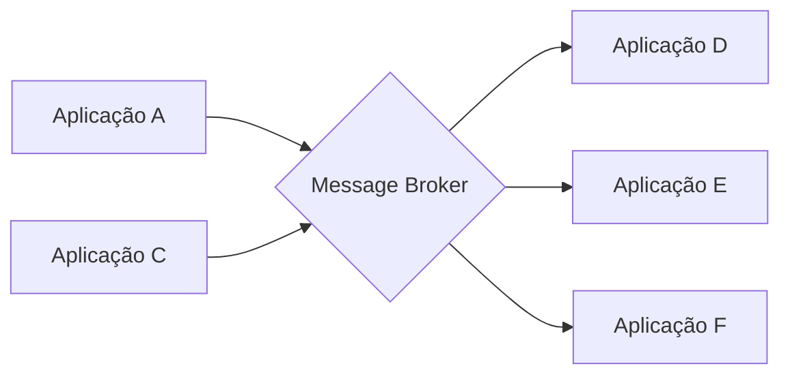

# Message Broker

## Descrição

O Message Broker coloca um intermediário central entre remetentes e receptores. Ele aceita mensagens de muitas origens, determina o destino correto de cada uma e a encaminha ao canal apropriado. É uma arquitetura hub-and-spoke que desacopla o destino da mensagem de seu remetente, mantendo controle central do fluxo.

Não é um componente único, e sim um padrão arquitetural construído internamente com os padrões de roteamento (Content-Based Router, Message Translator e outros). Pode-se compará-lo ao Pipes and Filters, mas em escala de solução inteira.

Para escalar, um broker sem estado pode rodar em várias instâncias, consumindo de um Point-to-Point Channel. Também é possível usar uma hierarquia: brokers locais tratam o tráfego do seu subsistema e repassam o resto a um broker central.

## Problemas que resolve

- Desacoplar o destino da mensagem de quem a envia mantendo controle central
- Evitar que remetentes conheçam a topologia dos receptores
- Concentrar a lógica de roteamento de uma integração grande

## Quando usar

- Muitas aplicações trocam mensagens e a lógica de roteamento deve ficar centralizada
- Quer-se um ponto único de gestão do fluxo
- É preciso desacoplar subsistemas inteiros

### Quando evitar

- Poucos participantes, sem necessidade de intermediário
- Um broker único viraria gargalo e ponto único de falha
- O roteamento ficaria tão complexo que seria melhor distribuí-lo por contexto

## Trade-offs

| Ganho | Custo / Risco |
| --- | --- |
| Remetentes e receptores desacoplados | Gargalo e ponto único de falha |
| Lógica de roteamento mantida em um lugar | Um broker monolítico fica difícil de manter |
| Escala com instâncias sem estado ou hierarquia | Vários brokers podem gerar "spaghetti" de roteamento |

- **Hierarquia:** brokers locais e central reduzem a complexidade por subsistema.
- **Governança:** documente as regras de roteamento para evitar fluxos emaranhados.

## Diagrama

As aplicações enviam mensagens ao broker, que decide o destino de cada uma.

## Padrões relacionados

- [Message Router](/architecture/eip/message-routing/message-router) — peça com a qual o broker é construído
- [Content-Based Router](/architecture/eip/message-routing/content-based-router) — critério de roteamento típico do broker
- [Process Manager](/architecture/eip/message-routing/process-manager) — outro hub central, com estado de processo
- [Message Bus](/architecture/eip/messaging-channels/message-bus) — alternativa de arquitetura de integração
- [Mediator](/coding/gof/behavioral/mediator) — mesmo princípio em design de classes
- [Pipes and Filters](/cloud/cloud-design-patterns/messaging/pipes-and-filters) — estilo comparável em escala menor

## Referência

- [Página do padrão no Enterprise Integration Patterns](https://www.enterpriseintegrationpatterns.com/MessageBroker.html)
