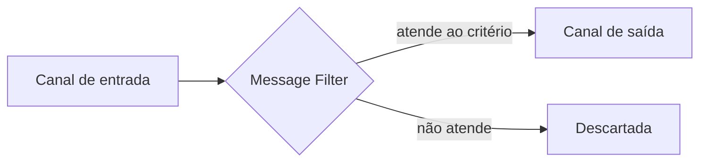

# Message Filter

## Descrição

O Message Filter é um roteador especializado com um único canal de saída. Se o conteúdo da mensagem atende aos critérios do filtro, ela passa adiante; caso contrário, é descartada.

Serve para que um componente não receba mensagens que não lhe interessam. No exemplo clássico, a gerência publica mudanças de preço e promoções a grandes clientes, mas cada cliente quer saber apenas dos itens que compra. O filtro aplica essa preferência de modo consistente, sem que o remetente conheça o interesse de cada um.

Muitos brokers implementam o padrão por meio de vínculos entre filas e chaves de roteamento: a chave do vínculo age como filtro.

## Problemas que resolve

- Destinatários recebem mensagens irrelevantes quando o remetente faz broadcast
- O remetente não deve conhecer as preferências de cada destinatário
- O critério de interesse precisa ser aplicado de forma uniforme

## Quando usar

- Parte das mensagens de um canal não interessa a um consumidor
- A relevância pode ser decidida pelo conteúdo da mensagem
- Quer-se reduzir tráfego e processamento desnecessários

### Quando evitar

- A mensagem descartada ainda é necessária em outro ponto; use um roteador com mais de uma saída
- O descarte silencioso esconderia erros importantes; prefira um canal de mensagens inválidas

## Trade-offs

| Ganho | Custo / Risco |
| --- | --- |
| Consumidores recebem apenas o que importa | Mensagens descartadas se perdem se o critério estiver errado |
| Menos carga e custo de processamento | Mais um componente para operar |
| Remetente desacoplado das preferências | Regras de filtro espalhadas dificultam o entendimento |

- **Auditoria:** registre ou conte as mensagens descartadas para detectar filtros mal configurados.
- **Alternativa:** um Selective Consumer filtra no próprio consumidor, em vez de em um componente separado.

## Diagrama

O filtro deixa passar somente as mensagens que satisfazem o critério.

## Padrões relacionados

- [Message Router](./message-router.md) — o filtro é um roteador com uma saída
- [Content-Based Router](./content-based-router.md) — escolhe entre várias saídas pelo conteúdo
- [Selective Consumer](../messaging-endpoints/selective-consumer.md) — filtragem feita no consumidor
- [Publish-Subscribe Channel](../../../cloud/cloud-design-patterns/messaging/publisher-subscriber.md) — canal em que filtros são usados por assinante
- [Pipes and Filters](../../../cloud/cloud-design-patterns/messaging/pipes-and-filters.md) — o filtro é uma etapa possível do pipeline

## Referência

- [Página do padrão no Enterprise Integration Patterns](https://www.enterpriseintegrationpatterns.com/Filter.html)
