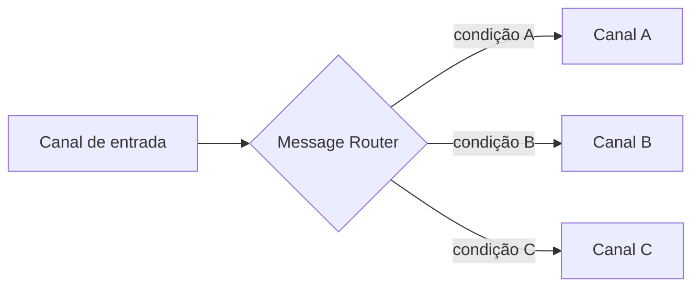

# Message Router

## Descrição

O Message Router é um tipo especial de filtro que fica entre canais de mensagens. Ele consome uma mensagem de um canal de entrada e a republica em um entre vários canais de saída, de acordo com um conjunto de condições. O conteúdo da mensagem não é alterado: o roteador se preocupa apenas com o destino.

Em um Pipes and Filters comum, cada filtro tem uma entrada e uma saída. O roteador quebra essa simetria ao ter várias saídas, e os componentes ao redor não sabem que ele existe. Isso desacopla as etapas de processamento: remetente e destinatários só conhecem seus canais.

Esse é o padrão-base da família de roteadores (Content-Based Router, Message Filter, Dynamic Router, Recipient List, entre outros), que variam na forma de decidir o destino.

## Problemas que resolve

- Etapas de um pipeline ligadas por canais precisam enviar mensagens a filtros diferentes conforme condições
- Regras de decisão espalhadas pelos componentes dificultam a manutenção
- Mudanças em tipos de mensagem ou em processadores obrigam a alterar vários componentes

## Quando usar

- A decisão de destino deve ficar fora do remetente e dos destinatários
- É preciso centralizar as regras de encaminhamento em um único ponto
- O fluxo deve ser reconfigurável sem tocar nos componentes de processamento

### Quando evitar

- Há um único destino possível; o roteador seria só um salto a mais
- A decisão pode ser resolvida pela própria infraestrutura de canais (por exemplo, assinaturas em um canal publish-subscribe)

## Trade-offs

| Ganho | Custo / Risco |
| --- | --- |
| Lógica de roteamento centralizada e fácil de mudar | O roteador pode virar ponto de acoplamento e gargalo |
| Remetentes e destinatários desacoplados | Um salto extra por mensagem |
| Mensagens passam por um ponto único, preservando a ordem de chegada | Um roteador único serializa o tratamento; paralelizá-lo exige cuidado com a ordem |

- **Observabilidade:** o roteador é um bom lugar para registrar e medir o tráfego.
- **Variantes:** a escolha entre elas depende de quem conhece os destinos e de como a regra evolui.

## Diagrama

O roteador lê uma mensagem do canal de entrada e a encaminha, sem modificá-la, para o canal cuja condição ela satisfaz.

## Padrões relacionados

- [Content-Based Router](/architecture/eip/message-routing/content-based-router) — roteia pelo conteúdo da mensagem
- [Message Filter](/architecture/eip/message-routing/message-filter) — roteador com uma única saída que descarta o que não interessa
- [Dynamic Router](/architecture/eip/message-routing/dynamic-router) — regras montadas em tempo de execução
- [Recipient List](/architecture/eip/message-routing/recipient-list) — encaminha a uma lista calculada de destinatários
- [Pipes and Filters](/cloud/cloud-design-patterns/messaging/pipes-and-filters) — o roteador é um filtro com várias saídas
- [Message Broker](/architecture/eip/message-routing/message-broker) — compõe roteadores em escala de solução
- [Gateway Routing](/cloud/cloud-design-patterns/gateways-and-edge/gateway-routing) — roteamento de requisições em um gateway

## Referência

- [Página do padrão no Enterprise Integration Patterns](https://www.enterpriseintegrationpatterns.com/MessageRouter.html)
