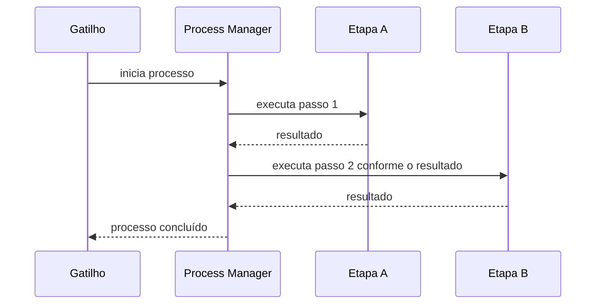

# Process Manager

## Descrição

O Process Manager é um coordenador central que mantém o estado de uma sequência de etapas e decide o próximo passo com base nos resultados até o momento. Uma mensagem de gatilho inicia o processo; o gerente envia uma mensagem ao primeiro processador, que responde ao terminar; então decide o que fazer a seguir, e assim até o fim. Como todo o tráfego passa por esse ponto, o desenho é chamado de hub-and-spoke.

Serve para fluxos que não podem ser fixados de antemão: os passos podem não ser conhecidos no desenho, o próximo pode depender de resultados intermediários e alguns podem rodar em paralelo. O Routing Slip, mais simples, pressupõe uma sequência linear predeterminada.

## Problemas que resolve

- Fluxos cujo caminho depende de resultados intermediários
- Passos paralelos e decisões condicionais
- Necessidade de acompanhar o estado de um processo de longa duração

## Quando usar

- O processo tem lógica de decisão, ramificações ou paralelismo
- Quer-se um ponto único para ver o estado e tratar falhas
- Os passos não são conhecidos de antemão

### Quando evitar

- O fluxo é linear e conhecido; um Routing Slip ou Pipes and Filters basta
- O coordenador central viraria gargalo ou excesso de engenharia para um problema simples

## Trade-offs

| Ganho | Custo / Risco |
| --- | --- |
| Suporta qualquer sequência, sequencial ou paralela | Hub central pode virar gargalo de desempenho |
| Estado do processo visível e controlável | Excesso de complexidade para casos simples |
| Lógica de fluxo concentrada | Acoplamento dos participantes ao coordenador |

- **Persistência:** o estado de cada instância precisa ser durável para sobreviver a falhas.
- **Compensação:** falhas parciais exigem compensação, como em sagas.

## Diagrama

O gerente mantém o estado, envia cada passo e escolhe o seguinte com base nas respostas.

## Padrões relacionados

- [Routing Slip](./routing-slip.md) — alternativa para sequências lineares predeterminadas
- [Message Broker](./message-broker.md) — hub-and-spoke de roteamento sem estado de processo
- [Saga](../../../cloud/cloud-design-patterns/distributed-coordination/saga.md) — coordenação de transações longas com compensação
- [Scheduler Agent Supervisor](../../../cloud/cloud-design-patterns/distributed-coordination/scheduler-agent-supervisor.md) — coordenação e recuperação de tarefas distribuídas
- [Choreography](../../../cloud/cloud-design-patterns/distributed-coordination/choreography.md) — alternativa descentralizada, sem coordenador

## Referência

- [Página do padrão no Enterprise Integration Patterns](https://www.enterpriseintegrationpatterns.com/ProcessManager.html)
